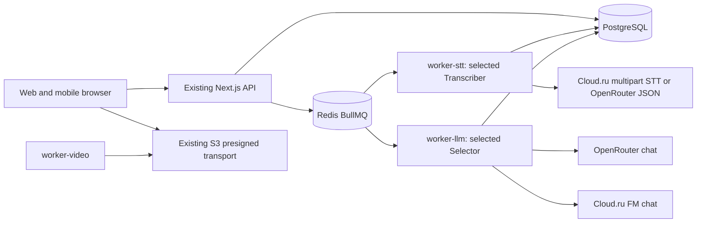

# Cloud.ru provider foundation — Architecture

v2 PLAN, 2026-10-27. v1 chat/S3 architecture and accepted checks are historical at source `0c42dfb1acd7f5085517ddde57f11d1f04781e66`; only optional STT extension below is new.

## Architecture Overview

Style: existing distributed monolith. Seven production compose services remain; MinIO/test profile is unchanged. v1 adds an optional chat adapter to worker-llm; v2 adds a selected strict Cloud.ru branch in the existing STT adapter and extends existing attribution plumbing. No service, route, table, model deployment or new storage abstraction.

## Component Breakdown

Shared config owns typed provider selection, model allowlists and startup refusal; entrypoints/compose own explicit secret forwarding. Selector factory owns provider-specific request serialization and response envelope checks. Existing fragments module owns strict local schema and semantic acceptance. Runtime and select worker carry execution provider into DB authorization and spend JSONL. Existing S3 package owns signatures/operations; Cloud.ru is configuration, not a replacement driver.

## Technology Stack

| Layer | Technology | Rationale |
|---|---|---|
| Frontend | Existing Next.js 15 | No UI changes |
| Backend | Existing Node 22/TypeScript fetch | Existing injected transport; no SDK dependency needed |
| Database | Existing PostgreSQL 16 | Existing provider/model text and exclusive dispatch claim |
| Cache | Existing Redis 7 | No new cache |
| Queue | Existing BullMQ | Existing fences/concurrency preserved |
| Infrastructure | Existing Docker compose, AWS SDK v3 S3 | No new containers/images/resources |

## External Dependencies

Primary-source evidence was opened during read-only research on 2026-10-26. CONFIRMED describes documented capability, not a successful tenant/live test. Short quotes below are deliberately limited. There are no authorized live probes in this PLAN; FR-9 is deferred until its explicit prerequisites.

| Capability needed | Provider / API | Evidence | Verdict | Requirements relying on it |
|---|---|---|---|---|
| Chat request endpoint | Cloud.ru Foundation Models | [API reference](https://cloud.ru/docs/foundation-models/ug/topics/api-ref), checked 2026-10-26: “https://foundation-models.api.cloud.ru/v1/”; [OpenAPI](https://cloud.ru/docs/api/specs/foundation-models/ug/_downloads/f2949c1237d79b17b2df8e523e02a89a/openapi__foundation-models.yaml?source-platform=Evolution): “POST /v1/chat/completions” | CONFIRMED | FR-cloudru-provider-foundation-3 |
| Bearer authentication and JSON-object request option | Cloud.ru FM OpenAPI 1.0.0 | [OpenAPI](https://cloud.ru/docs/api/specs/foundation-models/ug/_downloads/f2949c1237d79b17b2df8e523e02a89a/openapi__foundation-models.yaml?source-platform=Evolution), checked 2026-10-26: “scheme: bearer”, “enum: [text, json_object]” | CONFIRMED | FR-cloudru-provider-foundation-1, FR-cloudru-provider-foundation-3 |
| Project service-account key for FM | Cloud.ru FM authentication | [Authentication](https://cloud.ru/docs/foundation-models/ug/topics/api-ref__authentication?source-platform=Evolution), checked 2026-10-26: “Сервисы — Foundation Models”, “Сохраните Key Secret” | CONFIRMED | FR-cloudru-provider-foundation-1, NFR-cloudru-provider-foundation-1 |
| Exact internal DeepSeek model availability in documented catalogue | Cloud.ru FM | [Model overview](https://cloud.ru/docs/foundation-models/ug/topics/overview__available__models), checked 2026-10-26: “deepseek-ai/DeepSeek-V4-Pro”, “Внутренняя”, “1 048 576” | CONFIRMED | FR-cloudru-provider-foundation-3 |
| Strict schema generation on this model | Cloud.ru FM | Same OpenAPI has a json_schema field but type enum excludes json_schema; catalogue feature label does not resolve this. No supporting quotation for strict generation | UNCONFIRMED | None: removed from foundation; local strict validation remains FR-cloudru-provider-foundation-4 |
| Multipart audio request endpoint | Cloud.ru FM published console code | [Public console bundle](https://console.cloud.ru/sources/ml-foundation-models/cloudplatform-ml-foundation-models.js), checked 2026-10-26: `{{completionsLink}}/audio/transcriptions`, `"response_format": "text"`; provider-code evidence and hash in research note; not published audio schema | UNCONFIRMED | No provider timing promise; bounded owner-reference transport in FR-cloudru-provider-foundation-2 is conditional/offline |
| JSON-format request used by reference implementation | Owner-supplied donor, not provider docs | Pinned [Gitverse donor](https://gitverse.ru/dzhechkov/stt-rag-app), revision a2cbf2791e94404951055fd3ca190ee820dfa74d, inspected 2026-10-27: `"response_format": response_format`, default `"json"`; not primary capability evidence | UNCONFIRMED | FR-cloudru-provider-foundation-2 tests only our serialization/rejection; actual service qualification deferred to FR-cloudru-provider-foundation-9 |
| Real nonempty words/start/end, usable segments, seconds and chunk-relative origin | Cloud.ru FM Whisper | [Current official OpenAPI](https://cloud.ru/docs/api/specs/foundation-models/ug/_downloads/f2949c1237d79b17b2df8e523e02a89a/openapi__foundation-models.yaml?source-platform=Evolution), checked 2026-10-27: `- GET /v1/models`, `- POST /v1/chat/completions`; its limited scope does not specify audio. Donor defaults missing words to [] and its timing fixture is mocked | UNCONFIRMED | FR-cloudru-provider-foundation-9 / AC-cloudru-provider-foundation-9 deferred; blocks live compatibility/full migration, not pure conditional adapter tests |
| Per-model output-token ceiling and N5 quality/latency | Cloud.ru FM DeepSeek | Public model context is not output ceiling; no capability receipt | UNCONFIRMED | None: no throughput/quality/SLA claim in foundation |
| Compound S3 key, endpoint and region | Cloud.ru Evolution Object Storage | [SDK docs](https://cloud.ru/docs/s3e/ug/topics/tools__sdk-python), checked 2026-10-26: “aws_access_key_id=<tenant_id>:<key_id>”, “region=ru-central-1”, “https://s3.cloud.ru” | CONFIRMED | FR-cloudru-provider-foundation-6 |
| Multipart completion and part enumeration | Cloud.ru S3 | [ListParts](https://cloud.ru/docs/s3e/ug/topics/api__listparts), checked 2026-10-26: “Возвращает список частей объекта с их ETag”; [CompleteMultipartUpload](https://cloud.ru/docs/s3e/ug/topics/api__completemultipartupload): “Завершает multipart-загрузку” | CONFIRMED | FR-cloudru-provider-foundation-6 |
| CORS configuration | Cloud.ru S3 | [CORS](https://cloud.ru/docs/s3e/ug/topics/guides__cors), checked 2026-10-26: “укажите разрешенные домены, методы и заголовки запросов” | CONFIRMED | FR-cloudru-provider-foundation-6; actual browser acceptance later |

No requirement promising an UNCONFIRMED external capability enters implementation. FR-9 remains deferred. The existing owner-approved selected-Cloud-contour exception permits bounded reference-derived offline serialization/strict rejection in FR-2; it does not relabel these rows, waive an official gate, or establish live timing. Coordinator owns fresh Phase 2/gates and the cold validation before code. JSON-object is an explicitly approved generation mode; successful local validation is required independently of any provider guarantee. No generated JSON is persisted as a fragment without local validation.

## Data Architecture

Logical structures are in `02_pseudocode.md`. Configuration maps to immutable in-process types. Execution provider/model map to existing job_attempt text columns and current spend JSONL event fields; extend closed TypeScript provider union only. No backfill or migration. Transcript/fragment persistence and tenant ownership checks are unchanged. No duplicate logical field catalogue here.

## Security Architecture

Selected live key is required and scoped to worker environment; Cloud.ru Key Secret is not interchangeable with S3 key pair. Fixed HTTPS endpoints and redirect rejection prevent credential forwarding to arbitrary hosts. Missing selected key or invalid selector/model fails startup before external work. Explicit Cloud.ru STT config is allowed in v2; malformed/untimed output fails before transcript acceptance. Quota claim and durable attempt logging still precede paid dispatch. No runtime live probes, new RBAC or browser secrets.

## Implementation file allowlist

Only these project-relative paths may change after separate validation; unexpected need returns to coordinator:

* `packages/shared/src/config.ts`
* `apps/worker/src/llm/provider.ts`, `apps/worker/src/llm/prompts/selection.ts`, `apps/worker/src/llm/spend.ts`
* `apps/worker/src/runtime.ts`, `apps/worker/src/workers/select.ts`
* `apps/worker/workers/stt.ts`, `apps/worker/workers/select.ts`
* `packages/db/src/selection.ts`
* `.env.example`, `docker-compose.yml`
* `tests/cloudru-provider.test.ts` (new), `tests/config.test.ts`, `tests/selection.test.ts`, `tests/selection.integration.test.ts`, `tests/selection-order.test.ts`, `tests/model-spend.test.ts`, `tests/s3-public-endpoint.test.ts`, `tests/fixtures/environment.ts`
* `scripts/test-selection-mutations.mjs` (only adapting provider guard/new attribution mutant)
* Feature five documents, `research.md`, later `validation-report.md`/`review-report.md`; targeted `docs/REPRODUCE.md`, `docs/model-cost-contract.md`, `CLAUDE.md` provider-description updates during delivery.

v2 adds only these implementation paths to the prior allowlist: `apps/worker/src/stt/client.ts`, `apps/worker/src/stt/spend.ts`, `apps/worker/src/workers/stt.ts`, `packages/db/src/transcription.ts`; focused existing `tests/transcription.test.ts`, `tests/transcription.integration.test.ts`, `tests/transcription-order.test.ts`, `tests/transcription-quota.test.ts`, `tests/transcription-merge.test.ts`, `tests/transcription-word-order.test.ts`, `tests/render-media.test.ts`, `tests/credit-packages.integration.test.ts` where a new seam actually needs coverage. Existing config/runtime/entrypoint/compose/env/provider-test/mutation paths above remain applicable. Add no general validator or independent billing/probe service. A minimal bounded probe command, if later needed, requires coordinator allocation and exact authority first; it is not a live startup check.

No changes to packages/s3 transport, shared transcript parser, chunker/merge production code, migrations, manifests/lockfiles, root toolkit, finance logic, global settings or analytics. v1 LLM/S3 implementation remains a regression boundary. This PLAN agent writes only its five existing role documents and the requested research note; later delivery documentation is coordinator-owned.

## Reconciliation with Pseudocode

Расхождений с `02_pseudocode.md` не найдено. Сверены сущности: Backend, Mode, ExecutionProvider, LlmConfig, SttConfig, SelectionDependencies, SelectionSpend, job_attempt.provider/model; алгоритмы: Resolve provider configuration, Dispatch optional strict STT, Request documented chat and validate result, Authorize and attribute a dispatch, Verify reusable storage configuration offline. v2 adds Authorize and attribute STT call, Verify bounded STT pipeline offline and deferred Qualify live timing. Text DB columns admit the closed logical enum; application validation enforces it, no storage constraint conflict.

## Scalability Considerations

Preserve worker concurrency, one dispatch claim and segment-only prompt. No horizontal scaling/change in queue semantics. No token-cost or latency improvement is asserted before authorized measurements. Fixed 240000 ms timeout bounds requests but is not a Cloud.ru performance promise.

## v2 STT seams and conservative response policy

`stt/client.ts` already owns input bytes, timeout, redirects and strict parse; use a provider-specific body branch there without a new SDK. `runtime.ts` currently constructs STT config inline: retain config to pass actual provider/model to the worker. `workers/stt.ts` owns retry ordinal, before-dispatch spend and repeated parse. Its format errors are nonretryable; JSON parse errors must not become transport retries.

`packages/db/src/transcription.ts:authorizeSttCall` already conditionally updates stt_calls under the fenced row lock/savepoint before HTTP, then checks retry quota. Its job_attempt already has provider/model text columns: bind identity in that same successful UPDATE and preserve rollback on quota refusal. No schema/backfill/second claim. Extend existing SpendEvent rather than creating a paid ledger. Existing credit reservation/finalizeVideoCreditsTx stays untouched; provider retries can consume existing minutes quota without another customer-credit debit.

`selectionMessage` serializes segments only. Therefore first-release Cloud.ru acceptance requires a nonempty segment array with usable text in addition to actual timed words. Absent language alone may normalize to the requested ru. Do not normalize malformed language, missing segments or missing time values; empty context must fail before select. These are coordinator-approved adapter policies, not claims about the provider schema. A real response may require a separate bounded plan revision; do not silently add alignment, fabricated segments or unit conversion.

FM key is projected to worker-stt when this backend is selected and remains available to selected worker-llm; no web/video/browser leakage. Compose may project an optional value into the model-worker environment; runtime requires it only for selected live Cloud.ru. Never infer identity from availability of keys.
