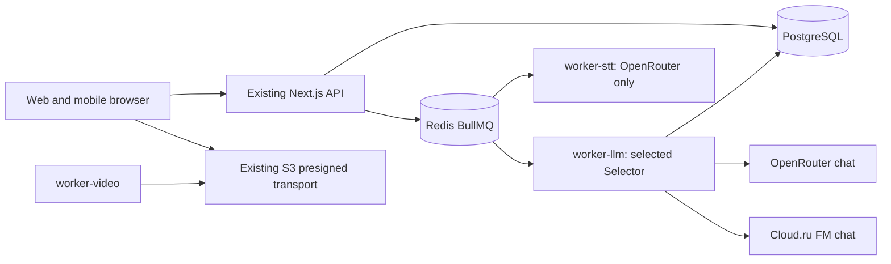

# Cloud.ru provider foundation — Architecture

## Architecture Overview

Style: existing distributed monolith. Seven production compose services remain; MinIO/test profile is unchanged. This feature adds an optional chat adapter to worker-llm and config/attribution plumbing. No service, route, table, model deployment or new storage abstraction.

## Component Breakdown

Shared config owns typed provider selection, model allowlists and startup refusal; entrypoints/compose own explicit secret forwarding. Selector factory owns provider-specific request serialization and response envelope checks. Existing fragments module owns strict local schema and semantic acceptance. Runtime and select worker carry execution provider into DB authorization and spend JSONL. Existing S3 package owns signatures/operations; Cloud.ru is configuration, not a replacement driver.

## Technology Stack

| Layer | Technology | Rationale |
|---|---|---|
| Frontend | Existing Next.js 15 | No UI changes |
| Backend | Existing Node 22/TypeScript fetch | Existing injected transport; no SDK dependency needed |
| Database | Existing PostgreSQL 16 | Existing provider/model text and exclusive dispatch claim |
| Cache | Existing Redis 7 | No new cache |
| Queue | Existing BullMQ | Existing fences/concurrency preserved |
| Infrastructure | Existing Docker compose, AWS SDK v3 S3 | No new containers/images/resources |

## External Dependencies

Primary-source evidence was opened during read-only research on 2026-10-26. CONFIRMED describes documented capability, not a successful tenant/live test. Short quotes below are deliberately limited. There are no live probes in foundation implementation.

| Capability needed | Provider / API | Evidence | Verdict | Requirements relying on it |
|---|---|---|---|---|
| Chat request endpoint | Cloud.ru Foundation Models | [API reference](https://cloud.ru/docs/foundation-models/ug/topics/api-ref), checked 2026-10-26: “https://foundation-models.api.cloud.ru/v1/”; [OpenAPI](https://cloud.ru/docs/api/specs/foundation-models/ug/_downloads/f2949c1237d79b17b2df8e523e02a89a/openapi__foundation-models.yaml?source-platform=Evolution): “POST /v1/chat/completions” | CONFIRMED | FR-cloudru-provider-foundation-3 |
| Bearer authentication and JSON-object request option | Cloud.ru FM OpenAPI 1.0.0 | [OpenAPI](https://cloud.ru/docs/api/specs/foundation-models/ug/_downloads/f2949c1237d79b17b2df8e523e02a89a/openapi__foundation-models.yaml?source-platform=Evolution), checked 2026-10-26: “scheme: bearer”, “enum: [text, json_object]” | CONFIRMED | FR-cloudru-provider-foundation-1, FR-cloudru-provider-foundation-3 |
| Project service-account key for FM | Cloud.ru FM authentication | [Authentication](https://cloud.ru/docs/foundation-models/ug/topics/api-ref__authentication?source-platform=Evolution), checked 2026-10-26: “Сервисы — Foundation Models”, “Сохраните Key Secret” | CONFIRMED | FR-cloudru-provider-foundation-1, NFR-cloudru-provider-foundation-1 |
| Exact internal DeepSeek model availability in documented catalogue | Cloud.ru FM | [Model overview](https://cloud.ru/docs/foundation-models/ug/topics/overview__available__models), checked 2026-10-26: “deepseek-ai/DeepSeek-V4-Pro”, “Внутренняя”, “1 048 576” | CONFIRMED | FR-cloudru-provider-foundation-3 |
| Strict schema generation on this model | Cloud.ru FM | Same OpenAPI has a json_schema field but type enum excludes json_schema; catalogue feature label does not resolve this. No supporting quotation for strict generation | UNCONFIRMED | None: removed from foundation; local strict validation remains FR-cloudru-provider-foundation-4 |
| Whisper request encoding and actual word timestamps | Cloud.ru FM Whisper | [Model overview](https://cloud.ru/docs/foundation-models/ug/topics/overview__available__models), checked 2026-10-26: “openai/whisper-large-v3”, “Audio-to-Text”; no cited audio wire or words timing contract | UNCONFIRMED | None: implementation deferred; FR-cloudru-provider-foundation-2 requires refusal, not transcription |
| Per-model output-token ceiling and N5 quality/latency | Cloud.ru FM DeepSeek | Public model context is not output ceiling; no capability receipt | UNCONFIRMED | None: no throughput/quality/SLA claim in foundation |
| Compound S3 key, endpoint and region | Cloud.ru Evolution Object Storage | [SDK docs](https://cloud.ru/docs/s3e/ug/topics/tools__sdk-python), checked 2026-10-26: “aws_access_key_id=<tenant_id>:<key_id>”, “region=ru-central-1”, “https://s3.cloud.ru” | CONFIRMED | FR-cloudru-provider-foundation-6 |
| Multipart completion and part enumeration | Cloud.ru S3 | [ListParts](https://cloud.ru/docs/s3e/ug/topics/api__listparts), checked 2026-10-26: “Возвращает список частей объекта с их ETag”; [CompleteMultipartUpload](https://cloud.ru/docs/s3e/ug/topics/api__completemultipartupload): “Завершает multipart-загрузку” | CONFIRMED | FR-cloudru-provider-foundation-6 |
| CORS configuration | Cloud.ru S3 | [CORS](https://cloud.ru/docs/s3e/ug/topics/guides__cors), checked 2026-10-26: “укажите разрешенные домены, методы и заголовки запросов” | CONFIRMED | FR-cloudru-provider-foundation-6; actual browser acceptance later |

No requirement depending on an UNCONFIRMED external capability enters implementation. JSON-object is an explicitly approved generation mode; successful local validation is required independently of any provider guarantee. No generated JSON is persisted as a fragment without local validation.

## Data Architecture

Logical structures are in `02_pseudocode.md`. Configuration maps to immutable in-process types. Execution provider/model map to existing job_attempt text columns and current spend JSONL event fields; extend closed TypeScript provider union only. No backfill or migration. Transcript/fragment persistence and tenant ownership checks are unchanged. No duplicate logical field catalogue here.

## Security Architecture

Selected live key is required and scoped to worker environment; Cloud.ru Key Secret is not interchangeable with S3 key pair. Fixed HTTPS endpoints and redirect rejection prevent credential forwarding to arbitrary hosts. Missing key, invalid model, unsupported STT fail startup before external work. Quota claim and durable attempt logging still precede paid dispatch. No runtime live probes, new RBAC or browser secrets.

## Implementation file allowlist

Only these project-relative paths may change after separate validation; unexpected need returns to coordinator:

* `packages/shared/src/config.ts`
* `apps/worker/src/llm/provider.ts`, `apps/worker/src/llm/prompts/selection.ts`, `apps/worker/src/llm/spend.ts`
* `apps/worker/src/runtime.ts`, `apps/worker/src/workers/select.ts`
* `apps/worker/workers/stt.ts`, `apps/worker/workers/select.ts`
* `packages/db/src/selection.ts`
* `.env.example`, `docker-compose.yml`
* `tests/cloudru-provider.test.ts` (new), `tests/config.test.ts`, `tests/selection.test.ts`, `tests/selection.integration.test.ts`, `tests/selection-order.test.ts`, `tests/model-spend.test.ts`, `tests/s3-public-endpoint.test.ts`, `tests/fixtures/environment.ts`
* `scripts/test-selection-mutations.mjs` (only adapting provider guard/new attribution mutant)
* Feature five documents, `research.md`, later `validation-report.md`/`review-report.md`; targeted `docs/REPRODUCE.md`, `docs/model-cost-contract.md`, `CLAUDE.md` provider-description updates during delivery.

No changes to packages/s3 transport, STT transport/parser, migrations, manifests/lockfiles, root toolkit, finance code, global settings or analytics. Cloud.ru STT refusal belongs in config. STT provider/model event enrichment is deferred; this feature's attribution scope is chat dispatch.

## Reconciliation with Pseudocode

Расхождений с `02_pseudocode.md` не найдено. Сверены сущности: Backend, Mode, ExecutionProvider, LlmConfig, SttConfig, SelectionDependencies, SelectionSpend, job_attempt.provider/model; алгоритмы: Resolve provider configuration, Refuse deferred STT, Request documented chat and validate result, Authorize and attribute a dispatch, Verify reusable storage configuration offline. Text DB columns admit the closed logical enum; application validation enforces it, no storage constraint conflict.

## Scalability Considerations

Preserve worker concurrency, one dispatch claim and segment-only prompt. No horizontal scaling/change in queue semantics. No token-cost or latency improvement is asserted before authorized measurements. Fixed 240000 ms timeout bounds requests but is not a Cloud.ru performance promise.
