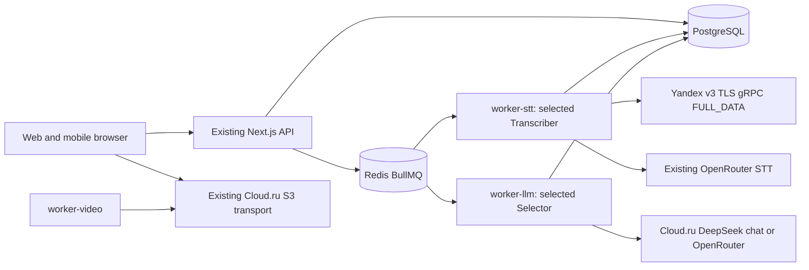

# Cloud.ru provider foundation — Architecture

v4 PLAN, 2026-10-27. Input ff80cdd07311c98e3d5f0fd2bfbf42deea5ecee7; accepted v1 Cloud.ru chat/S3 history stays at 0c42dfb1acd7f5085517ddde57f11d1f04781e66. Root owns integration/manifests/lockfile and native gates.

## Architecture Overview

Style: existing distributed monolith. Existing services, queues, S3 and model workers remain. Add a small Yandex gRPC implementation of the existing Transcriber interface; no new process, bucket, async provider-job store, public route, DB schema, GPU or local model. Cloud.ru STT construction remains refused; Cloud.ru DeepSeek chat and Object Storage continue unchanged.

## Component Breakdown

Shared config separates LLM/STT backend allowlists, keys and immutable model/endpoint constants. Existing stt/client.ts dispatches fake/OpenRouter/Yandex; new small Yandex client/protocol files own TLS RPC, byte stream, final mapping and cleanup. Worker retains retry/quota/spend ownership; runtime passes actual STT provider/model. Existing transcript parser, extraction, pause-aware chunker, merge, selection and render remain the shared acceptance pipeline.

## Technology Stack

| Layer | Technology | Rationale |
|---|---|---|
| Frontend | Existing Next.js | No UI change |
| Backend | Existing Node22/TypeScript; @grpc/grpc-js 1.14.6, @grpc/proto-loader 0.8.1 | Fixed Yandex bidi RPC; no full provider SDK/sidecar |
| Protocol | Bounded readable official projection/descriptor (<500 lines/file) | Preserve exact package/service/field numbers/enums; pin source and golden |
| Database | Existing PostgreSQL16 | Same job_attempt provider/model/ordinal claim; no migration |
| Cache/Queue | Existing Redis7/BullMQ | Existing concurrency/fences/deadline |
| Infrastructure | Existing Docker/AWS SDK S3 | No extra service/bucket; protocol must work in actual build image |

## External Dependencies

CONFIRMED means cited documented capability, not full production acceptance. Current Yandex source/probe evidence is 2026-10-27. Preserve the three official verdict labels; observed probe limits are described separately rather than invented verdict values.

| Capability needed | Provider / API | Evidence | Verdict | Requirements relying on it |
|---|---|---|---|---|
| Chat request endpoint | Cloud.ru Foundation Models | [API reference](https://cloud.ru/docs/foundation-models/ug/topics/api-ref), checked 2026-10-26: “https://foundation-models.api.cloud.ru/v1/”; [OpenAPI](https://cloud.ru/docs/api/specs/foundation-models/ug/_downloads/f2949c1237d79b17b2df8e523e02a89a/openapi__foundation-models.yaml?source-platform=Evolution): “POST /v1/chat/completions” | CONFIRMED | FR-cloudru-provider-foundation-3 |
| Bearer authentication and JSON-object request option | Cloud.ru FM OpenAPI 1.0.0 | [OpenAPI](https://cloud.ru/docs/api/specs/foundation-models/ug/_downloads/f2949c1237d79b17b2df8e523e02a89a/openapi__foundation-models.yaml?source-platform=Evolution), checked 2026-10-26: “scheme: bearer”, “enum: [text, json_object]” | CONFIRMED | FR-cloudru-provider-foundation-1, FR-cloudru-provider-foundation-3 |
| Project service-account key for FM | Cloud.ru FM authentication | [Authentication](https://cloud.ru/docs/foundation-models/ug/topics/api-ref__authentication?source-platform=Evolution), checked 2026-10-26: “Сервисы — Foundation Models”, “Сохраните Key Secret” | CONFIRMED | FR-cloudru-provider-foundation-1, NFR-cloudru-provider-foundation-1 |
| Exact internal DeepSeek model availability in documented catalogue | Cloud.ru FM | [Model overview](https://cloud.ru/docs/foundation-models/ug/topics/overview__available__models), checked 2026-10-26: “deepseek-ai/DeepSeek-V4-Pro”, “Внутренняя”, “1 048 576” | CONFIRMED | FR-cloudru-provider-foundation-3 |
| Strict schema generation on this model | Cloud.ru FM | Same OpenAPI has a json_schema field but type enum excludes json_schema; catalogue feature label does not resolve this. No supporting quotation for strict generation | UNCONFIRMED | None: removed from foundation; local strict validation remains FR-cloudru-provider-foundation-4 |
| Per-model output-token ceiling and N5 quality/latency | Cloud.ru FM DeepSeek | Public model context is not output ceiling; no capability receipt | UNCONFIRMED | None: no throughput/quality/SLA claim in foundation |
| Compound S3 key, endpoint and region | Cloud.ru Evolution Object Storage | [SDK docs](https://cloud.ru/docs/s3e/ug/topics/tools__sdk-python), checked 2026-10-26: “aws_access_key_id=<tenant_id>:<key_id>”, “region=ru-central-1”, “https://s3.cloud.ru” | CONFIRMED | FR-cloudru-provider-foundation-6 |
| Multipart completion and part enumeration | Cloud.ru S3 | [ListParts](https://cloud.ru/docs/s3e/ug/topics/api__listparts), checked 2026-10-26: “Возвращает список частей объекта с их ETag”; [CompleteMultipartUpload](https://cloud.ru/docs/s3e/ug/topics/api__completemultipartupload): “Завершает multipart-загрузку” | CONFIRMED | FR-cloudru-provider-foundation-6 |
| CORS configuration | Cloud.ru S3 | [CORS](https://cloud.ru/docs/s3e/ug/topics/guides__cors), checked 2026-10-26: “укажите разрешенные домены, методы и заголовки запросов” | CONFIRMED | FR-cloudru-provider-foundation-6; actual browser acceptance later |
| Word/phrase time fields and FULL_DATA MP3 RPC | Yandex SpeechKit v3 | [Streaming reference](https://aistudio.yandex.ru/ru/docs/speechkit/stt-v3/api-ref/grpc/Recognizer/recognizeStreaming), checked 2026-10-27: `FULL_DATA`, `start_time_ms`, `end_time_ms`; pinned official source and actual two-final/10-word short receipt below | CONFIRMED | FR-2/AC-2 conditional mapping; short component of FR-9 |
| Limits and Russian general model | Yandex SpeechKit | [Limits](https://aistudio.yandex.ru/ru/docs/speechkit/concepts/limits): “5 минут”, “10 МБ”; [models](https://aistudio.yandex.ru/ru/docs/speechkit/stt/models): `general`, `ru-RU`, checked 2026-10-27 | CONFIRMED | FR-2/8 |
| Service-account key auth | Yandex SpeechKit | [Authentication](https://aistudio.yandex.ru/ru/docs/speechkit/concepts/auth), checked 2026-10-27: `Authorization: Api-Key`; role ai.speechkit-stt.user; key presence/authority supplied by owner, never copied here | CONFIRMED | FR-1/2, NFR-1 |
| Natural-speech quality, full chunk <=120s, full journey | Yandex SpeechKit on N5 | Short synthetic speech is imperfect; no representative long/target receipt. No supporting SLA/quality quotation | UNCONFIRMED | Remaining FR-9/AC-9 qualification stays pending; no production/quality promise enters implementation |
| Actual usable word timestamps on tested Cloud.ru Whisper request | Cloud.ru FM Whisper | Five actual short probes: verbose words:null / JSON text-only. Primary public docs did not specify timing; this is tested incompatibility, not universal provider non-support | UNCONFIRMED | None for transcription implementation; FR-1 retains startup refusal |

Documented Yandex serialization plus bounded actual short response supports implementation without promising natural quality or long latency. Old selected-contour evidence exception remains coordinator-owned; no official gate threshold is waived or obsolete validation report reused. Unconfirmed long/target capabilities cannot be called passed by an offline test.

## Data Architecture

Logical fields belong to 02_pseudocode.md. Add actual yandex/general identity to current job_attempt update/current JSONL only. LLM selection keeps narrower openrouter/cloudru/fake identity; Yandex cannot be selected for chat merely because a shared audit union contains it. Final-key map lives inside one RPC; PostgreSQL remains dispatch truth. No schema/backfill/cache/operation ledger or customer-credit debit is added.

## Protocol and independent interoperability boundary

Official source: [yandex-cloud/cloudapi at b5702253b8216fa5cdac9f70509ed608eb0f17f5](https://github.com/yandex-cloud/cloudapi/tree/b5702253b8216fa5cdac9f70509ed608eb0f17f5). Root's manifest `/tmp/n5-yandex-speechkit-probe-20261027/proto-source-manifest.json` SHA256 `8915da2d95628f1a6654c3f8c500cd687ab866712867cd3f81fb0aced86c660a`; stt.proto `c01bf84436ffd5525b79fb41ac214cb243e856d775e9812535c12778b5fed45f`, stt_service.proto `621a4e895b359564f648f3c977c196f40e53ccc8b220cf25095117525a689651`. Preserve source/provenance and applicable notices; do not import the full 1000-line dependency tree into production.

| Critical official wire element | Exact mapping to preserve |
|---|---|
| Service | package speechkit.stt.v3; /speechkit.stt.v3.Recognizer/RecognizeStreaming, bidi stream |
| StreamingRequest / AudioChunk | session_options=1, chunk=2; chunk.data=1 |
| StreamingOptions | recognition_model=1 |
| RecognitionModelOptions | model=1, audio_format=2, text_normalization=3, language_restriction=4, audio_processing_type=5 |
| Format/options enums | AudioFormatOptions.container_audio=2; ContainerAudio.container_audio_type=1, MP3=3; normalization field=1/DISABLED=2; restriction type=1/WHITELIST=1 and language_code=2; FULL_DATA=2 |
| StreamingResponse | audio_cursors=2, partial=4, final=5, final_refinement=7, status_code=8, top-level channel_tag=9 |
| AudioCursors / AlternativeUpdate | final_index=5; alternatives=1; nested deprecated channel_tag=2 must not replace top-level channel identity |
| Alternative / Word | words=1,text=2,start_time_ms=3,end_time_ms=4,languages=6; Word text=1,start_time_ms=2,end_time_ms=3; LanguageEstimation language_code=1 |

Decode the documented snake_case fields and exact int64 strings explicitly (for proto-loader, keepCase/longs/options must preserve those types and valid scalar/index zero); do not depend on accidental loader defaults.

Coder chooses minimal type-safe packaging: readable embedded protocol/descriptor, or a small .proto with explicit build/image asset handling. Every source/fixture file stays <500 lines; no general protocol/validation engine. Do not hand-code gRPC framing/auth transport or trust a roundtrip through the same projected schema as interoperability proof.

**Independent golden already exists:** `/tmp/n5-yandex-protocol-fixtures-20261027/official-protocol-golden.json`, 6395 bytes, SHA256 `8d7a2f539e0eff0fc881b516f25deb78cc9ea971aa84313094b21c99f1005314`. Root generated it OFFLINE using the COMPLETE pinned official schema and its own captured synthetic response: 8 events, 2 finals/10 words, official method path and exact session-options request bytes. These are re-encoded fixture bytes, **not original network frames**. Carry its provenance into a compact test fixture. Tests must compare production-serialized request to golden bytes and decode golden official responses with production projection; field-number/enum mutations must fail. Golden alone does not validate network availability, auth, quality or cancellation.

## Security and resource architecture

Yandex key exists only in worker-stt environment/metadata; FM key remains worker-llm only. Select fixed TLS host with standard certificate validation; no credentials to arbitrary endpoint/authority and no new browser/admin access. Actual STT entrypoint projection, synthetic compose resolution and built worker packaging are checked, not just a config object.

Existing mono 16kHz/64kbit MP3 extraction and pause-aware target180s chunks already fit documented duration in ordinary boundaries (non-final 160..200s). Keep common25MB guard; adapter enforces conservative10_000_000 bytes and300s, no rebasing chunk time/size constants. Deadline covers bytes through final status; cancellation tears down the owned RPC/client and blocks late transcript acceptance. Keep bounded gRPC receive defaults rather than unbounded output; full successful status is required even after valid finals. No SDK/client transparent retry policy.

## STT attribution seam

`authorizeSttCall` already conditionally claims a call ordinal in the fenced job_attempt transaction/savepoint and checks retry quota. Add bound actual provider/model to that same successful UPDATE; rollback on quota refusal still rolls back identity/ordinal. Existing worker fsyncs one attempt event before RPC and records matching outcomes. Preserve initial whole-file charge, retry-minute quota, current customer credit reservation/finalizeVideoCreditsTx and stale-result semantics. No adapter/local mutex substitutes for DB ownership.

## Implementation file allocation

- Core: packages/shared/src/config.ts; apps/worker/src/stt/client.ts, new small stt/yandex.ts and stt/yandex-protocol.ts (or bounded .proto equivalent), stt/spend.ts; apps/worker/src/workers/stt.ts, runtime.ts; apps/worker/workers/stt.ts; packages/db/src/transcription.ts.
- Wiring: .env.example/docker-compose.yml and existing env fixtures/guards; no Yandex key in LLM/web/video. Root owns dependency-manifest/lockfile integration; approved dependency versions above only. Coder must coordinate any package/build/Docker asset need before expanding ownership.
- Tests: existing cloudru-provider/config/transcription/order/quota/integration/merge/word-order/render-media/credit-packages suites; small new Yandex-focused test/official-golden fixture if needed. Existing selection mutation runner may extend new guard mutants; no standalone validator engine. Tests define actual titles before a future completion map is written.
- This PLAN writer changes only the six current feature documents. Current validation/review reports, telemetry, root toolkit, unit-economics documents and runtime are other owners' scopes.

Do not change v1 chat/S3 runtime, shared parser, extraction/chunker/merge production logic, finance code, DB schema, unrelated manifests/config or analytics. A concrete newly necessary path returns to root, not a silent scope expansion.

## Reconciliation and remaining acceptance

Specification/pseudocode use separate backends, same exact wire constants, final identity/strict conversion, existing attribution transaction and bounded cancellation. Actual short protocol receipt is verified separately in research; full migration remains pending. Root cold-validates the frozen six-file set before bounded coding, then independent review uses planner context and source only. No UI change; if a browser receipt is used, its existing fresh Docker/browser requirements remain mandatory.
