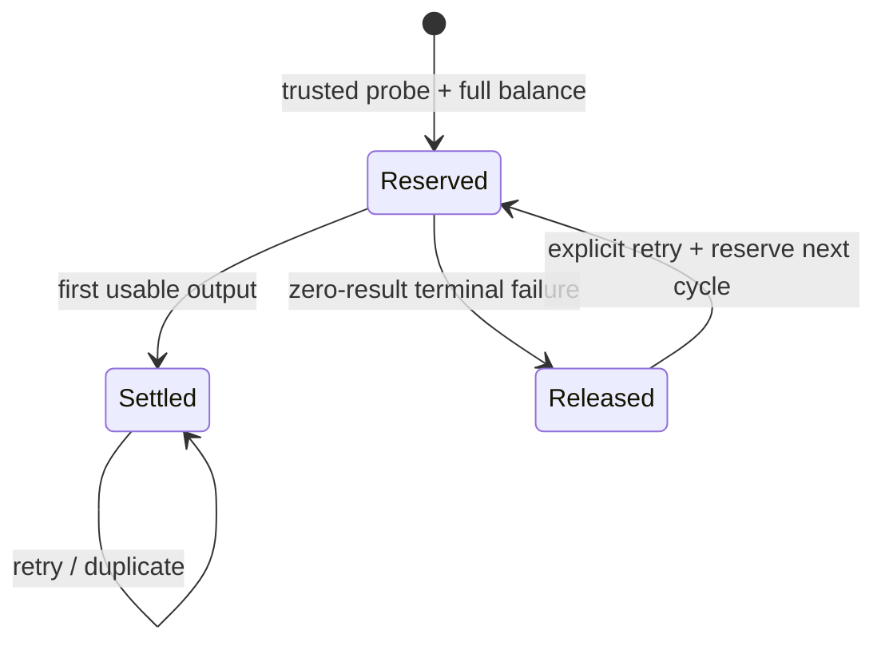

# Credit packages — Pseudocode

Finite first code contract v2: [owner-decisions.md](owner-decisions.md) separates direct owner answers from coordinator choices. Immediate upgrade is disabled, not a pending branch for the coder to choose.

## Data Structures
- `credit_grant`: id:UUID, account_id, source/source_key unique, total/remaining/reserved_seconds:int, available_at/expires_at, entitlement_start/end, original_entitlement_ref, payment_ref, base_period_ref, created_at:Timestamp.
- `video_credit_charge`: id:UUID, video/input identity, cycle:int, billable_seconds:int, state:reserved|settled|released, policy_version, entitlement_snapshot, created_at:Timestamp. One active cycle/video; settled input cannot acquire another charge.
- `credit_allocation`: id:UUID, charge_id/grant_id unique, seconds:int>0, created_at:Timestamp.
- `payment_intent` extension: existing id:UUID/created_at:Timestamp, immutable SKU/version, price_minor, grant_seconds, available/expiry/entitlement terms, period_ref, provider_payment_id, fulfilled_at.
- `base_period`: stable start/end and original base SKU recorded on base grant/intent; no extra service, upgrade quote table, pending-upgrade state or capacity aggregation engine in this release.

## Core Algorithms
### Algorithm: Resolve offer and immutable payment intent
REQUIREMENT: `FR-credit-packages-1`
REQUIREMENT: `FR-credit-packages-6`
REQUIREMENT: `NFR-credit-packages-2`
REQUIREMENT: `AC-credit-packages-7`
REALISES: SC-US-002-1, SC-US-007-1
INPUT: session, closed SKU, idempotency_key, decision version and typed billing mode.
OUTPUT: intent/redirect or conflict/unavailable.
STEPS:
1. Rate limit→Origin/session→strict body validation; legacy account keeps original {idempotency_key} checkout semantics/price. Credit account uses closed SKU body; reject unknown SKU and immediate upgrade. New credit sale requires credits_v1 mode; fulfill persisted intents regardless of later enrollment mode.
2. Resolve price/units/dates on server; INSERT intent unique(account,key); IF existing terms differ RETURN409.
3. Call provider outside transaction using intent.id; IF persisted provider ID exists THEN re-read it, never create a different payment.
4. Verify webhook authenticity/remote payment identity, currency, amount, ownership and current provider state BEFORE event claim.
5. In transaction claim event, lock payment advisory→account→intent; IF intent fulfilled by another payment THEN record review and RETURN no grant.
6. Grant once from immutable intent source; mark intent fulfilled and status succeeded atomically; RETURN package snapshot.
COMPLEXITY: O(1) SQL operations; external network bounded by existing adapter timeout.

### Algorithm: Create account or transitional trial once
REQUIREMENT: `FR-credit-packages-2`
REQUIREMENT: `AC-credit-packages-1`
REALISES: SC-US-001-1, SC-US-001-2
INPUT: normalized email/password hash/session, typed mode, OR explicit audited operator opt-in.
OUTPUT: account/session plus at most one lifetime trial grant.
STEPS:
1. Hash password outside SQL; INSERT account with immutable policy from typed mode (default legacy) ON CONFLICT DO NOTHING RETURNING id. Legacy path retains existing account/session behavior with no grant.
2. Only returned credit_v1 new account inserts no-expiry signup grant1800seconds and session in same transaction.
3. Schema migration never gifts/converts. Explicit audited operator opt-in requires credits_v1 enabled, effective-free account, no active legacy entitlement or unresolved legacy intent. Atomically pin credit policy and insert1800seconds migration_trial, guarded by one partial unique index(account_id) across signup|migration_trial; replay never resets balance.
4. IF any write fails THEN rollback all; login/payment/renewal never calls trial grant procedure; RETURN opaque existing registration response.
COMPLEXITY: O(1) per signup or explicit cutover.

### Algorithm: Reserve trusted input and authorize retries
REQUIREMENT: `FR-credit-packages-3`
REQUIREMENT: `FR-credit-packages-4`
REQUIREMENT: `NFR-credit-packages-1`
REQUIREMENT: `NFR-credit-packages-3`
REQUIREMENT: `AC-credit-packages-3`
REQUIREMENT: `AC-credit-packages-4`
REALISES: SC-US-003-1, SC-US-003-2, SC-US-004-1
INPUT: video/fence, trusted probe duration, canonical precision, provider quotas.
OUTPUT: reserved/transcribing OR shortage/stale/safety refusal.
STEPS:
1. Validate source2–90min; transaction lock video; re-read active account/fence after lock without account row lock.
2. IF pinned legacy THEN use protected legacy accounting; ELSE compute/persist ceil(durationSeconds) once, never ceil(minutes).
3. Acquire credit-account advisory lock; re-read charge/grants in fresh statement. IF settled/reserved same input THEN reuse it.
4. IF released cycle THEN require explicit retry and create next cycle; order eligible grants by expiry NULLS LAST,created_at,id.
5. Check provider safety quota and full available balance; IF insufficient THEN rollback all allocations/quota changes, persist refusal, RETURN without model call.
6. Move remaining→reserved with guarded updates; insert allocations; persist transcribing and stable charge atomically.
7. Automatic chunk/fence/select/render retry uses same customer charge; internal provider attempt safety/cost still increments before each real dispatch. RETURN authorized attempt.
COMPLEXITY: O(g), g=eligible grants; ordered indexed reads.

### Algorithm: Accept output or finalize failed charge
REQUIREMENT: `FR-credit-packages-5`
REQUIREMENT: `AC-credit-packages-8`
REALISES: SC-US-004-2, SC-US-008-1, SC-US-008-2
INPUT: current fenced output/failure or watchdog candidate.
OUTPUT: settled/released/no-op.
STEPS:
1. Lock video→credit-account advisory→charge/grants; re-read current state/usable clips. IF stale output/failure THEN RETURN no-op.
2. IF ≥1accepted usable clip THEN reserved→settled once in authoritative output transaction; later failures cannot release it.
3. ELSE IF current terminal zero-result failure THEN reserved→released once; restore each allocation to original grant.
4. IF original expiry passed THEN insert recovery grant only for returned units, unique(source charge,allocation); expires=release_time+24h, retain original source paid-render entitlement snapshot. Never restore full package or signup grant.
5. Watchdog repairs terminal charges using same helper, not an external queue. Erasure cancels holds and removes/anonymizes approved credit links in existing deletion transaction; RETURN final state.
COMPLEXITY: O(a), a=allocations; watchdog bounded batch.

### Algorithm: Schedule base periods and union paid rights
REQUIREMENT: `FR-credit-packages-7`
REQUIREMENT: `AC-credit-packages-2`
REALISES: SC-US-002-2
INPUT: fulfilled base/add-on intent, account entitlement windows, now.
OUTPUT: grant window and effective paid/free.
STEPS:
1. IF addon THEN available_at=verified purchase time, expires=+30days; independent paid entitlement covers identical window, including without base.
2. IF base THEN start=max(now,latest committed base end,protected legacy end), end=start+30days; future credits not available before start. Persist stable period identity.
3. Effective paid=legacy indefinite OR any entitlement start≤now<end OR pinned recovery authorization for this job only. Never sum overlapping intervals.
4. Grant expiry affects new reservations only; active reserved operation retains pinned paid-render decision. RETURN windows/status from SQL, not browser input.
COMPLEXITY: O(w), w=active/scheduled windows.

### Algorithm: Refuse immediate upgrade and schedule manual plan change
REQUIREMENT: `FR-credit-packages-8`
REQUIREMENT: `AC-credit-packages-5`
REALISES: SC-US-005-1, SC-US-005-2
INPUT: requested operation, immutable account policy, selected base SKU, current committed periods.
OUTPUT: refused immediate operation OR full-price future base offer/fulfillment.
STEPS:
1. IF immediate upgrade requested THEN RETURN upgrade_unavailable before payment intent/provider call; expose addon-now and next-period Pro alternatives. No20RUBquote, money credit or delta grant.
2. ELSE validate closed base SKU/full catalog price, active credit account and credits_v1 sale mode; legacy accounts retain legacy checkout unless explicit eligible-free operator cutover completed.
3. Persist full-price intent with renewal operation; on verified once-only fulfillment serialize account period allocation and start=max(payment time,latest committed base end). Intent/provider identity and fulfillment uniqueness guard duplicates.
4. Grant full selected package ONLY for future [start,start+30days); retain current grants/independent addon expiry/used/held volume. Repeated separate purchases may schedule later periods; same intent cannot schedule twice.
5. RETURN named future package/start/end, not immediate Pro activation. Never save card/auto-debit or silently count current purchases as a discount.
COMPLEXITY: O(p), committed base periods; no immediate-upgrade framework.

### Algorithm: Protect legacy cutover
REQUIREMENT: `FR-credit-packages-9`
REQUIREMENT: `AC-credit-packages-6`
REALISES: SC-US-006-1
INPUT: additive migration, explicit legacy cohorts and old pending intents.
OUTPUT: preserved legacy policy or new credit policy.
STEPS:
1. Snapshot counts and existing paidUntil/source; label all old invoices legacy_pro990_v1 and active legacy jobs legacy_daily_v1.
2. IF old paid active THEN protect daily terms through old expiry; IF operator/pre021 indefinite THEN retain until explicit opt-in.
3. New policy starts only for credit-mode new registrations or explicit audited eligible-free operator cutover; migration alone changes no account policy/balance. Existing credit policy remains authoritative if new enrollments are disabled. Existing old invoice fulfillment still extends legacy daily rights by old rules; never reinterpret same990price as Start.
4. Operator cutover invokes once-only grant procedure; schema replay issues no gift. No unresolved legacy invoice may be hidden by cutover. RETURN cohort/cutover audit receipt.
COMPLEXITY: O(accounts+intents+active jobs) additive labeling; explicit cutover O(1), rehearsed on isolated SQL.

### Algorithm: Present credit offers and result
REQUIREMENT: `FR-credit-packages-10`
REALISES: SC-US-007-2
INPUT: server balance, reserved units, active/future windows and selected offer.
OUTPUT: mobile UI with required charge and exact package result.
STEPS:
1. Convert seconds to credits without truncating stored units; show hours/minutes as equivalent and exact required seconds where precision matters.
2. Display all prices/credits/hours/windows, one-time30credit trial, available/reserved amount and operational quotas separately.
3. IF credit shortage THEN show package action; IF safety quota THEN show existing reset/overload; never claim credit renewal at midnight.
4. Return screen distinguishes applied addon, active base, future renewal and unknown payment; analytics observes confirmed once-per-intent event only. RETURN accessible UI.
COMPLEXITY: O(g+w) display rows.

## API Contracts
Session authorization remains existing `__Host-n5_session` cookie+Origin, never a new Bearer scheme.
- POST `/api/checkout`: legacy account strict `{idempotency_key}` unchanged; credit account strict `{sku,idempotency_key}`; no immediate upgrade operation accepted;201/200 `{data:{intent_id,redirect_url,status}}`;409 conflicting offer,422invalid SKU,503provider unavailable.
- GET `/api/checkout/{id}`: owned resource;200 `{data:{status,sku,grant,available_at,expires_at,paid_windows}}`;404foreign/missing.
- Existing dashboard/processing responses add integer available/reserved/required seconds and explicit insufficient_credits; no new public anonymous path.
All errors use `{error:{code,message}}`, no partial financial success hidden in200.

## State Transitions

## Error Handling Strategy
Invalid source retains existing bounded upload-slot refund; shortage is persistent until credit purchase, not tomorrow. Provider outage before verification writes no claim; SQL failure rolls back grant/claim. Unknown provider payment remains pending/review. Cash refund retains OWN019 operator review; no automatic clawback. New enrollment flag cannot turn an already-created credit input/intent into legacy accounting.

## Scenario Coverage
Scenarios in 01_specification.md:15 · claimed by an algorithm:15.
Not claimed by any algorithm: none.
Claimed by an algorithm but absent from 01_specification.md: none.
Coverage is naming linkage only; runtime proof remains pending.
