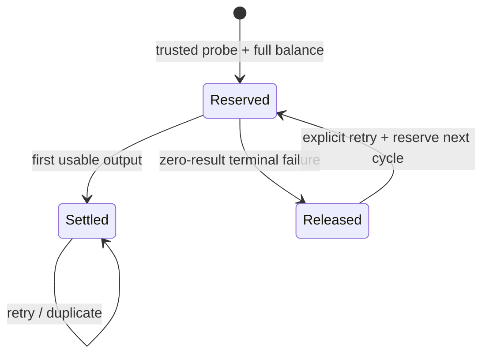

# Credit packages — Pseudocode

Proposed execution contract; monetary branches require decisions in [owner-decisions.md](owner-decisions.md). Pending choice never defaults silently.

## Data Structures
- `credit_grant`: id:UUID, account_id, source/source_key unique, total/remaining/reserved_seconds:int, available_at/expires_at, entitlement_start/end, original_entitlement_ref, payment_ref, base_period_ref, created_at:Timestamp.
- `video_credit_charge`: id:UUID, video/input identity, cycle:int, billable_seconds:int, state:reserved|settled|released, policy_version, entitlement_snapshot, created_at:Timestamp. One active cycle/video; settled input cannot acquire another charge.
- `credit_allocation`: id:UUID, charge_id/grant_id unique, seconds:int>0, created_at:Timestamp.
- `payment_intent` extension: existing id:UUID/created_at:Timestamp, immutable SKU/version, price_minor, grant_seconds, available/expiry/entitlement terms, period_ref, quote_revision, provider_payment_id, fulfilled_at.
- `base_period`: proposed metadata on grant/intent identifying stable start/end, original base SKU, upgraded state and pending upgrade intent; no extra service. Store aggregate eligibility from immutable fulfilled purchases, not displayed balance.

## Core Algorithms
### Algorithm: Resolve offer and immutable payment intent
REQUIREMENT: `FR-credit-packages-1`
REQUIREMENT: `FR-credit-packages-6`
REQUIREMENT: `NFR-credit-packages-2`
REQUIREMENT: `AC-credit-packages-7`
REALISES: SC-US-002-1, SC-US-007-1
INPUT: session, closed SKU, idempotency_key, approved decision version.
OUTPUT: intent/redirect or conflict/unavailable.
STEPS:
1. Rate limit→Origin/session→strict body validation; reject unknown SKU or unapproved terms.
2. Resolve price/units/dates on server; INSERT intent unique(account,key); IF existing terms differ RETURN409.
3. Call provider outside transaction using intent.id; IF persisted provider ID exists THEN re-read it, never create a different payment.
4. Verify webhook authenticity/remote payment identity, currency, amount, ownership and current provider state BEFORE event claim.
5. In transaction claim event, lock payment advisory→account→intent; IF intent fulfilled by another payment THEN record review and RETURN no grant.
6. Grant once from immutable intent source; mark intent fulfilled and status succeeded atomically; RETURN package snapshot.
COMPLEXITY: O(1) SQL operations; external network bounded by existing adapter timeout.

### Algorithm: Create account or transitional trial once
REQUIREMENT: `FR-credit-packages-2`
REQUIREMENT: `AC-credit-packages-1`
REALISES: SC-US-001-1, SC-US-001-2
INPUT: normalized email/password hash/session OR approved migration cohort.
OUTPUT: account/session plus at most one lifetime trial grant.
STEPS:
1. Hash password outside SQL; INSERT account ON CONFLICT DO NOTHING RETURNING id.
2. Only returned new account may insert signup grant1800seconds and session in same transaction.
3. Migration checks approved cohort and one partial unique index(account_id) across signup|migration_trial; INSERT1800seconds ON CONFLICT DO NOTHING.
4. IF any write fails THEN rollback all; login/payment/renewal never calls trial grant procedure; RETURN opaque existing registration response.
COMPLEXITY: O(1) per account; migration O(accounts).

### Algorithm: Reserve trusted input and authorize retries
REQUIREMENT: `FR-credit-packages-3`
REQUIREMENT: `FR-credit-packages-4`
REQUIREMENT: `NFR-credit-packages-1`
REQUIREMENT: `NFR-credit-packages-3`
REQUIREMENT: `AC-credit-packages-3`
REQUIREMENT: `AC-credit-packages-4`
REALISES: SC-US-003-1, SC-US-003-2, SC-US-004-1
INPUT: video/fence, trusted probe duration, approved precision, provider quotas.
OUTPUT: reserved/transcribing OR shortage/stale/safety refusal.
STEPS:
1. Validate source2–90min; transaction lock video; re-read active account/fence after lock without account row lock.
2. IF pinned legacy THEN use protected legacy accounting; ELSE compute/persist proposed ceil(durationSeconds) once, never ceil(minutes).
3. Acquire credit-account advisory lock; re-read charge/grants in fresh statement. IF settled/reserved same input THEN reuse it.
4. IF released cycle THEN require explicit retry and create next cycle; order eligible grants by expiry NULLS LAST,created_at,id.
5. Check provider safety quota and full available balance; IF insufficient THEN rollback all allocations/quota changes, persist refusal, RETURN without model call.
6. Move remaining→reserved with guarded updates; insert allocations; persist transcribing and stable charge atomically.
7. Automatic chunk/fence/select/render retry uses same customer charge; internal provider attempt safety/cost still increments before each real dispatch. RETURN authorized attempt.
COMPLEXITY: O(g), g=eligible grants; ordered indexed reads.

### Algorithm: Accept output or finalize failed charge
REQUIREMENT: `FR-credit-packages-5`
REQUIREMENT: `AC-credit-packages-8`
REALISES: SC-US-004-2, SC-US-008-1, SC-US-008-2
INPUT: current fenced output/failure or watchdog candidate.
OUTPUT: settled/released/no-op.
STEPS:
1. Lock video→credit-account advisory→charge/grants; re-read current state/usable clips. IF stale output/failure THEN RETURN no-op.
2. IF ≥1accepted usable clip THEN reserved→settled once in authoritative output transaction; later failures cannot release it.
3. ELSE IF current terminal zero-result failure THEN reserved→released once; restore each allocation to original grant.
4. IF original expiry passed THEN insert recovery grant only for returned units, unique(source charge,allocation); expires=release_time+24h (PENDING), retain original source paid-render entitlement snapshot. Never restore full package or signup grant.
5. Watchdog repairs terminal charges using same helper, not an external queue. Erasure cancels holds and removes/anonymizes approved credit links in existing deletion transaction; RETURN final state.
COMPLEXITY: O(a), a=allocations; watchdog bounded batch.

### Algorithm: Schedule base periods and union paid rights
REQUIREMENT: `FR-credit-packages-7`
REQUIREMENT: `AC-credit-packages-2`
REALISES: SC-US-002-2
INPUT: fulfilled base/add-on intent, account entitlement windows, now.
OUTPUT: grant window and effective paid/free.
STEPS:
1. IF addon THEN available_at=verified purchase time, expires=+30days; independent paid entitlement covers identical window, including without base.
2. IF base THEN proposed start=max(now,latest committed base end,protected legacy end), end=start+30days; future credits not available before start. Persist stable period identity.
3. Effective paid=legacy indefinite OR any entitlement start≤now<end OR pinned recovery authorization for this job only. Never sum overlapping intervals.
4. Grant expiry affects new reservations only; active reserved operation retains pinned paid-render decision. RETURN windows/status from SQL, not browser input.
COMPLEXITY: O(w), w=active/scheduled windows.

### Algorithm: Quote and fulfill all-purchases immediate upgrade
REQUIREMENT: `FR-credit-packages-8`
REQUIREMENT: `AC-credit-packages-5`
REALISES: SC-US-005-1, SC-US-005-2
INPUT: active Start base_period, selected approved upgrade mode, fulfilled linked purchases.
OUTPUT: immutable delta invoice OR next-period offer.
STEPS:
1. IF owner chose next-period-only THEN RETURN Pro next-period offer; never auto-enable immediate mode while unanswered.
2. Under period purchase serialization, eligible purchases=original Start plus all succeeded, non-refunded addons purchased in [base.start,base.end), immutably linked to this period; each can be credited once. Prior-period/standalone purchases are excluded (PENDING definition).
3. Let M=sum eligible price_minor, C=sum eligible credit seconds, U=settled consumed seconds, R=current holds. Neither U nor R changes purchase entitlement C.
4. IF M>399000 OR C>108000 OR already upgraded THEN RETURN next-period offer/no destructive conversion. DeltaMoney=399000−M; DeltaUnits=108000−C.
5. Persist quote revision, eligible purchase IDs, M,C,delta,end; one pending upgrade perperiod. While invoice pending block new financial addon/upgrade purchases in this period, but allow processing. Do not hold SQL lock across network. Cancellation verified by provider clears freeze; unknown payment stays pending/review.
6. IF period ended before upgrade payment fulfillment THEN record operator review, do not invent a fresh window or auto-refund; ELSE verified fulfillment rechecks quote/purchase identity and once-only period marker; add ONLY DeltaUnits in separate grant [now,original base.end). Preserve every existing addon grant/expiry/paid window and all consumed/reserved units; do not reissue C or reset period.
7. IF zero monetary delta THEN use separately approved no-charge transition transaction, never fake provider payment; not expected for current Start+integer addons catalog. RETURN resulting grant/rights snapshot.
COMPLEXITY: O(p+a), period purchases and allocations; no historical usage reconstruction.

### Algorithm: Protect legacy cutover
REQUIREMENT: `FR-credit-packages-9`
REQUIREMENT: `AC-credit-packages-6`
REALISES: SC-US-006-1
INPUT: additive migration, explicit legacy cohorts and old pending intents.
OUTPUT: preserved legacy policy or new credit policy.
STEPS:
1. Snapshot counts and existing paidUntil/source; label all old invoices legacy_pro990_v1 and active legacy jobs legacy_daily_v1.
2. IF old paid active THEN protect daily terms through old expiry; IF operator/pre021 indefinite THEN retain until explicit opt-in.
3. New policy starts only for eligible newly authorized inputs. Existing old invoice fulfillment still extends legacy daily rights by old rules; never reinterpret same990price as Start.
4. Apply migration trial only through once-only grant procedure if approved; migration replay does not change rights or totals. RETURN cohort receipt.
COMPLEXITY: O(accounts+intents+active jobs), staged on isolated rehearsal first.

### Algorithm: Present credit offers and result
REQUIREMENT: `FR-credit-packages-10`
REALISES: SC-US-007-2
INPUT: server balance, reserved units, active/future windows and selected offer.
OUTPUT: mobile UI with required charge and exact package result.
STEPS:
1. Convert seconds to credits without truncating stored units; show hours/minutes as equivalent and exact required seconds where precision matters.
2. Display all prices/credits/hours/windows, one-time30credit trial, available/reserved amount and operational quotas separately.
3. IF credit shortage THEN show package action; IF safety quota THEN show existing reset/overload; never claim credit renewal at midnight.
4. Return screen distinguishes applied addon, active base, future renewal and unknown payment; analytics observes confirmed once-per-intent event only. RETURN accessible UI.
COMPLEXITY: O(g+w) display rows.

## API Contracts
Session authorization remains existing `__Host-n5_session` cookie+Origin, never a new Bearer scheme.
- POST `/api/checkout`: strict `{sku,idempotency_key}` (+approved upgrade quote reference only for upgrade);201/200 `{data:{intent_id,redirect_url,status}}`;409 conflicting offer,422invalid SKU,503provider unavailable.
- GET `/api/checkout/{id}`: owned resource;200 `{data:{status,sku,grant,available_at,expires_at,paid_windows}}`;404foreign/missing.
- Existing dashboard/processing responses add integer available/reserved/required seconds and explicit insufficient_credits; no new public anonymous path.
All errors use `{error:{code,message}}`, no partial financial success hidden in200.

## State Transitions

## Error Handling Strategy
Invalid source retains existing bounded upload-slot refund; shortage is persistent until credit purchase, not tomorrow. Provider outage before verification writes no claim; SQL failure rolls back grant/claim. Unknown provider payment remains pending/review. Cash refund retains OWN019 operator review; no unapproved clawback.

## Scenario Coverage
Scenarios in 01_specification.md:15 · claimed by an algorithm:15.
Not claimed by any algorithm: none.
Claimed by an algorithm but absent from 01_specification.md: none.
Coverage is naming linkage only; runtime proof remains pending.
