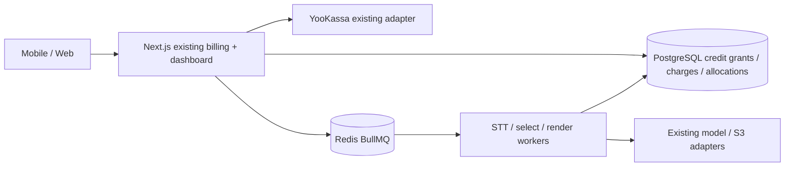

# Credit packages — Architecture

Phase1 finite code contract v2 on c5596736; authority/status in [owner-decisions.md](owner-decisions.md).

## Architecture Overview
Style: existing distributed monolith, unchanged7production services. PostgreSQL remains money/rights source; Redis remains transport. Add three bounded tables and a credit helper, no framework or service.

## Component Breakdown
| Boundary | Exact project paths | Change |
|---|---|---|
| Catalog/units | packages/shared/src/tariff.ts, enums.ts | Closed immutable SKUs, seconds, shortage enum |
| Persistence | packages/db/migrations/022_credit_packages.sql; src/credits.ts,index.ts,payments.ts | Additive schema/constraints; bounded reserve/finalize/rights helpers; immutable intent |
| Signup | apps/web/src/server/auth-store.ts | Account+trial+session atomic |
| Input/provider quota split | packages/db/src/probe.ts,transcription.ts | Customer seconds once; provider attempt budget separately |
| Failure/output | packages/db/src/selection.ts,render.ts; apps/web/src/server/watchdog.ts,video-retry.ts; apps/worker/src/retry.ts | Current-fence finalization and recovery |
| Billing/rights | apps/web/src/server/billing-handler.ts,billing-deps.ts; packages/db/src/plan.ts; packages/shared/src/tariff.ts | Fulfillment/scheduled base periods and union paid windows |
| Expiry/erasure | apps/web/src/server/retention.ts; packages/db/src/payments.ts,plan.ts | Preserve addon paid windows and old promises; erase credit links safely |
| UI/contracts | apps/web/src/app/upgrade/page.tsx,UpgradeScreen.tsx,return/ReturnScreen.tsx; dashboard/page.tsx,LimitsPanel.tsx; upload/Uploader.tsx; lib/payment-return.ts,limits-contract.ts; server/limits.ts,screen.ts,upload-contract.ts | Package-aware display/return and distinct shortage |
| Existing offers | apps/web/src/app/page.tsx; server/guest-page.ts and current paid CTA components found by scoped search | Replace live stale Pro990/daily-volume offers, preserve historical evidence |

Integration owner /root owns compose, .env examples, packages/shared/src/config.ts and configuration wiring tests to avoid Cloud-provider flag ownership overlap. Credit implementation owns tariff/enums/DB/web behavior only; pass typed billingMode from shared runtime configuration to web/workers. No dependency addition expected. Each implementation file<500lines. Full proposed test scope in refinement; docs here do not alter frozen canon/Specification or existing migrations.

## Technology Stack
| Layer | Technology | Rationale |
|---|---|---|
| Frontend | Existing Next.js15/React | Existing mobile UI |
| Backend | Existing TypeScript handlers/tRPC | Preserve boundary checks |
| Database | PostgreSQL16 + current pg SQL | Transactions/checks/uniqueness |
| Cache | Redis7 | Existing limiter only |
| Queue | BullMQ | Existing fenced recovery |
| Infrastructure | Existing compose, future separate Cloud.ru VM | This plan launches nothing |

## Persistence and entitlement rules
Grant counters integer seconds, nonnegative checks and remaining+reserved≤total. Unique trial account across signup/migration; unique fulfilled intent source; unique active video charge and charge/grant allocation. Persist input billable seconds without relying on old numeric(10,1) duration rounding. Settled customer charge is distinct from minutes_charged/provider quotas.
`effectivePlanSql` and shared `effectivePlan` retain binary paid/free equality fail-closed. Include union of independent base/addon entitlement windows, protected legacy/operator rights and narrowly scoped original-source recovery authorization. Update ALL paid-right readers, paid expiry watchdog and retention queries together; do not let `expirePaidPlans` turn active addon free. Account plan_paid_until must not be extended by summing overlap. Retention anchor uses latest actual paid window end, preserving existing paid clips through that end+72h under existing promise; recovery24h does not silently renew unrelated stored assets.
A job pins monetary/input policy and paid-render entitlement source; expiry during a valid reserved operation cannot downgrade output. This is a coordinator code contract under autonomy, not a direct owner answer, current app claim or authorization to activate production terms.

## Lock ordering and recovery
Existing erasure takes account→video; never take account row lock after video. Credit writers use transaction advisory lock peraccount after video where applicable, then grant rows ordered expiry/id; re-read account status/fence and grant state after lock in fresh statements. Payments use existing payment advisory→account→intent, then credit advisory, and never lock video afterward. Erasure takes account→videos→credit advisory before cleanup. Credit helpers never lock account after credit advisory. Verify these orders with barrier-based SQL races.
No provider network inside transaction. Commit before enqueue; watchdog republishes SQL-authoritative jobs and idempotently finalizes stale charges. Immediate upgrade is rejected with no intent/provider side effect; no quote/purchase freeze/upgrade schema is built. Manual renewal periods are serialized at fulfillment, not by holding SQL across network.

## External Dependencies
This feature reuses existing services; no external capability was freshly verified in this read-only source planning stage. UNCONFIRMED rows block the named live acceptance requirement until provider evidence/runtime receipt is attached; local schema/UI work is independent.
| Capability needed | Provider / API | Evidence | Verdict | Requirements relying on it |
|---|---|---|---|---|
| Create/re-query payment and verify successful event | Existing YooKassa adapter | Source audit only, no newly opened provider docs/quote;2026-10-26 | UNCONFIRMED | FR-credit-packages-6 live payment acceptance |
| Process audio/selection and persist clip objects | Existing model/S3 adapters | Existing project receipts are historical, not this build/provider proof | UNCONFIRMED | FR-credit-packages-3/5 live end-to-end acceptance |
New Cloud.ru FM/S3 compatibility is a separate stage; no fabricated confirmation. No new external API is required for credit arithmetic. Phase2 must explicitly scope independent local implementation versus blocked live acceptance; do not use this table to waive mandatory delivery gates.

## Decision and migration boundaries
Direct owner answers and coordinator code choices are versioned distinctly in feature docs/intent snapshots. Additive022 preserves old intent legacy_pro990_v1, old job legacy_daily_v1 and paid cohorts; all three new tables add explicit erasure policy. Schema migration neither gifts existing accounts nor switches their policy; explicit audited effective-free opt-in alone may issue migration_trial, once lifetime, after checking no active/unresolved legacy rights/intents. No old migration edit, no automatic data conversion from price, no historical consumed minutes inferred. Migration rehearse on scrubbed isolated SQL first. Stop/drain old writers before enabling credits; old workers cannot process credit_v1 jobs. Once new purchases exist, rollback requires compatibility build/forward fix; dropping credit data or blindly restoring old code is prohibited.

## Versioned mode and ownership seam
Canonical key: `N5_BILLING_MODE=legacy|credits_v1`; undefined→legacy, empty/unknown→startup error. No current production setting is changed. Integration owner declares `BillingMode` and `WebConfig.billingMode` and the loadWorkerConfig return billingMode in packages/shared/src/config.ts, adds it via loadWebConfig/loadWorkerConfig and wires existing web/worker runtime dependencies and compose/env examples, and owns config tests. Credit helper receives the typed mode; no second env parser, Cloud flag alias or global configuration change.
Mode gates new credit registrations, explicit operator cutover and new credit SKU sale. Existing immutable account/input/intent policy still controls processing/fulfillment after new enrollments stop; legacy mode never converts credit balances back to daily allowance. New default-legacy migrations/config preserve old test fixtures and behavior; add explicit credits_v1 fixtures for new behavior, retaining full prior regression suite.
