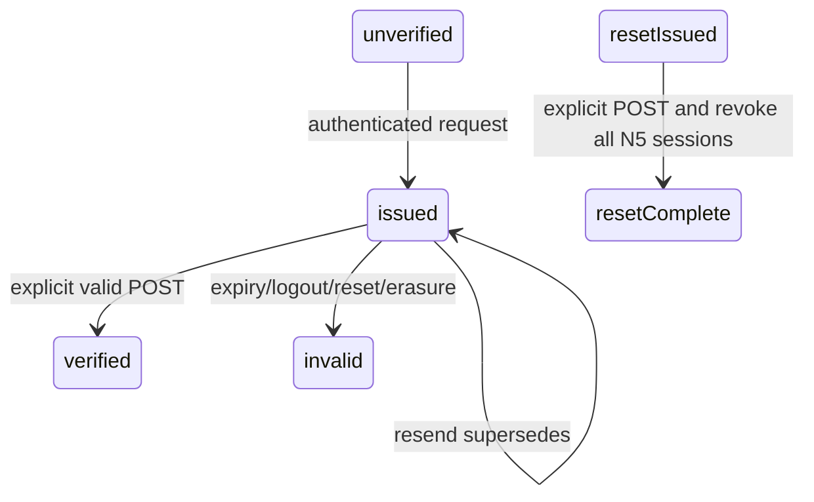

# Support access — pseudocode
Source specification: `01_specification.md`; each exact machine key is claimed once.
Existing N5 cookie authority is retained; API authorization is cookie-based, never Bearer.
## Data Structures
`support_email_token`: id UUID, created_at Timestamp, account_id UUID, purpose
verify|reset, email snapshot, SHA256 digest UNIQUE, issuing session hash for verify,
expires_at, used_at, delivery state; partial UNIQUE(account_id,purpose) WHERE unused.
`account.email_verified_at`: nullable Timestamp; current email is the proof subject.
`support_operator`: id UUID, account_id UUID UNIQUE, created_at Timestamp, revoked_at.
`support_audit`: id UUID, created_at Timestamp, actor UUID/string, target UUID, action,
reason for grant/revoke; no raw query, PII payload or secrets.
Persisted mail admission counters/events keyed by purpose/email/IP hashes and window.
No local ticket/message database. Vendor contact mapping, if stored, is account-id keyed,
not an alternate authority; remove it on N5 erasure.
## Core Algorithms
### Algorithm: ALGO-support-access-1 — preserve account invariants
REQUIREMENT: `FR-support-access-1`
REQUIREMENT: `AC-support-access-1`
REALISES: SC-US-001-1
INPUT: existing register/login/proof/reset commands. OUTPUT: original account authority.
STEPS: 1. Keep existing AuthService/PgAuthStore and grantTrialTx. 2. Add proof field only.
3. Never invoke registration/credit grant from proof/reset. RETURN existing login result.
COMPLEXITY: O(1).
### Algorithm: ALGO-support-access-2 — select bounded mail transport
REQUIREMENT: `FR-support-access-2`
REQUIREMENT: `AC-support-access-2`
REALISES: SC-US-001-2
INPUT: validated env, committed token/template. OUTPUT: disabled|accepted|failed|unknown.
STEPS: 1. Parse closed mode; absent => disabled; malformed explicit config => startup error.
2. Reject test in production; smtp requires explicit TLS settings and credentials.
3. Outside SQL acquire one of four send slots or fail quickly; deadline entire operation
at 8000ms, close transport on timeout. 4. Send text+HTML with one recipient and fixed
configured from; no file/URL loading/debug logging. 5. Persist sanitized delivery status
by token UUID. IF ambiguous THEN do not retry. RETURN acceptance, never mailbox delivery.
COMPLEXITY: O(message bytes), bounded.
### Algorithm: ALGO-support-access-3 — issue and consume current-email proof
REQUIREMENT: `FR-support-access-3`
REQUIREMENT: `AC-support-access-3`
REALISES: SC-US-001-3
INPUT: authenticated session, token on confirm only. OUTPUT: verified|invalid|unavailable.
STEPS: 1. Apply ALGO-5 admission and require mail configured before issue.
2. Lock account then issuing session, recheck active status/session with clock_timestamp().
3. Supersede prior verify token; insert 32-byte random token digest with 24-hour expiry,
email snapshot and issuer session hash; COMMIT then ALGO-2 sends fragment URL.
4. GET only renders form; browser strips fragment immediately, waits for explicit click.
5. Confirm requires fresh session for SAME account, allowing another device; lock account,
then issuer/current sessions in deterministic hash order, then token. Recheck current email,
both sessions and expiry after waits. 6. Conditional unused-token UPDATE and email proof
write in one transaction; concurrent loser invalid. RETURN verified without new session.
COMPLEXITY: O(1), indexed token/account lookup.

### Algorithm: ALGO-support-access-4 — forgot and reset password
REQUIREMENT: `FR-support-access-4`
REQUIREMENT: `AC-support-access-4`
REALISES: SC-US-001-4
INPUT: normalized email or token+new password. OUTPUT: uniform 202 or reset success/invalid.
STEPS: 1. Apply ALGO-5 even for missing email; disabled reports global unavailability.
2. For known active account lock account; supersede reset tokens and issue digest, 1h TTL;
COMMIT before mail. Return same202 without awaiting SMTP; schedule bounded after-response
send through injected lifecycle callback (best effort, no durable-delivery promise).
3. On reset precheck digest cheaply, compute bcrypt OUTSIDE transaction; then lock account
and conditional token consume with purpose/email/status/clock_timestamp guards.
4. In same transaction set password hash; revoke all N5 sessions, all reset/verify tokens;
keep existing proof, membership and ledger; COMMIT. No new session, no proof upgrade.
5. Concurrent login uses existing password-hash recheck under account lock; old-hash login
cannot create a post-reset session. RETURN success and instruct ordinary login.
COMPLEXITY: O(sessions+outstanding tokens), bcrypt fixed cost 10.

### Algorithm: ALGO-support-access-5 — boundary and atomic admission
REQUIREMENT: `FR-support-access-5`
REQUIREMENT: `AC-support-access-5`
REALISES: SC-US-001-5
INPUT: request, trusted proxy config. OUTPUT: validated intent or bounded refusal.
STEPS: 1. IP limiter BEFORE body; fail closed when unavailable. 2. Require exact Origin
on new POSTs, JSON stream <=4096 bytes, strict schema. 3. Persist admission atomically;
lock IP/email/pair hashed keys in stable sorted order before count+record, so different
emails cannot race one shared IP quota. Enforce 5/30/5 per hour and 60s cooldown.
4. Use account→sessions→token lock order for identity mutations; never hold network or
bcrypt in SQL transaction. 5. Prune expired admission data (>1h) and expired/used tokens
(>7d) in bounded batches; bound pending admission/token storage to 10000 rows each and
fail uniformly when full. 6. Redact failures to error codes only; set private/no-store and
no-referrer on token pages/responses; never persist browser token. RETURN bounded intent.
COMPLEXITY: O(log n), bounded cleanup batch <=100.

### Algorithm: ALGO-support-access-6 — staff authority and bootstrap
REQUIREMENT: `FR-support-access-6`
REQUIREMENT: `AC-support-access-6`
REALISES: SC-US-002-1
INPUT: session cookie or privileged CLI account UUID/actor/reason. OUTPUT: staff|404.
STEPS: 1. SSR/API authenticate current N5 session. 2. DB read transaction checks active
session/account and nonrevoked operator; browser roles/actor ignored. 3. Empty membership
=> no access. 4. Separate privileged process-only command validates UUID, action and
actor/reason; locks account+membership; grant requires existing active verified account,
revoke does not require current proof; membership and audit update atomically.
5. No public/browser grant route; CLI requires process access/current privileged DB URL.
RETURN staff DTO or identical 404; sensitive pages private/no-store.
COMPLEXITY: O(1), indexed membership.

### Algorithm: ALGO-support-access-7 — read minimal diagnostic DTO
REQUIREMENT: `FR-support-access-7`
REQUIREMENT: `AC-support-access-7`
REALISES: SC-US-002-2
INPUT: validated exact email/UUID POST-body query or GET cursor. OUTPUT: minimal DTO or404.
STEPS: 1. ALGO-6 within read transaction, no cached staff claim. 2. Validate server cursor,
query with explicit columns and bound parameters, stable created_at/id ordering, LIMIT25.
3. Card reads account and at most20 entries each for ledger/payments/video-job rows;
reuse current balance/domain reads. 4. Append minimal staff access audit; no sensitive
search input logging, URL query or referrer. 5. GET lists/cards and guarded POST search are read-only; account mutations refused. RETURN DTO.
COMPLEXITY: O(log n+25) list, O(20) per card section.

### Algorithm: ALGO-support-access-8 — initialize official widget identity
REQUIREMENT: `FR-support-access-8`
REQUIREMENT: `AC-support-access-8`
REALISES: SC-US-003-1
INPUT: closed support config, current N5 cookie. OUTPUT: disabled|anonymous settings|JWT.
STEPS: 1. Disabled => no script/network. Test requires isolated runtime and fixture origin.
2. Live validates HTTPS base URL/inbox, loads official /widget.js from configured origin.
3. Anonymous settings contain baseURL/inboxID only; never add real account email.
4. IF explicit verified mode THEN fresh authenticate and read current email/proof; refuse
JWT if unverified/revoked/deleted. Sign server-built HS256 payload with exp=now+60sec,
external_user_id immutable UUID, email and neutral first_name; never emit user_id.
5. Call official Libredesk.setUser(jwt); no vendor agent credential in client. RETURN.
COMPLEXITY: O(1). Vendor matching/isolation needs real pinned pilot, not fixture inference.

### Algorithm: ALGO-support-access-9 — safe support context and deep link
REQUIREMENT: `FR-support-access-9`
REQUIREMENT: `AC-support-access-9`
REALISES: SC-US-003-2
INPUT: optional video UUID, authenticated caller. OUTPUT: previewable safe context or 404.
STEPS: 1. Validate UUID; find video by BOTH id and session account; foreign==missing404.
2. Project only status/failure/timestamp/IDs; anonymous draft contains no account ID.
3. Show user context preview; attach/copy only after explicit consent, no background
media transfer. 4. Context Link is ordinary /admin/support/accounts/{external_user_id};
ALGO-6 always runs. URL values are lookup hints, never bearer authority. RETURN context.
COMPLEXITY: O(1).

### Algorithm: ALGO-support-access-10 — reconcile local and vendor lifetimes
REQUIREMENT: `FR-support-access-10`
REQUIREMENT: `AC-support-access-10`
REALISES: SC-US-003-3
INPUT: N5 logout/reset/erase/revoke, widget focus/open/account change. OUTPUT: cleared UI.
STEPS: 1. N5 reset/erasure revoke tokens/sessions; delete local proof/mapping on erasure.
2. Before identification and on visibility/focus revalidate current session/account proof.
3. IF account differs/authority lost THEN official Libredesk.logout(), remove old settings/
JWT and clear app widget state before new identity; logout path does this before navigation.
4. Never claim vendor session revoked remotely; record separate vendor pilot and deletion
checklist, synthetic-only until real contact/retention policy configured. RETURN safe UI.
COMPLEXITY: O(1) client transition, O(tokens) erasure.

### Algorithm: ALGO-support-access-11 — render and demonstrate accessible states
REQUIREMENT: `FR-support-access-11`
REQUIREMENT: `AC-support-access-11`
REALISES: SC-US-004-1
INPUT: typed auth/staff/support states. OUTPUT: Russian forms/cards and browser evidence.
STEPS: 1. Reuse compact existing/N4 form/card styles; pending/error/success distinct.
2. Wire login/dashboard/failed-video links; show configured contact only; no fake address.
3. Exercise 360px+desktop, keyboard and unavailable/test states with existing Playwright.
4. Record exact source/build/fixtures and all native gate results before delivery. RETURN.
COMPLEXITY: O(rendered rows), bounded by DTO limits.

## API Contracts

New JSON POSTs require exact Origin, <=4096 bytes, private/no-store; cookie auth as stated.
All errors: `{error:{code:string,message:string}}`; malformed422, oversized413, limiter429,
unavailable503; auth401 on customer mutations, unauthorized staff always404. Never echo input.
| Method/path | Request/auth | Success JSON |
|---|---|---|
| POST `/api/auth/email/send` | `{}` / N5 session | 202 `{ok:true}` |
| POST `/api/auth/email/confirm` | `{token}` / N5 session | 200 `{ok:true,verified:true}` |
| POST `/api/auth/forgot` | `{email}` / public | 202 `{ok:true,message:"Если адрес зарегистрирован, инструкция будет отправлена. Доставка не гарантирована."}` |
| POST `/api/auth/reset` | `{token,password}` / public | 200 `{ok:true,loginRequired:true}` |
| GET `/api/admin/support/accounts?cursor=` | staff; no email query | 200 `{items:[{id,email,status,verified,plan}],nextCursor:string|null}` |
| POST `/api/admin/support/search` | `{query,cursor?}` / staff | same bounded list DTO; query exact UUID/email |
| GET `/api/admin/support/accounts/[accountId]` | staff | 200 `{account,credits,ledger,payments,jobs}`; exact projections in AC7 |
| POST `/api/support/session` | `{}` / optional session | 200 `{mode:"anonymous",baseURL,inboxID}` or `{mode:"verified",baseURL,inboxID,jwt,expiresAt}`; unverified never JWT |
| POST `/api/support/context` | `{videoId?}` / N5 session for video | 200 `{context:{accountId?,videoId?,status?,failureCode?,at}}` |
Disabled support/mail =>503; test mode adds `synthetic:true` to support settings (no live claims).
UI GETs: `/support`, `/verify-email`, `/forgot`, `/reset`, `/admin/support/accounts[/id]`.

## State Transitions

## Error Handling Strategy

Config errors fail explicit enabled modes; disabled remains honest and network-free.
Transport accepted/failed/unknown is internal; forgot never enumerates by delivery outcome.
DB lock timeout/admission storage-full fails closed; token/page errors never include token.

## Scenario Coverage

Scenarios in `01_specification.md`: 11 · claimed by an algorithm: 11.
Not claimed by any algorithm:
none

Claimed by an algorithm but absent from specification:
none
