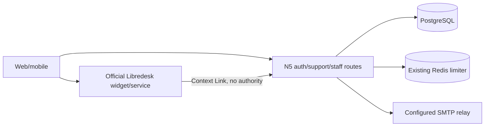

# Support access — architecture and ownership
## Architecture Overview
Monolith: existing Next.js/web/PostgreSQL/Redis; SMTP adapter and separate optional Libredesk.

## Component Breakdown
Auth stays N5; proof/reset store adapts N1 schema names and N3 guards. Staff DB predicate
adapts N6b; read DTOs use existing N5 credits/payments/video data. Widget is vendor code,
not a new ticket backend; Context Links are staff-authenticated UUID deep links.
## Technology Stack
| Layer | Technology | Rationale |
|---|---|---|
| Frontend/backend | Existing Next.js/React/TypeScript | Existing compact forms/cards; no admin framework |
| Database/cache | Existing PostgreSQL/Redis | Atomic token/admission authority and existing limiter |
| Queue | Existing queue unchanged | No new mail/ticket worker |
| Mail/infrastructure | Nodemailer adapter; optional separate Libredesk v2.9.0 | No campaign engine or new image required locally |
## External Dependencies
All cited pages below opened 2026-10-28; citations confirm API shape, not deployed operation.
| Capability needed | Provider / API | Evidence | Verdict | Requirements relying on it |
|---|---|---|---|---|
| SMTP adapter/TLS | Nodemailer | [SMTP](https://nodemailer.com/smtp): “Nodemailer requires a STARTTLS upgrade” | CONFIRMED | FR-support-access-2 |
| Anonymous widget | Libredesk | [Live Chat](https://support.libredesk.io/en/articles/livechat): “Visitors can start conversations anonymously” | CONFIRMED | FR-support-access-8 |
| Signed immutable identity | Libredesk HS256 | [Live Chat](https://support.libredesk.io/en/articles/livechat): “Stable unique ID from your system.” | CONFIRMED | FR-support-access-8 |
| Staff deep link variables | Libredesk | [Context Links](https://support.libredesk.io/en/articles/context-links): “Contact's external user ID” | CONFIRMED | FR-support-access-9 |
| Actual RF mailbox delivery | Relay/domain not selected | No configured runtime or sender proof | UNCONFIRMED | Deferred real-mail acceptance, no local FR depends on delivery |
| Vendor remote revoke/full deletion | Pinned pilot needed | Neither JWT exp nor logout establishes this | UNCONFIRMED | Deferred vendor acceptance; FR-support-access-10 requires disclosure/local revocation only |
## Concrete ownership (all paths relative to project root)
Root integrates shared files; no two writers share a worktree. Rows below are proposed scopes, not dispatch permission. Actual root dispatch: ONE backend
writer owns all backend/shared/manifests/migration; UI writer owns NEW pages/components/tests
and responsive adapter/tests only. Root freezes precise paths/spec SHA and only merges.
| Unit | Exclusive files | Checks / stop condition |
|---|---|---|
| email | NEW `packages/db/src/support-email.ts`; NEW `apps/web/src/server/support/{email-handler,mail}.ts`; NEW `apps/web/src/app/api/auth/{forgot,reset}/route.ts`, `api/auth/email/{send,confirm}/route.ts`; NEW `tests/support-email*.test.ts`, `tests/support-mail*.test.ts` | Token/admission/reset/SMTP tests; no shared auth/config edits; deliver bounded receipt |
| staff | NEW `packages/db/src/support-admin.ts`, `packages/db/src/ops-support-operator.ts`; NEW `apps/web/src/server/support/staff-handler.ts`; NEW `apps/web/src/app/api/admin/support/accounts/route.ts`, `[accountId]/route.ts`; NEW `tests/support-staff*.test.ts` | Guards/DTO/CLI and concurrent revoke; no payment mutation |
| UI/widget | NEW `apps/web/src/server/support/{widget,context,handler}.ts`; NEW `apps/web/src/app/{support,verify-email,forgot,reset}/**`; NEW `apps/web/src/app/admin/support/**`; NEW `apps/web/src/app/SupportLauncher.tsx`; NEW `tests/support-widget*.test.ts`, `scripts/check-support.mjs` | API-shaped fixtures and browser; widget account switch/absence/failure |
| root integration | `packages/db/migrations/023_support_access.sql`; existing `packages/db/src/index.ts`, shared config/environment/runtime, auth-handler/auth-store/retention, app layouts/AuthForm/dashboard/video pages; all manifests/lockfile/compose/env examples; `scripts/check-responsive.sh`, its adapter tests; dispatch/telemetry/completion and feature index | Full gates; minimal `N5_PLAYWRIGHT_CONTAINER` reuse adapter runs SAME responsive verifier, copy/run failures exit2, path injection rejected |
Migration023 must be reconciled against live integration HEAD before allocation. Root owns
current-account proof field and existing erasure hook; no worker silently modifies those seams.
## Deployment boundary
Separate same-RU-VM Libredesk recipe only: pinned stable image/digest selected at deployment,
separate DB/owner and Redis namespace/ACL, no N5 schema access, no DB host ports, explicit TLS,
SMTP/AI/external channels off until configured. No pull/start/capacity claim in this plan.
Staff local Libredesk accounts are separate from N5 operator membership; no OIDC invented.
Current N5 source uses one DATABASE_URL and no role scaffold: source-level staff guard is
mandatory. Shared owner DB URL remains privileged; no SQL/RCE isolation or RLS retrofit.
