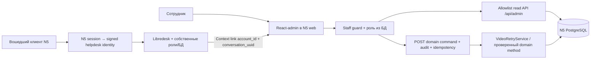

# N5: OSS-админка и минимальная интеграция поддержки

Дата проверки: 27.10.2026 UTC. Source: `f60215a5199584c5025b65b14b00bfabeacdd003`, read-only `/tmp/n5-acquisition-analytics-20261026`, проект `projects/05-podcast-clips-opus` (далее P). Пакет исследования, не реализация и не разрешение установки/публикации/расходов.

**Рекомендация:** React-admin Community в существующем Next.js + Libredesk как отдельный helpdesk, сначала только диагностическое чтение и ссылки между карточкой N5 и разговором. Это экономит процесс/БД самой админки на исходной VM 2 vCPU/4 GB. Цена выбора — небольшой N5 API и адаптеры авторизации/данных; UI-фреймворк их не создаст. AdminJS — сильная альтернатива для быстрого SQL-каталога, если отдельный Node-сервис допустим. Он может сократить начальный код списков, но безопасная проекция данных и доменные операции всё равно требуют настройки.

Libredesk выбран совместно с исследователем helpdesk; полное сравнение, лицензия и ограничения каналов — его отдельный отчёт. Проверенный здесь [Context Links](https://support.libredesk.io/en/articles/context-links) умеет передавать external_user_id/conversation_uuid в ссылку на внешнюю карточку. Для первого этапа достаточно ссылки и отдельной N5 staff-сессии; мост SSO не нужен.

## 1. Что есть в N5 и что придётся добавить

| Нужда сотрудника | Проверенный источник P | Вывод для интеграции |
|---|---|---|
| Пользователь, тариф | `packages/db/migrations/001_init.sql:3`; `021_payments.sql:9`; `src/payments.ts:190` внутри `packages/db` | `account` содержит email, plan/status/plan_source/plan_paid_until; брать также effective_plan и billing_policy, а не рисовать доступ по одному plan. |
| Баланс | `packages/db/src/credits.ts:38`; `022_credit_packages.sql` | Есть readCreditBalance: available/reserved/recovery/next_expiry. Две политики legacy_daily_v1 и credits_v1 сосуществуют. Нельзя редактировать balance числом. |
| Видео, стадия/ошибка | `packages/db/migrations/001_init.sql:24,142`; `005_queue_probe.sql`; `007_selection.sql` | `video`, `job_attempt`: status/failure_reason/progress/timestamps/fence/series/attempt_no/provider/model/unit_count. Возможны deferred/stalled; показывать время последнего обновления. |
| Технические попытки/расход | `apps/worker/src/stt/spend.ts`; `apps/worker/src/llm/spend.ts`; `runtime.ts:31` | JSONL считает phase=attempt; outcome не ещё одна платная попытка. STT секунды, select вызовы. Фактических USD/рублей/токенов в этих интерфейсах нет: оценка тарифа отдельно, фактическая сумма null до сверки. Нужен фиксированный агрегатор/проекция, не доступ к произвольным файлам. |
| Платежи и возвраты | `packages/db/src/payments.ts:88,157`; `021_payments.sql:16,26,37` | Есть payment_intent/payment/payment_event, SHA payload и dedup event key. Refund отмечается refunded + needs_review; это не готовый механизм выдачи возврата или корректировки credit ledger. |
| Retry | `apps/web/src/server/video-retry.ts:12` | Готов VideoRetryService.retry(account,videoId): active owner, retryable state/file, quota/credits, новая серия/фенс, commit до enqueue. Staff endpoint обязан отдельно разрешить выбор чужого аккаунта, записать actor/reason/request key. Не заменять на UPDATE status или прямую запись в Redis. |
| Операторская операция | `packages/db/src/ops-set-plan.ts:18`; `credits.ts:20` | setPlanByOperator валидирует plan/reason/operator и пишет operator_action в транзакции; optInCredits тоже журналирует. Это CLI/доменные методы, а не staff auth. set_plan не равно исправление кредитов. |
| Произвольная коррекция кредитов | `022_credit_packages.sql`; `packages/db/src/credits.ts` | Источники grant: signup/migration_trial/payment/recovery; общего manual adjustment нет. Коррекция требует отдельной семантики append-only компенсации, причины/лимитов/идемпотентности и тестов; в первую read-only поставку не входит. |
| Удаление пользовательских данных | `apps/web/src/server/retention.ts:15–48` | Удаляются сессии/видео/ledger; платежи и operator_action отвязываются от account. Новые support links/копии переписки требуют собственных правил удаления и хранения. |

Сессии: `apps/web/src/server/auth.ts`, `auth-store.ts`, `auth-handler.ts`. Собственный bcrypt + HMAC-хэш случайного токена, TTL 7 суток, cookie `__Host-n5_session` Secure/HttpOnly/SameSite=Lax; authenticate возвращает только account_id активного аккаунта. В просмотренных auth-модулях/миграциях **нет staff role, email_verified_at, reset/verify token, recovery endpoint**. В `app/api/auth` найдены только login/register/logout. Нельзя объявить любой зарегистрированный аккаунт администратором.

`docs/Architecture.md` описывает Next.js15 + React19 + pg напрямую/SQL migrations, не Prisma. Фактический `apps/web/package.json`: next15.5.25, React^19.1.0. Архитектурный документ сам предупреждает об устаревших местах; интеграция выше привязана к коду.

Межпроектное reuse проверено через `git show` той же ревизии (N6/N7 отсутствуют физически в sparse checkout): N6 `packages/db/src/tariffs.ts` и auth уже являются донорами N5; `P/docs/reuse-map.md:130` фиксирует платежи/ops. N7 `src/auth/service.ts` даёт register/login/authenticate/logout на Argon2, готового recovery/staff-helpdesk в узком source search не найдено. N7 `src/dispatch/smtp.ts` связан с кампаниями, transport authority/budget/consent: перенос такого SMTP-движка ради transactional email не минимален. Исторические telemetry/receipts и другие worktrees не читались.

## 2. Четыре OSS-кандидата и один актуальный source-available контроль

Лицензии прочитаны по commit, полученному из currentOid официальной GitHub-страницы. Это pin исследования, не выбранная production-версия и не lockfile. Документация может описывать текущий продукт/EE шире, чем CE; такие границы ниже отмечены.

| Кандидат, pinned license | Existing PostgreSQL / Next.js / код | Бесплатное ядро и платные границы | Ресурсы и решение |
|---|---|---|---|
| **React-admin**, `001b01c8143f12930839f00a2ba1b57c7f0ea886`, [MIT](https://github.com/marmelab/react-admin/blob/001b01c8143f12930839f00a2ba1b57c7f0ea886/LICENSE.md) | Не подключается к PG из браузера; N5 read API → dataProvider. [Официальная Next.js-интеграция](https://marmelab.com/react-admin/NextJs.html): client component/dynamic ssr:false. Peer React18/19 в [pinned package](https://github.com/marmelab/react-admin/blob/001b01c8143f12930839f00a2ba1b57c7f0ea886/packages/react-admin/package.json). | Community Lists/Show/filter/forms, authProvider/canAccess; серверные роли реализует N5. Готовые [ra-rbac](https://registry.marmelab.com/documentation/ra-rbac) и [ra-audit-log](https://registry.marmelab.com/documentation/ra-audit-log) — EE/подписка. Это не запрещает собственный server-side RBAC/audit на MIT UI. SSO — интеграция authProvider, не бесплатный готовый IdP. | Отдельного сервера/БД framework не требует, RAM minimum для N5 нет. Browser bundle/build и SQL нагрузка остаются. **Основной выбор на общей VM4GB**; больше glue, меньше инфраструктуры. |
| **AdminJS**, `9c2ee7f1b58c1471edc02f39d01db64d0764873e`, [MIT](https://github.com/SoftwareBrothers/adminjs/blob/9c2ee7f1b58c1471edc02f39d01db64d0764873e/LICENSE.md); SQL `b82a013602157013b4ba296cdba649e8d58b5f27`, [MIT](https://github.com/SoftwareBrothers/adminjs-sql/blob/b82a013602157013b4ba296cdba649e8d58b5f27/LICENSE) | [Официальный SQL adapter](https://docs.adminjs.co/installation/adapters/sql) без ORM, PostgreSQL через Knex, явный allowlist resources; не загружать всю БД. Из коробки many-to-one, иные связи/custom read models потребуют кода. [Runtime plugins](https://docs.adminjs.co/installation/plugins): Express/Nest/Fastify/Hapi/Koa; официального Next.js plugin в списке нет. ESM-only v7. | [Auth providers](https://docs.adminjs.co/basics/authentication) требуют своей authenticate-логики. [isAccessible](https://docs.adminjs.co/tutorials/adding-role-based-access-control) блокирует API; isVisible лишь UI. Custom handlers — бесплатная основа для domain actions; готовый staff IdP и финансовый audit автоматически не появляются. Опциональные premium-пакеты проверять отдельно, их лицензия не выводится из MIT core. | Лишний Node runtime/sidecar или отдельная интеграция server framework; опубликованного универсального RAM minimum в рассмотренных официальных guide нет. **Быстрейший SQL-каталог-кандидат**, если такой overhead приемлем. Не доказано, что безопасные joins/views будут автоматически работать как таблицы. |
| **Appsmith CE**, `3321f41567979dd1a2fa883ce7a04e4457e3089d`, [Apache2.0](https://github.com/appsmithorg/appsmith/blob/3321f41567979dd1a2fa883ce7a04e4457e3089d/LICENSE) | Low-code отдельный сервис; free PG connector присутствует в [community source](https://github.com/appsmithorg/appsmith/blob/3321f41567979dd1a2fa883ce7a04e4457e3089d/app/server/appsmith-plugins/postgresPlugin/pom.xml); [документация](https://docs.appsmith.com/connect-data/reference/querying-postgres): SQL, prepared params, read-only mode. REST datasource подходит для команд N5. Next — ссылки/embed, не нативная N5 staff session. | Free стандартные роли; [custom GAC](https://docs.appsmith.com/advanced-concepts/granular-access-control) и [audit logs](https://docs.appsmith.com/advanced-concepts/audit-logs) помечены Business. [Pricing](https://www.appsmith.com/pricing): SAML/OIDC — Enterprise. Не путать Apache CE с примером appsmith-ee Docker и платными возможностями. | [Docker guide](https://docs.appsmith.com/getting-started/setup/installation-guides/docker): >=8GB RAM host для all-in-one MongoDB/Redis/PG. External services могут снизить память контейнера, конкретное число не обещано. **Не default для всего N5 на4GB**; рассматривать позже при доказанном запасе/смене размещения. |
| **ToolJet CE**, `9570bb17ed2cef9ec3ee4f317ae2d069f1226a1a`, [AGPL3.0](https://github.com/ToolJet/ToolJet/blob/9570bb17ed2cef9ec3ee4f317ae2d069f1226a1a/LICENSE) | Отдельная low-code платформа; free PG plugin есть в [community source](https://github.com/ToolJet/ToolJet/blob/9570bb17ed2cef9ec3ee4f317ae2d069f1226a1a/plugins/packages/postgresql/package.json), [SQL/GUI connector](https://docs.tooljet.ai/docs/data-sources/postgresql/) с параметрами. Для write — только REST domain API; Next session сама не переносится. | CE AGPL не означает бесплатность EE. [Официальная security page](https://tooljet.com/security): Team включает SSO/audit/GitSync, Enterprise SCIM/multiple deployments. Точный текущий free allowance и custom-RBAC gate на production SKU надо сверить перед выбором; не полагаться на скрытые кнопки как серверную авторизацию N5. | [System requirements](https://docs.tooljet.ai/docs/setup/system-requirements/): app 1vCPU/4GB/8GiB; PostgreSQL отдельно 2vCPU/8GB/20GB; Redis7 512MB (1GB production recommended); x86_64, не arm64. Это опубликованные component minima, не измерение нашего случая. **Не default общей4GB VM**. |
| **Directus (исключён из строгого OSS-выбора)**, `60133482b7ca8a864fd632b67511a5cf5df14d7a`, [MSCL-1.0-GPL](https://github.com/directus/directus/blob/60133482b7ca8a864fd632b67511a5cf5df14d7a/license) | PG поддерживается; готовый Studio/API, свои metadata/system tables/права, адаптация к существующей БД. Автогенерация CRUD не соблюдает автоматически N5 credit/quota/fence/payment транзакции. | **Текущий pin уже не старый BSL.** [Нынешняя лицензия](https://directus.com/license): ограничения competing use и обхода license-key features, будущий GPL3 через4года. Free core и paid higher limits/features по [self-host overview](https://directus.com/docs/self-hosting/overview). Это source-available; не считать текущую редакцию OSI-эквивалентом MIT/AGPL. Старые BSL/$5m условия нельзя переносить на этот pin. | [Requirements](https://directus.com/docs/self-hosting/requirements): app container минимум0.25vCPU/512MB, рекомендовано2×1vCPU/2GB; DB отдельно, Redis опционален до горизонтального масштабирования. Миграции Directus и N5 надо разводить. **Не выбирать ради внутренней диагностики N5**. |

Админка не должна получать право произвольного write CRUD к account/session, credit_grant/allocation/charge, payment*, video/attempt, uploads/S3. Скрыть кнопки/поля недостаточно: для AdminJS default actions доступны по API; запрет new/edit/delete/bulkDelete нужен через isAccessible и read-only DB grants. Пароли/хэши/токены исключаются из **ответов**, не только из видимости колонок. [Документация actions](https://docs.adminjs.co/basics/action), [RBAC/поле password](https://docs.adminjs.co/tutorials/adding-role-based-access-control).

## 3. Минимальная архитектура и граница чтения/записи

Все стрелки — предлагаемый проект, не существующая интеграция. DB остаётся во внутренней сети; helpdesk не получает credentials N5. Отдельная БД/роль helpdesk может жить в том же Postgres, если это поддержано проверенной конфигурацией и нагрузкой; миграции/helpdesk backup принадлежат helpdesk, N5 SQL migrations — N5. Нельзя направлять миграции платформы на схему N5 с owner credentials. Это не требует обязательной второй VM.

Read API: `GET /api/admin/me`; allowlist list/get ресурсов accounts, videos, attempts, payments/events и operator actions; credit balance как read projection. Пагинация, ограниченный поиск email/UUID, whitelist sort/filter, явные поля, no-store. В staff-projection не включать password_hash, session hashes, private S3 keys/presigned links, transcript.words/segments, raw prompts/provider responses/ключи. Для необходимости посмотреть клиентский контент нужен отдельный осознанный доступ, не автоматическая выгрузка в helpdesk.

Staff identity: минимально таблица staff_membership(account_id,role,enabled) с ручным назначением владельцем и server-side проверкой на каждом /api/admin запросе. Начать с `support_readonly`; отдельное `ops_retry` добавить при включении retry, `billing_operator` — только когда появится разрешённая доменная коррекция. React-admin authProvider вызывает N5 me/login/logout и canAccess отражает права сервера. Существующие клиентские owner predicates нельзя заменять универсальным staff=true. Для staff сессий отдельно выбрать срок и способ усиления входа; имеющаяся семидневная клиентская сессия не является готовой политикой staff.

Writes этапа2: один явный `POST /api/admin/videos/:id/retry` с reason, ticket reference, persisted Idempotency-Key, target account/video, authenticated actor, outcome/ошибка в durable audit. Сохраняются действующие проверки/порядок квот и credit reservation, fence и commit-before-enqueue. Существующий operator_action пока принимает только set_plan/credit_opt_in и plan before/after; универсального аудита retry/credit delta ещё нет — расширение схемы требуется. Клиент не выбирает actor/operator строкой. Повтор ключа возвращает исходный результат; конкурентные запросы проверяются на настоящей БД.

Refund на первом этапе — read-only payment/refunded/needs_review/event receipt, ссылка на существующий разрешённый operator workflow. Не добавлять кнопку «возврат» через имитацию webhook; recordVerifiedRefund принимает **проверенное** событие провайдера. Новый credit adjustment нельзя свести к setPlanByOperator или вставке фальшивого payment grant.

Helpdesk links: external_user_id берётся из N5 session account_id; видео/intent добавлять только после owner check. Верифицировано helpdesk-исследователем: Libredesk JWT требует email и external_user_id; первый sync может присоединить ранее существовавший email-only contact ([pinned source](https://github.com/abhinavxd/libredesk/blob/5668a2a2c503b9304404d8f3620131b2990cbb99/internal/user/contact.go#L162)). Поэтому stable account_id сам по себе не делает raw unverified email безопасным: authenticated identity/history — только после verified-email gate N5; до него новый anonymous/unlinked запрос без доступа к прежней истории. Для первого шага Libredesk Context Link ведёт на `/admin#/accounts/<external_user_id>/show` с conversation reference; отдельно валидировать UUID и не доверять URL для выдачи доступа. Зашифрованный Context Link token может передавать агентский контекст, но не заменяет N5 authorization. Если идентичность/контекст нельзя подписать — ручная ссылка и явно «контакт не подтверждён», не автоматическое объединение по email.

## 4. Email/recovery остаются задачей N5

У helpdesk собственные сотрудники/пароли/SSO. Их password reset восстанавливает helpdesk, а не `account.password_hash` и N5 cookie. Тикет с email и даже staff SSO не доказывают владение N5 аккаунтом; неподтверждённый email нельзя автоматически объявить verified. При недоступном почтовом канале остаётся logged-in чат/диагностика, но не восстановление потерянного N5 входа.

Минимальная N5-добавка: transactional email adapter (готовая библиотека/SMTP/API, без собственного SMTP сервера/кампаний N7), действительный sender/support address и разрешённый провайдер/ящик; SPF/DKIM/DMARC и доступы настраиваются отдельно. Логировать delivery status без reset-token/секретов. Ни отправитель, ни расходы сейчас не выбраны/не разрешены исследованием.

Auth endpoints: request-reset, confirm-reset, request-verification, confirm-verification. Нужны hashed single-use expiring tokens с purpose/account и consumed_at, email_verified_at; rate limits и одинаковый ответ на request для существующего/несуществующего адреса; bcrypt вне транзакции, атомарное потребление токена+смена хэша, отзыв сессий после reset. Существующим аккаунтам нужна явная миграционная политика unverified; отправка verification-письма не равна её успешному завершению. Новый email authority не переносится из helpdesk или UI framework автоматически.

## 5. Порядок работ и оценка

1. Выбрать read-only AC и схему staff rights; сформировать проекции без секретов, проверить cross-tenant deny/ordinary user deny. Не переносить БД в ORM ради админки.
2. React-admin Lists/Show + auth/data providers; карточки пользователя/баланса/видео/попыток/платежа/операторских событий. Open-source List используется и для собственного server audit — покупать ra-audit-log для этого не обязательно.
3. Минимальный Libredesk канал и подписанная identity; двусторонние ссылки. Проверить backup/restore и нагрузку при N5 render/STT; накопленные письма/вложения лимитировать отдельно. Если общего4GB недостаточно — сохранить ту же React-admin, после настройки действительного support mailbox временно использовать почтовый канал и отложить helpdesk (журнал/автоидентичность этим fallback не покрываются), либо согласовать изменение ресурсов; второй сервер не предрешён.
4. N5 email verification/recovery отдельной законченной задачей, включая доставку на контрольный адрес и просроченный/повторный token/отзыв сессий. До выбора email канала эта часть имеет внешний dependency, а не обещанный срок готовности.
5. Только затем operator retry; позже отдельно согласованный credit correction/refund reconciliation. Для write-стадий обязательны idempotency/concurrency, quota/credit/fence invariants, origin/role/tenant и независимое ревью. Политика сложности: read-only UI умеренен, money/auth writes требуют усиленного профиля; число файлов проверок не сокращает.

**Оценка-гипотеза, не прогноз по измеренной телеметрии:** staff guard+read API+React-admin 3–5 инженерных дней; helpdesk identity/deep-links/локальная проверка 1–2 дня при готовом канале; recovery+verification 2–4 дня после готовности email; audited retry 1–2 дня. Итого последовательной работы 7–13 дней без отдельной доменной коррекции кредитов; возможен scope reduction до read-only первого результата за3–5дней. Это ручная декомпозиция с низкой уверенностью; `analog_run_ids=[]`, method=insufficient_data, elapsed/active forecast=null, календарные ожидания провайдера/email/owner decisions неизвестны. Текущая исследовательская попытка не аналог реализации.

100 стартовых и1000 будущих пользователей — вводные планирования; без concurrency/media workload/измерений ни один framework не доказывает вместимость VM4GB. Ограничение4GB делает Appsmith/ToolJet плохим default, но не доказывает невозможность любого совместного размещения React-admin+Libredesk.

## 6. Проверки и ограничения исследования

Проверено: source HEAD/launch SHA; фактические N5 auth/ledger/retry/payment/retention seams; pinned primary licenses и PostgreSQL connector sources; current official API/runtime/edition/hardware docs; ограниченное reuse N6/N7. Не запускались install/build/test/контейнеры/браузер/DB/provider/support calls; claims об исполнении/нагрузке/E2E отсутствуют. E2E readiness=not_applicable (read-only research).

GitHub API вернул публичный rate-limit403; pin получен из GitHub currentOid HTML, license — raw.githubusercontent.com по этому SHA. Некоторые ToolJet current marketing URLs закрыты403, часть docs URLs меняется; точный free plan/custom RBAC allowance оставлен неизвестным, не предположен бесплатным. Для AdminJS/React-admin не найдено применимого официального численного RAM minimum. Текущие HEAD-пины не являются security-reviewed release selection. При handoff обнаружен HEAD f468e8dda0f714668de4207cd7bd8af417db1e56: один docs-коммит после launch-source; diff всех исследованных N5 code/Architecture/reuse-map/canon и N6/N7 donor modules пуст. Прочитаны только имена изменённых файлов; binding сохраняется к f60215a.

Модель requested: gpt-6.1-sol, reasoning high (launch); actual_model=null — независимые runtime metadata исполнителю не предоставлены, координатор может подтвердить по host spawn receipt; независимый review не выполнен этим исследователем. Usage/cost/active_compute=null: счётчики хоста не предоставлены. Coordination owner=/root; источник принятого нового credits baseline и фактическое внедрение остаются у него. Артефакты только /tmp report+trace; исходники/историческая телеметрия не изменялись.
