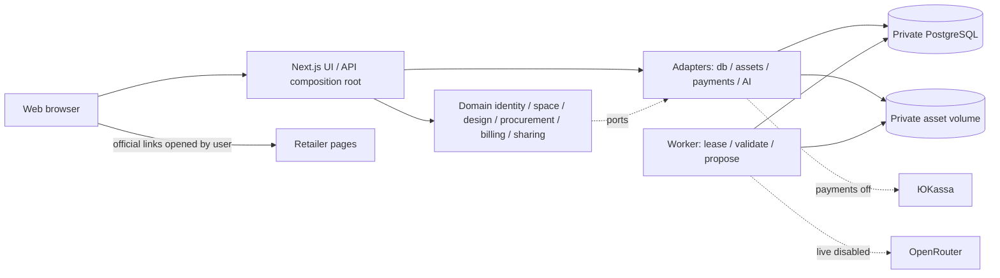

# N8 — Architecture v0.1

2026-10-13 · modular monolith · план для реализации, не описание уже работающей системы. Следовать [Specification](Specification.md), [Pseudocode](Pseudocode.md), [ADR](ADR.md). Владелец разрешил локальный полный цикл; live inference, реальные платежи и публичная публикация остаются выключены без соответствующего отдельного разрешения/config.

## Architecture Overview

No Redis/GPU/API gateway/microservice mesh for MVP. PostgreSQL job lease patterns already exist in N4; reuse them with N8 semantics. Worker is a separate process using the same packages, never holds a database transaction over provider I/O. No second renderer. No runtime imports from `projects/01..07`; selected code is adapted into N8 with provenance/tests.

## Component Breakdown

| Path / public export | Owns | Ports and allowed dependencies |
|---|---|---|
| `packages/domain/src/identity/index.ts` (`@n8/domain/identity`) | Account/session/project policy, ownership/caps | AuthStore, ProjectStore, Clock, TokenHasher; no Next/pg/fs imports |
| `packages/domain/src/space/index.ts` | ManualRoom, calibration, shell hashes, reference rules | AssetStore, SpaceStore; pure geometry helpers |
| `packages/domain/src/design/index.ts` | Scene schema/invariants, revisions, jobs/spend policy | DesignStore, JobStore, SceneProposalProvider; imports space public types only |
| `packages/domain/src/procurement/index.ts` | Provenance/freshness, decimal quantity/budget/replacements | ProcurementStore, CatalogueProvider; design IDs/types only |
| `packages/domain/src/billing/index.ts` | Order/ledger/credits/entitlement policy | PaymentStore, PaymentProvider; shared scalar types |
| `packages/domain/src/sharing/index.ts` | Redaction, link lifecycle, export entitlement | ShareStore, ImageExporter, identity capability type |
| `packages/db/src/{identity,space,design,procurement,billing,sharing}.ts` | SQL repositories, transaction/CAS/fence | Implements domain store ports; no UI/provider fetch |
| `packages/adapters/src/{assets,openrouter,yookassa,catalogue}.ts` | Files/decoding/network/provider contracts | Implements domain ports; fixed endpoints, limits/config |
| `apps/web/src/server/composition.ts` | Build dependencies, request actor, config | Only composition root wires concrete implementations |
| `apps/web/src/app` | Routes + accessible UI, Babylon viewer | Domain public types/schemas; never SQL or secrets in client bundles |
| `apps/worker/src` | Claim/sweep jobs, call adapters, persist fenced result | Same composition/config gates; no public listening port |

Public interfaces are small typed functions: AuthStore sessions; AssetStore put/read/deleteOpaqueKey; SpaceStore appendShell; DesignStore append/approveCAS; JobStore reserve/claim/markDispatched/completeFence; CatalogueProvider resolve→Snapshot/ManualRequired/Blocked; ProcurementStore appendBudget; PaymentProvider create/get/verify; ShareStore create/resolve/revoke. Each adapter has contract tests; reusable means domain imports do not depend on the current web framework or N6 types, not a generic enterprise framework.

## Technology Stack

| Layer | Decision | Rationale / version policy |
|---|---|---|
| Frontend/backend | Next.js App Router + React + TypeScript | Donor N6 currently next 15.5.25, React ^19.1, Zod ^3.25; preserve compatible contracts, pin audited concrete versions during foundation, don't copy entire donor lock |
| Runtime | Supported Node LTS compatible with selected Next and native image/bcrypt dependencies | Container version pinned in implementation after build/audit; no global upgrade |
| Database | PostgreSQL 16+, pg 8-compatible repository adapter | Transactional ownership/revisions/spend/payments, donor pg ^8.16.3; exact image tag/digest recorded with build |
| Cache | None beyond request-local values | No stale authorization or private share cache; stored source snapshots are domain data |
| Queue | PostgreSQL Job table, N4 lease/fence adaptation | Atomic budget/job admission, no Redis delivery outbox needed |
| 3D | Babylon.js + GLB loader + Khronos glTF validator | Prior source comparison [spatial research](research/spatial-ai.md); explicit small supported subset, library validation does not prove measurement accuracy |
| Decimal/image | Established decimal arithmetic library; sharp for bounded decode/reencode/watermark | Do not handwrite money decimal parser or raster codec; versions/licenses audited/pinned by implementer |
| Files | Private local volume adapter, N6 exclusive/bounded file pattern | No public asset root; S3 interface extension uses N5 SDK adapter when needed, not required now |
| Infrastructure/tests | isolated Compose, Vitest, Playwright | N6/N5 patterns; no DB published ports, browser tooling may live in /tmp |

Dependency versions above identify donor compatibility, not completed security validation. Foundation must commit exact compatible lock after audit and smoke build; an actionable high/critical vulnerability blocks using that version. No assertion that latest is automatically safe. Downloaded third-party libraries retain their licenses.

## External Dependencies

Only provider-owned documentation actually opened is CONFIRMED. Check date for every row: **2026-10-13**. Documentation confirms a capability, not credentials, access in this deployment, quality or a completed live call.

| Capability needed | Provider / API | Evidence: exact short quote | Verdict | Requirements / consequence |
|---|---|---|---|------ |
| Model text response through POST | OpenRouter `/api/v1/chat/completions` | [API docs](https://openrouter.ai/docs/api/api-reference/chat/create-a-chat-completion): “Sends a request for a model response for the given chat conversation.”; checked 2026-10-13 | CONFIRMED | FR-design-3 adapter; live disabled without key/caps |
| Schema-shaped response request | OpenRouter structured outputs | [Docs](https://openrouter.ai/docs/guides/features/structured-outputs): “Enforce specific JSON Schema validation on model responses”; checked 2026-10-13 | CONFIRMED | FR-design-3; local validation still mandatory; endpoint support checked |
| Provider-side spend controls | OpenRouter guardrails | [Docs](https://openrouter.ai/docs/guides/best-practices/spend-controls): “Per-person or per-key limit that stacks with workspace budgets”; checked 2026-10-13 | CONFIRMED | NFR-cost-1; operator must configure actual limit, not a boolean promise |
| Create redirect checkout | ЮKassa payments | [Quick start](https://yookassa.ru/developers/payment-acceptance/getting-started/quick-start): “Для оплаты перенаправьте пользователя на confirmation_url.”; checked 2026-10-13 | CONFIRMED | FR-billing-1; merchant access absent, adapter tested offline |
| Verify webhook by remote status | ЮKassa notification contract | [Docs](https://yookassa.ru/developers/using-api/webhooks): “Проверьте текущий статус объекта, чтобы убедиться, что статус из уведомления актуален.”; checked 2026-10-13 | CONFIRMED | FR-billing-2; trusted source + order amount/merchant checks remain |
| Automatic current retailer price/stock | Лемана ПРО/Дом Лента pages | [Retail browser addendum](research/retail-browser-addendum.md): ordinary Chromium observations 401/401, no usable fields; no provider-owned API citation granting this access; checked 2026-10-13 | UNCONFIRMED | Removed from mandatory MVP; FR-procurement-1 uses manual snapshots/blocked adapter |
| Anonymous B2C catalogue API | Лемана ПРО B2B | [Provider docs](https://developers.lemanapro.ru/b2b-started/): “После одобрения заявки на интеграцию, вам будут предоставлены данные”; checked 2026-10-13 | UNCONFIRMED | B2B API is documented, consumer entitlement isn't; no automatic catalogue requirement |
| Read any public Pinterest board/pin | Pinterest API | Prior [research](research/references-commerce.md) describes authorization/approval; universal access not confirmed by a provider citation; checked 2026-10-13 | UNCONFIRMED | No API-import dependency; FR-space-3 stores link/upload |
| Metric 3D reconstruction / 25-second exact redesign | Gemini/Scaniverse | No provider technical guarantee or measured acceptance dataset; checked 2026-10-13 | UNCONFIRMED | Removed; FR-space-1/design-1 use measured input/immutable geometry, no SLA claim |

No mandatory FR rests on an UNCONFIRMED provider behavior. Scraping is not declared CONTRADICTED globally: two 401 responses establish local no-go for sampled URLs, not provider-wide impossibility. The current implementation may ship a blocked CatalogueProvider, provided manual procurement is complete and honestly labelled.

## Data Architecture

Logical fields/enums reside only in [Pseudocode Data Structures](Pseudocode.md). PostgreSQL tables map one-to-one to those entities using snake_case; UUID PK, timestamptz timestamps, text+CHECK enums, bigint money/counters, numeric for persisted scalar decimals, jsonb for bounded immutable scene/calibration/budget snapshots. No duplicated alternate field list here.

- Account→Session/Project/PaymentOrder; Project→Asset/Reference/ShellRevision/DesignRevision/Job/ProductSnapshot/ShoppingLine/BudgetRevision/ShareLink. Composite `(id,project_id)` uniqueness and composite FKs prevent cross-project relation injection; repositories still constrain account ownership.
- Shell/Design/Budget content immutable at domain and DB update boundary; approval/state metadata separate from hashed content. Project pointers and version updated together; initial circular pointers nullable then set only after child insert in transaction. Cross-project FK must apply to current pointers too.
- Unique canonical account email, tokenHash, `(account_id,idempotency_key)` on Job, `(account_id,idempotency_key)` on PaymentOrder, `(provider,remote_event_key)` on PaymentEvent, `AuditEvent.event_key`, ShareLink.tokenHash. SpendBudget unique scope/account/day with separate unique partial indexes for global nullable account and account rows; RateBucket unique subject/kind/window.
- Index every ownership FK, history `(project_id,created_at,id)`, queued dispatch `(state,request_dispatched_at,lease_until,created_at)`, external remote payment ID. Do not use permissive UPDATE of entire JSON entity.
- Transaction order for spend: stable PostgreSQL advisory transaction mutex independent of day → Account → Project → global/account-day budget → Job; admission/release/settlement/archive follow the same order. Past-day unresolved reservations aggregate under this same mutex, including requests crossing midnight. Payment paths lock Account then PaymentOrder consistently. Runtime SQL role has only app tables and no superuser; migrations use separate role.
- Files are byte-addressed by random internal key, mounted only web/worker. No path supplied by client. Ready DB row grants access; DB/file failures use orphan cleanup with age+reachability, not mass directory deletion. Backup must include DB + asset volume consistently.

## Reconciliation with Pseudocode

Расхождений с `Pseudocode.md` по физическому mapping не найдено. Сверены сущности: Account, Session, Project, Asset, Reference, ShellRevision, DesignRevision, Job, SpendBudget, ProductSnapshot, ShoppingLine, BudgetRevision, PaymentOrder, PaymentEvent, ShareLink, AuditEvent, RateBucket; value types ManualRoom/GLBDescriptor/Calibration/SceneProposal/ObjectDefinition/BudgetLine/CostRow. Сверены алгоритмы: Authenticate, ProjectCommand, CalibrateSpace, StorePrivateAsset, SaveReference, ValidateAndRenderScene, ReviseAndApprove, SubmitAndRunProposal, RecordProductSnapshot, CalculateBudget, ReplaceAndPhase, Checkout, ApplyVerifiedPayment, ExportAndShare, RecordGrowth, GuardRequest, BootOperational, RenderAccessibleJourney, EnforceBounds. Это сравнение плана, не проверка ещё не существующих migrations; при их появлении независимое ревью повторяет type/column/enum check.

## Security Architecture

Private by default. Exact Origin guard implements CSRF defense for cookie mutation; no wildcard CORS and missing Origin rejected. API browser session cookies, no session tokens in localStorage. Secrets loaded server-only and never embedded in Next public env. SQL parameterized, scoped repositories accept actor context, private files route through DB authorization. Admin/operator reconciliation isn't a public endpoint; first implementation can use a documented, audited local operator script under separate DB role.
Untrusted GLB/images parse in bounded worker/process or worker thread with deadline; GLB textures have a separate8K-per-side and134217728-total-pixel budget, validated sequentially with bounded1×1 decoded output; standalone images retain20MP; reject external URI before loader; CSP restricts assets to self/blob where viewer needs it, and forbids script from assets. Client validation is UX, server validation authoritative. Share assets are redacted reencoded derivatives, accessible through revocation-aware routes. Public requests cannot name arbitrary asset/object keys.
Outbound endpoints fixed in provider adapters; test endpoint injection exists only through constructor in tests. No arbitrary browser-proxy fetch, shell execution, evaluated code, credential scraping or CAPTCHA bypass. Payment proxy source/IP contract tested; unknown peer chain fails closed. Public deployment would require TLS and separate release approval, not covered here.

## Per-feature reuse contract

Before coding **each F1–F6**, author creates `docs/features/<slug>/reuse.md`: `local sweep 01,02,03,03a,04,05,05a,06,07` with paths/absence, then fresh GitHub search, candidates/revision/license/compatibility/decision, tests to port. Existing [inventory](research/reuse-inventory.md) is seed, not blanket completion. 07 has README only in baseline. Local root LICENSE absent: internal reuse authorized, external relicensing not inferred. Record base `3b84e9ef5ce68fdbdcf34e0d1671bace8006aff4` and individual SHA-256 before adaptation.

| Feature | Local candidates to reopen before coding | GitHub candidates to verify after local sweep | Decision / compatibility boundary |
|---|---|---|---|
| F1 foundation | N6 `apps/web/src/server/auth.ts`, `packages/db/src/pool.ts`, cabinet page; N3a session module | better-auth/better-auth, brianc/node-postgres | adapt N6 AuthStore/hash/revoke tests; remove @n6/rag status/partner rules; library alternative only if demonstrably better |
| F2 space-assets | N6 `source-upload-handler.ts`; N5 `packages/s3/src/*`; local 3D gap | KhronosGroup/glTF-Validator, BabylonJS/Babylon.js, lovell/sharp | adapt bounded exclusive upload/local storage; reuse codecs/validator; new measured-domain module justified by donor gap |
| F3 design | N4 `apps/recognizer/src/lease.ts` + sweep and concurrency tests; N6 model provider patterns | timgit/pg-boss, BabylonJS/Babylon.js, OpenRouterTeam docs/examples | adapt N4 lease/fence rather than bespoke broker; pg-boss alternative not added without need; new scene constraints necessary |
| F4 procurement | N4 decimal computation modules, N6 integer-money helpers; no room procurement donor | MikeMcl/decimal.js; compatible unit libs if needed | use decimal library, adapt proven integer bounds; new shopping schema is N8-specific gap |
| F5 billing | N6 `server/payments/{provider,config,yookassa,origin,cidr-match}.ts`, `packages/db/src/payments.ts`; N4 provider/tests | official yoomoney/yookassa SDK repositories where available; provider API examples | adapt N6 verified notification/rollback contracts; replace subscriptions/partner commissions by typed package credits; don't weaken trust checks |
| F6 sharing | N6 guest/share security patterns and `packages/db/src/growth.ts`; N1 public token handlers; N5 exports | lovell/sharp, microsoft/playwright | adapt token/revoke/event pattern, new redacted visual payload only; no shared guest access to project data |

Known spatial pinned source revisions/licenses remain in [spatial-ai](research/spatial-ai.md). Registry source/version/license/security checks before lock are part of each reuse decision; no donor secrets/.env/lock/workspace business tables copied wholesale.

## Scalability Considerations

One web and one worker are enough for local acceptance; scale claims wait for measurement. Stateless web can multiply after shared rate/session semantics are proven; local file volume currently requires shared mount and prevents naive independent replicas. Queue claim/fence supports multiple workers, but cost caps apply across all. Primary risks: GLB decode memory, image decode, too many scene objects, long DB holds, unresolved provider calls. Bound first; only optimize observed failures. No fabricated production SLA or user count forecast.

## Concrete validation amendments

- Custom Node HTTP entrypoint is mandatory for Next production/dev; normal next build, no standalone/next-start bypass. Socket peer overwrites reserved headers before Next; mapped IPv6 normalization, missing peer refusal, no XFF/loopback provider trust. Exact ingress is tested against built server.
- Scalar project references get composite FKs incl current pointers; bounded JSON/arrays (referenceIds, scene/catalog/snapshot IDs) require same-project validation inside owning mutation transaction. Catalog old entries append-only and ProductSnapshot immutable at DB boundary. Job(projectId,accountId) composite FK matches Project owner. Shopping unique(projectId,designId,elementId). SpendBudget global⇔accountId null, account⇔nonnull. pg bigint→bounded safe integer, numeric→canonical Decimal string, no unsafe implicit Number.
- One parser slot in local web; process memory512MiB,10s body/10s decode deadline, native memory also bounded by container. Source/normalized images together count retained bytes; ready requires both for images. Asset pending row is reservation, originalHash null until success, storedBytes reserved maximum30MiB image/export or25MiB GLB. Account→Project locks reserve before streaming;≥512MiB filesystem free,64assets/project,200MiB/project,1GiB/account. Cleanup rejected/pending15min grace with reachability; no general scheduler.
- GLB only embedded uncompressed triangle data and KHR_materials_unlit; accessor components≤8million/vertices≤750k, triangles≤250k,nodes≤1000, embedded textures≤8192px per side and≤134217728 total pixels, checked before sequential1×1 validation decode. Normalized image≤20MiB. Worker parsing cannot fetch external resource.
- Export Asset provenance is server-only and immutable; share-image creation only export service. Account→Project transaction rechecks entitlement/provenance at publication. Public guarantee covers generated frame/DTO/metadata, not arbitrary sensitive owner-uploaded pixels; preview/rights explicitly covers pixels. Refund revokes existing unwatermarked share/derivative access; watermark regeneration creates new asset.
- Jobs persist exact consented request bytes and origin design/version; replay lookup precedes mutable admission. Dispatch mark transaction is authorization linearization and completion never overwrites later same-shell manual work. Expiry120s and max3 predispatch claims. Refund blocks pending dispatch; in-flight uncertain cost keeps reservation. Local operator reconciliation records evidence and exact once-only cost/credit settlement, no blind redispatch.
- Archive/share revocation is set-based with indexed predicates; lifetime work scales with owned rows rather than claimed constant bounds. Growth query has explicit30-day interval and kind/createdAt index. Historical camera orbit is not persisted; design choices are.

GLB calibration preview uses existing BabylonRoom with previewAssetId and no ShellRevision. Surface picking is confined to imported mesh, ignoring drag gestures; marker state is ephemeral. Domain native calibration is strict explicit confirmation of scale1, with no fabricated anchors. Existing immutable shell/CAS and owner asset checks remain authoritative.
