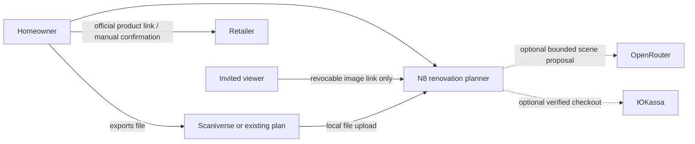
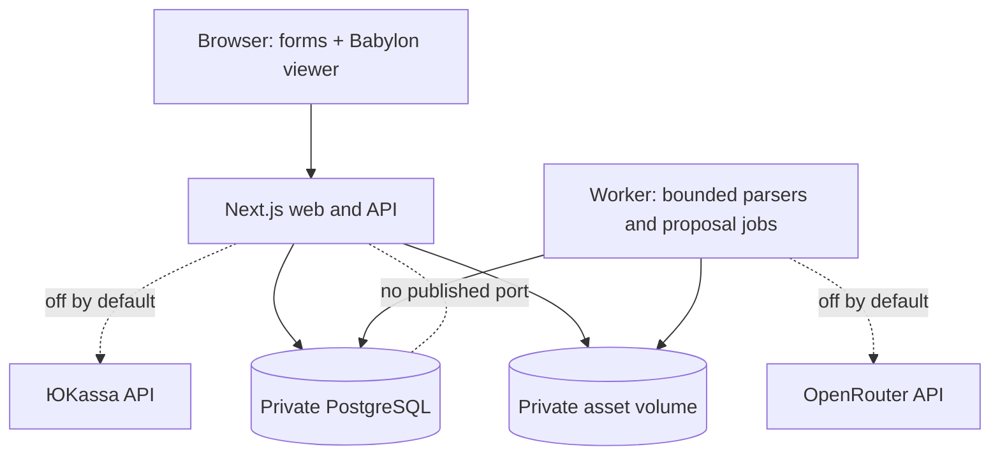
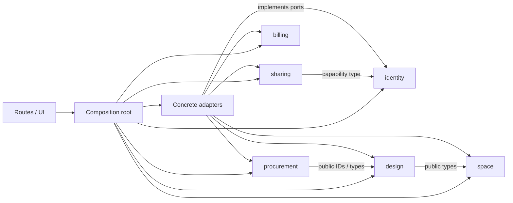
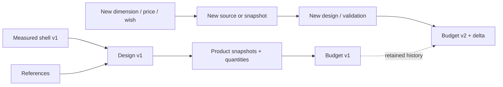
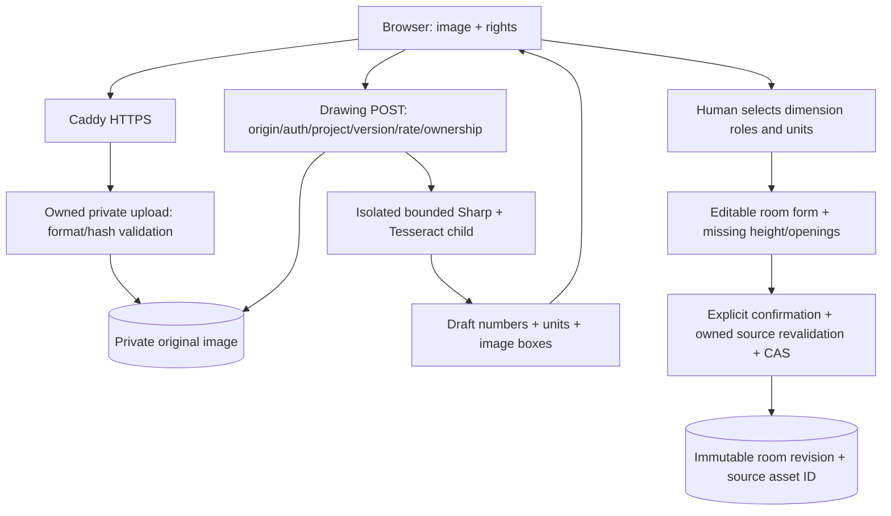

# N8 — C4 views v0.1

Architecture views; names match Architecture.md. Public HTTPS deployment was authorized and delivered on 2026-10-14 via Caddy; AI remains manual and payments off. Mermaid diagrams explain flows; runtime evidence lives in telemetry.

## Context

## Containers

## Components / dependency rule

Pure domain cannot import Next.js, PostgreSQL, fs or concrete provider clients. Database/adapter stores own I/O, public domain entrypoints own policies. Cross-module writes happen in named application services/transactions, not via ad-hoc imports of another module's SQL internals.

## Data flow: change causes revision

## Drawing import flow

| Экран | Что загрузить / выбрать | Результат |
|---|---|---|
| 01 Обмеры → Чертёж | JPG/PNG/WebP с размерными подписями и права на файл | Приватное изображение; черновик распознанных чисел |
| Проверка распознавания | Единицы без обозначений, подписи длины/ширины/высоты по номерам | «Перенести» заполняет форму; ещё не сохраняет основу |
| Форма обмеров | Отсутствующая высота, двери/окна, подтверждение размеров | Immutable основа одной комнаты, площадь и чертёж-источник |
| 02 Референсы | Собственные изображения или публичные ссылки Pinterest | Пожелания к оформлению; геометрию не меняют |
| 03 Дизайн | Ручное описание, изображения и предметы | Вариант оформления поверх подтверждённой основы |

Мебель на исходном чертеже необязательна. Числовые подписи мебели нельзя автоматически считать размером комнаты. Автоматическая рекомендация расстановки этим импортом не реализуется.

OCR не сохраняет размеры и не меняет ревизию проекта. Перенос очищает старые проёмы и подтверждение. Только сохранение проверенной формы создаёт новую основу. Чертёж не публикуется автоматически и недоступен другому владельцу. OCR работает локально без LLM/API; лимиты: 10 МБ, bounded pixels, один decoder slot, 20 секунд и 256 МБ aggregate child RSS.
