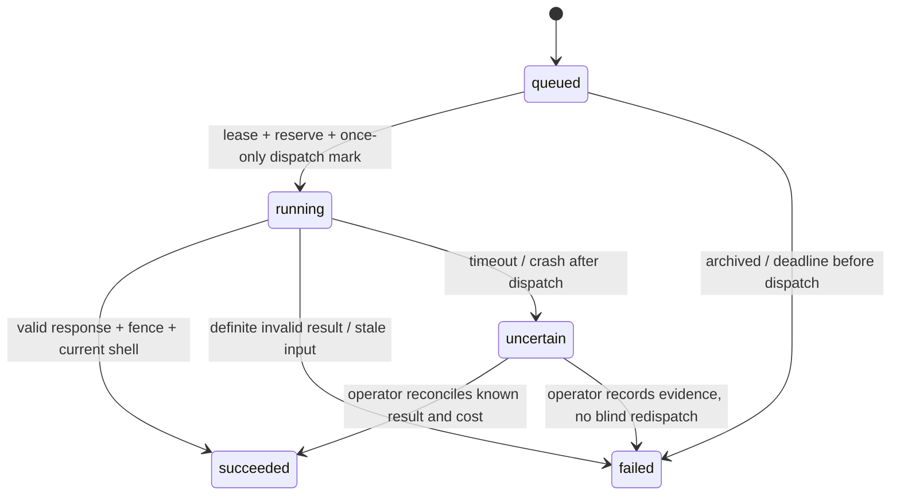

# N8 — Pseudocode v0.1

Logical source of truth; physical mapping is in Architecture.md. Decimal = validated canonical string; Timestamp = UTC ISO-8601; UUIDs generated server-side. MoneyMinor and MicroUSD are separate nonnegative safe integers, never interchangeable. Every persisted entity below has `id: UUID`, `created_at: Timestamp`; these common fields are not omitted from implementation. All project-bound commands receive an authenticated `actorId`, projectId and expectedVersion; providers cannot choose actor/ownership.

## Data Structures

| Entity | Logical fields in addition to id/created_at |
|---|---|
| Account | emailCanonical, passwordHash, status(active/disabled), creditsAvailable:Int, creditsHeld:Int, paidExport:Bool, billingHold:Bool |
| Session | accountId, tokenHash, expiresAt, revokedAt? |
| Project | accountId, name, region, store?, state(active/archived), version:Int, currentShellId?, currentDesignId?, currentBudgetId?, sceneCatalog:[ObjectDefinition] |
| Asset | projectId, kind(reference/room_photo/glb/share_image), originalKey, normalizedKey?, originalHash?(null only pending), mime, bytes, rightsConfirmed:Bool, state(pending/ready/rejected), storedBytes:Int, metadata:bounded JSON including server export provenance/reservation expiry |
| Reference | projectId, assetId?, sourceURL?, tags:[color/material/form], note, observedAt, rightsConfirmed |
| ShellRevision | projectId, parentId?, mode(manual/glb), sourceAssetId?, units='m', geometry:ManualRoom or GLBDescriptor, calibration:Calibration, floorAreaM2:Decimal?, floorAreaSource(manual_geometry/user_confirmed/unknown), confirmedAt?, hash |
| DesignRevision | projectId, parentId?, shellId, shellHash, scene:SceneProposal, referenceIds[], style, mode(manual/demo/live), state(draft/approved/superseded), fit(bbox_checked/unconfirmed), approvedAt?, changeReason |
| Job | projectId, accountId, shellId, referenceIds[], style, inputText, inputHash, requestBody:String, consentHash, originProjectVersion:Int, originDesignId?, expiresAt, idempotencyKey, mode(demo/live), modelId?, state(queued/running/succeeded/failed/uncertain), leaseFence:Int, leaseUntil?, workerId?, requestDispatchedAt?, reservedMicroUSD:Int, admissionDay, actualMicroUSD?, usage?, creditState(none/held/consumed/released), outputDesignId?, errorCode?, finishedAt? |
| SpendBudget | scope(account/global), accountId?, day, settledMicroUSD:Int, reservedMicroUSD:Int, capMicroUSD:Int |
| ProductSnapshot | projectId, retailer, seller?, article?, name, sourceURL, region?, store?, observedAt?, source(manual/api/scraper/demo), freshness(fresh/stale/unknown/blocked), priceMinor?, currency='RUB', baseUnit(m2/l/kg/m/piece), saleUnit(pack/piece), coverage:Decimal?, stock(in_stock/out_of_stock/unknown), stockQty:Decimal?, dimensionsM?:[Decimal,Decimal,Decimal] |
| ShoppingLine | projectId, designId, elementId, selection(matched/unmatched/retained), retainedReason?, snapshotId?, quantitySource(floor_area/wall_area/surface_area/manual), sourceShellId?, quantityConfirmed:Bool, baseQuantity:Decimal?, wastePct:Decimal, phase(preparation/finishing/furnishing), fit(bbox_checked/unconfirmed), version:Int |
| BudgetRevision | projectId, designId, parentId?, inputProjectVersion, linesSnapshot:BudgetLine[], services:CostRow[], delivery:CostRow[], reservePct:Decimal, reserveBase(known_subtotal/scenario_subtotal), reserveBaseMinor:Int, reserveMinor?, phaseTotals:JSON, delta:JSON, limitMinor?, knownSubtotalMinor:Int, scenarioTotalMinor?, unresolvedCount:Int, complete:Bool, inputHash, changeReason |
| PaymentOrder | accountId, sku, priceMinor, currency='RUB', credits:Int, unwatermarkedExport:Bool, idempotencyKey, requestHash, provider, remoteId?, confirmationURL?, state(created/pending/succeeded/canceled/refund_hold), paidAt? |
| PaymentEvent | provider, remoteEventKey, orderId, kind(succeeded/refund_hold), remoteObjectId, payloadHash, appliedAt |
| ShareLink | projectId, designId, assetId, tokenHash, caption, expiresAt, revokedAt? |
| AuditEvent | accountId?, projectId?, kind, eventKey, requestId, data:allowlisted redacted JSON |
| RateBucket | subjectHash, kind, windowStart, count:Int |

Value types: ManualRoom={lengthM,widthM,heightM,openings:[{id,wallId,offsetM,widthM,heightM,sillM}]}; GLBDescriptor={assetId,originalHash,normalizationMatrix,vertexCount,triangleCount,nodeCount}; Calibration={anchors:[{a:[x,y,z],b:[x,y,z],measuredM}],scale:Decimal,toleranceM:Decimal?,checks:[{actualM,measuredM,deltaM}],userConfirmed:Bool}. The default tolerance is absent, so an import requiring a cross-check cannot silently pass; user explicitly supplies the tolerated discrepancy and sees that it is their criterion, not tested device accuracy.
SceneProposal={shellId,shellHash,materials:[{surfaceId,color,materialCode}],objects:[{id,catalogId,positionM:[x,y,z],rotationY,dimensionsM:[x,y,z]}]}; no script/URI/shell mutation fields. ObjectDefinition={id:UUID,name,primitive(box/cylinder),dimensionsM:[Decimal,Decimal,Decimal],source(manual/product),snapshotId?}; ≤100 entries in Project.sceneCatalog. Owner registers measured primitive/product dimensions via owned catalog command; AI cannot change catalog. Definition IDs are immutable: changing dimensions creates a new ID; Design scene stores exact dimensions so old revisions remain reproducible. Proposal dimensions must equal catalog values. BudgetLine={lineId,elementId,selection,retainedReason?,quantitySource,sourceShellId?,quantityConfirmed,phase,fit,snapshot copy,effectiveFreshness,baseQuantity,wastePct,packs?,purchasedQuantity?,lineMinor?,reason?}; CostRow={id,label,kind(confirmed/estimate/unknown/excluded),amountMinor?,reason?}. Immutable budget embedded snapshot values include all fields needed for reproduction.

## Core Algorithms

### Algorithm: Authenticate
REQUIREMENT: `FR-foundation-1`
REALISES: SC-US-001-1, SC-US-001-2, SC-US-001-3
INPUT: registration/login/logout request, credentials or session token. OUTPUT: cookie/session or 401.
1. Call GuardRequest; normalize email, validate bounds; password hashing outside DB transaction. Use donor constant-work dummy hash for missing account; reject password >72 UTF-8 bytes explicitly before bcrypt.
2. Register atomically unique canonical email + session; duplicate email returns the same neutral registration response without usable session. Login compares hash and active status; issue random token, persist hash/expiry only.
3. Authenticate every request by unexpired, unrevoked Session joined to active Account; IF missing RETURN 401. Logout sets revokedAt; rotate token on login, set cookie flags.
COMPLEXITY: O(1) indexed lookups plus bounded password hash cost.

### Algorithm: ProjectCommand
REQUIREMENT: `FR-foundation-2`
REALISES: SC-US-002-1, SC-US-002-2
INPUT: actor, project command, expectedVersion. OUTPUT: owned project/list or error.
1. GuardRequest and EnforceBounds; query only actor-owned rows. Create under account lock checks project count; initial version=1, private state.
2. On edit lock owned Project; IF archived RETURN 409; IF version mismatch RETURN 409. Rename/region change increments version; changed region/store makes dependent data effectively stale through context mismatch, never rewrites immutable snapshots.
3. Archive command acquires the spend global mutex BEFORE Account/Project locks because it may release holds; sets state archived, revokes ShareLinks, prevents future dispatch; queued jobs are failed before dispatch with reservation/credit release. Running/uncertain jobs cannot be assumed canceled at provider; completion is suppressed, costs retained/reconciled.
COMPLEXITY: O(page size + affected queued jobs/links); archive uses indexed set-based operations, not a lifetime-count bound.

### Algorithm: CalibrateSpace
REQUIREMENT: `FR-space-1`
REALISES: SC-US-003-1, SC-US-003-2
INPUT: ManualRoom or ready owned GLB + anchors/measurement/confirmation. OUTPUT: new immutable shell.
1. GuardRequest; validate positive finite bounded decimal dimensions/anchors. Manual: validate openings in walls and pairwise no overlap; derive floor area length×width exactly.
2. GLB: validate nonzero anchor distance, compute uniform scale=measured/distance; no automatic geometry repair. Compare additional anchors after scale; require explicit tolerance and delta≤tolerance when present. Show control data and require owner confirmation; floorArea remains null unless separately entered/confirmed.
3. Persist normalized transform and immutable source hash, derive shell hash from canonical geometry/calibration; transaction CAS Project.currentShellId/version. Prior design approval becomes ineffective by shell mismatch; clear currentBudgetId. RETURN revision + limitations.
COMPLEXITY: O(openings² + anchors), counts bounded.

Preview privately at source scale before persistence; actual surface picks supply source-world points. Alternative strict native method requires explicit userConfirmed=true, rejects supplied anchors/scale, stores scale1 and empty anchors. No preview/pick persists a shell; edits clear consent.

### Algorithm: StorePrivateAsset
REQUIREMENT: `FR-space-2`
REALISES: SC-US-004-1, SC-US-004-2, SC-US-004-3
INPUT: owned project, bounded stream, declared kind. OUTPUT: ready Asset or typed refusal.
1. GuardRequest pre-body-only returns actor after auth/rate/Origin/owner/header checks without any body consumption. Uploader is the only stream reader; enforce actual streaming byte limit even without trustworthy Content-Length. Write private random temp path with exclusive mode; never use submitted filename as path.
2. In bounded parsing task inspect magic/dimensions/mesh resources; GLB validator + explicit URI/extension/count checks, image decode/reencode strips EXIF. No remote asset fetch; fail/timeout cleans temp, never marks ready.
3. Preserve original bytes at random originalKey. Images write separate reencoded normalized/thumbnail bytes at random normalizedKey and verify both hashes/files before readiness; GLB retains its validated original key without a fabricated normalized image. Account→Project transaction rechecks owner/version/reservation and sets ready only after required keys exist, settling storedBytes to actual total. Any parse/write/CAS/DB failure cleans both original and normalized keys plus pending reservation best-effort; stale pending cleanup settles leftovers. Orphan cleanup only unreachable keys older than grace period; no arbitrary path input. Serving requires owned DB asset lookup and fixed MIME/nosniff, not raw public path.
COMPLEXITY: O(bytes + primitives), hard limits/deadline.

### Algorithm: SaveReference
REQUIREMENT: `FR-space-3`
REALISES: SC-US-005-1, SC-US-005-2, SC-US-005-3
INPUT: note/tags and owned asset or public URL. OUTPUT: Reference.
1. GuardRequest; validate bounded note/tags, exactly one assetId or sourceURL, HTTPS no userinfo and supported absolute URL. Do not fetch URL.
2. Verify linked asset same project, rights flag for image use. Save provenance/observedAt and original canonical input URL (including owner pin path), not vendor homepage; render escaped text and safe external link.
3. IF Pinterest import requested RETURN CAPABILITY_DISABLED with upload/link alternative, preserving existing reference.
COMPLEXITY: O(input bytes), bounded.

### Algorithm: ValidateAndRenderScene
REQUIREMENT: `FR-design-1`
REALISES: SC-US-006-1, SC-US-006-2
INPUT: shell, preset/manual/provider SceneProposal, catalog. OUTPUT: valid scene/view status or 422.
0. For owner catalog registration command: GuardRequest + CAS, validate bounded positive dimensions/primitive and same-project optional product snapshot; insert new immutable ObjectDefinition ID into bounded Project.sceneCatalog. AI responses cannot enter this command; field changes require new ID.
1. Reject unknown keys, nonfinite/transformed shell, wrong shellId/hash, unknown material surface or catalogId, changed catalog dimensions, excessive objects. Material edits only change permitted material fields.
2. Manual room: compute rotated object AABBs, test inside shell and against door/window exclusion rectangles and other object boxes; report bbox_checked with explicit non-engineering limitation. GLB: skip unsupported semantic fit and mark unconfirmed, never fabricate collision clearance.
3. Viewer loads immutable geometry and adds objects/material layer; initial and design camera identical for comparison. Assert shell object transforms/hash unchanged before persist; fallback to plan/measurements on WebGL error.
COMPLEXITY: O(objects² + geometry load), ≤200 objects.

### Algorithm: ReviseAndApprove
REQUIREMENT: `FR-design-2`
REQUIREMENT: `NFR-integrity-1`
REALISES: SC-US-007-1, SC-US-007-2, SC-US-007-3
INPUT: actor, parent design, expectedVersion, proposed scene or approval. OUTPUT: new revision/approval or conflict.
1. Read owned Project + shell; validate scene outside transaction against immutable hash. Transaction locks owned Project; compare version/current shell and recheck referenced IDs in same project.
2. IF new design/style selection/history restore, insert immutable content, parentId/changeReason, state draft; supersede prior active design without editing its content. Set currentDesignId, clear currentBudgetId, increment version. Shopping view warns until current design approved, regardless of previous approval.
3. IF approval, require confirmed shell, current hash and valid scene; set approvedAt/state for that revision via conditional update and increment project version. New shell or design invalidates approval by current pointer, history retained. RETURN current snapshot.
COMPLEXITY: O(scene validation), constant short transactional writes.

### Algorithm: SubmitAndRunProposal
REQUIREMENT: `FR-design-3`
REQUIREMENT: `NFR-cost-1`
REALISES: SC-US-008-1, SC-US-008-2, SC-US-008-3, SC-US-008-4, SC-US-008-5, SC-US-008-6
INPUT: actor, shell/style/reference text, idempotency key, expectedVersion. OUTPUT: job/status or capability/budget refusal.
1. Validate startup config (manual/demo/live, key/caps/rate ceiling/output limit). Live model allowlist starts with current candidate `google/gemini-4-argon`; alternatives require explicit config/eval, never silent fallback. Preview transmitted text; require explicit consent per job. No files/remote links/code execution/tools in initial provider path.
2. Transaction lock stable global spend mutex (Postgres advisory transaction lock independent of day) → Account → Project → global/account-day SpendBudget → Job, consistent in admission/release/settlement/archive; recheck owner/current shell/archive/billingHold and creditsAvailable≥1. Lookup existing key/hash BEFORE mutable eligibility/credit/cap conditions; same hash returns existing job even after success/archive/shell change, mismatched body→409. Only new keys check current eligibility. Immutable requestBody/consentHash and origin version/design are saved at admission; no worker rebuild of mutable references/catalog. Count ALL live Job admissions for UTC-day: ≥5 account or ≥20 global→429 BUDGET_EXHAUSTED before any new job; no queued defer or cheaper fallback. Calculate conservative request ceiling from complete serialized bounded text request bytes/output max + explicit rate overhead; refuse if above per-job cap. Reserve full per-job cap in BOTH ledgers considering outstanding previous-day reservations; move one credit available→held; insert queued Job with exact snapshot input.
3. Worker selects queued row using SKIP LOCKED; lease fence increments, leaseUntil set, transaction closes. Recheck config, deadline, project eligibility. Under stable spend mutex→Account→Project→budgets→Job atomically recheck fence/state/current shell/active account+project/no billingHold/expiry and set requestDispatchedAt once. This commit is dispatch authorization linearization: archive/refund before mark prevents it; after mark is in-flight. Send saved requestBody bytes only. Dispatch one bounded OpenRouter POST with strict JSON schema, require_parameters, max_tokens, no redirects, 30s timeout. Transport failure after dispatch → uncertain, keep holds; no auto retry/reclaim dispatch.
4. Parse bounded response and ValidateAndRenderScene. Transaction conditional on job fence/state: successful valid response creates DRAFT DesignRevision only if current shell still matches; otherwise fail STALE_INPUT without applying scene. Recheck active project/account/billingHold at completion; archive suppresses scene application. If same shell but origin version/design changed, append detached draft and do not replace current design/budget pointers. Record usage actual or null; reconcile reservation only with reliable total usage/cost, else retain and flag uncertain cost. Successful scene consumes held credit; definite failed scene releases credit (spent provider money still recorded).
5. Crashed lease before dispatch can requeue with max 3 lease attempts; after dispatch always uncertain. Sweep prevents forever queued jobs, releases pre-dispatch holds once. Unknown external completion/cost requires operator reconciliation, never guessed zero. Demo jobs use explicit fixture labels and no spend/credits; manual creates no job. Usage view derives own admissions/caps and held/known/unknown from Jobs/SpendBudget, distinguishes reservations from billed amounts; global readonly query is operator-only.
COMPLEXITY: O(input bytes + scene validation); indexed queue admission, bounded one external call.

### Algorithm: RecordProductSnapshot
REQUIREMENT: `FR-procurement-1`
REALISES: SC-US-009-1, SC-US-009-2, SC-US-009-3
INPUT: actor, product fields or CatalogueProvider response. OUTPUT: immutable snapshot/effective status.
1. GuardRequest; validate URL/decimals/enums and same-project owner; element is verified later in line binding. Missing region/date→unknown; observedAt future beyond clock tolerance→422. Manual fresh requires explicit confirmation; blocked adapter produces blocked data with no invented price.
2. Persist snapshot; shopping line points to it only through versioned command. Effective freshness=fresh only if stored fresh AND matching current region/store AND age≤24h; otherwise stale/unknown/blocked, retaining historical values labelled old.
3. Do not refresh snapshots in place. Current adapter returns manual-required/blocked for unsupported retailer access, with official deep link; no CAPTCHA/proxy bypass.
COMPLEXITY: O(fields), bounded.

### Algorithm: CalculateBudget
REQUIREMENT: `FR-procurement-2`
REALISES: SC-US-010-1, SC-US-010-2, SC-US-010-3, SC-US-010-4, SC-US-010-5, SC-US-010-6, SC-US-010-7
INPUT: current owned design, ≤200 lines, cost rows, reservePct/base, optional limit, expectedVersion. OUTPUT: immutable BudgetRevision.
1. UI price in RUB uses min=0, step=0.01; integer input 1600 is valid and converted exactly to 160000 minor. Rerender limit comparison from current controlled value. Enumerate expected element IDs from scene materials/objects: no shopping row creates an unmatched placeholder, never disappears. retained needs explicit reason and remains visibly excluded from purchases. For floor_area require element=floor and baseUnit=m2, derive current confirmed floorArea (null stays unknown). For wall_area require named wall, derive wall length×height−opening areas. surface_area/manual use explicit quantityConfirmed and same sourceShellId or remain unknown, including GLB. Piece objects require piece baseUnit/saleUnit, pack coverage positive and matching material unit; no cross-unit guesses. Parse exact Decimal strings using established decimal library; reject negative/overflow/nonfinite and incompatible units. For a pack need=q×(1+waste/100), packs=ceil(need/coverage); for pieces ceil(need); null q/coverage/price or unmatched/unselected element produces unknown, even if other costs are known.
2. lineMinor=integer pack/piece count×integer purchase price. Separate confirmed fresh costs from estimates/old snapshots: knownSubtotal includes usable confirmed rows; scenarioTotal includes explicit estimates but remains null if any unresolved unknown without estimate. Preserve zero only with explicit entered amount/kind, not absence.
3. Compute reserve from server-computed enum base known_subtotal/scenario_subtotal using decimal round-half-up to minor unit, once; complete iff all lines, work/delivery scope rows resolved and context current, no unmatched or stale evidence. A user can explicitly mark work excluded/self-performed; exclusion is visible and not represented as free vendor service.
4. Revalidate project/design version in transaction, save all immutable input copies + totals/hash/reason; set inputProjectVersion to the new committed project.version after increment, set currentBudgetId. Use semantic inputHash/context for outdated display, so a rename alone is not a cost change. Delta matches stable elementId/cost-row ID and unit; missing/added rows and scope changes explicit. Every BudgetLine stores all mutable selection/phase/quantity/provenance fields in immutable input copy; reproduction never queries current ShoppingLine. services/delivery require at least one explicit row; excluded requires reason and is visibly omitted, not free. Compare limit only on complete scope, otherwise uncertainty.
COMPLEXITY: O(lines + cost rows).

### Algorithm: ReplaceAndPhase
REQUIREMENT: `FR-procurement-3`
REALISES: SC-US-011-1, SC-US-011-2, SC-US-011-3, SC-US-011-4
INPUT: existing line, new snapshot/phase or return-to-design. OUTPUT: new selection revision + stale budget.
1. GuardRequest; show difference in price/spec/dimensions; require owner confirmation for substitution. New dimensions trigger ValidateAndRenderScene, never preserve prior fit blindly.
2. Transaction CAS Project/version and line/version; create new DesignRevision for appearance/dimension changes, clone relevant lines to new design; phase-only edit changes line version without duplicating a row. Clear currentBudgetId; old BudgetRevision inputs retained.
3. CalculateBudget and ReviseAndApprove are explicit subsequent commands; RETURN change reason and new version. Return deterministic phase preview from current complete copied inputs; saved BudgetRevision remains old/outdated until explicit recalculation. Summing stages partitions each line exactly once; moving phase changes preview subtotals, never grand total.
COMPLEXITY: O(lines + scene checks).

### Algorithm: Checkout
REQUIREMENT: `FR-billing-1`
REALISES: SC-US-012-1, SC-US-012-2
INPUT: authenticated account, server SKU, idempotencyKey. OUTPUT: pending order/redirect or disabled.
1. GuardRequest; config off→503, live incomplete→startup failure. Test provider only constructor injection with NODE_ENV=test. Read trusted SKU; lock account, unique(accountId,key), compare requestHash; save immutable intent/amount/credits before provider I/O.
2. Call donor PaymentProvider.createPayment using order.id as remote idempotency key outside transaction; timeout keeps created intent for same-key reconciliation, not new payment.
3. Conditionally store remoteId/status/HTTPS confirmation URL after matching amount/currency/order metadata. GET return page only reads owned status; it never grants credits. RETURN same order on replay.
COMPLEXITY: O(1) DB + one bounded provider request.

### Algorithm: ApplyVerifiedPayment
REQUIREMENT: `FR-billing-2`
REALISES: SC-US-013-1, SC-US-013-2, SC-US-013-3, SC-US-013-4
INPUT: raw bounded webhook, direct/trusted peer IP. OUTPUT: 200 applied/duplicate, 400 invalid or 503 retry.
1. Provider off→404. Reject untrusted source; parse only to identify event/object; Payment event: re-fetch fixed payments/:id and validate full shop/test/currency/amount/paid/status/orderId/remoteId. Refund event: re-fetch refunds/:refundId, verify succeeded/RUB/positive amount≤original, fetch payment at verified refund.payment_id, validate linked original order/payment; never compare partial refund amount to full amount for equality. On provider error throw before event transaction; do not reserve event key.
2. Transaction locks Account then PaymentOrder (same order as checkout), recomputes identity checks against immutable intent; dedupe by provider + kind + remoteObjectId. succeeded transition only from created/pending with no refund_hold/billingHold: insert event and increment credits once, set paidExport if SKU permits; replay returns same result. Late succeeded after refund_hold is recorded as ignored audit, never regrants credits or export.
3. Verified refund: insert unique refund event, state refund_hold, billingHold=true, paidExport=false; revoke existing unwatermarked ShareLinks/derivative access. Admitted-but-undispatched jobs fail eligibility before mark. Do not guess unused-credit refund arithmetic. Rollback all local mutations on any error; no webhook body content in logs. Remote event ordering cannot restore entitlement after billingHold.
COMPLEXITY: O(1) indexed DB + bounded verification request.

### Algorithm: ExportAndShare
REQUIREMENT: `FR-sharing-1`
REALISES: SC-US-014-1, SC-US-014-2, SC-US-014-3
INPUT: owner/current design, chosen caption, generated before/after image, rights confirmation. OUTPUT: downloadable image or private link.
1. GuardRequest + owner/revision check, render deterministic before/after at same camera. Ordinary uploader forbids share_image. Export service reencodes bounded owner-provided renderer image, strips metadata and persists immutable designId/hash + normalized key/hash + watermark/schema version provenance; server applies watermark unless current verified paidExport and no billingHold. Never trust client entitlement or hidden watermark checkbox.
2. Show preview image/caption only; require explicit publish action + rights. Recheck Account→Project locks and current entitlement so refund cannot race publish; match export provenance to design, forbid raw reference/photo/GLB. Create random link token; save hash + TTL, return raw token once. No plan/GLB/reference/budget fields in public DTO and image metadata stripped.
3. Public resolver rate-limits, checks hash/expiry/revocation/project active on EVERY image/view request, returns no-store/noindex; no static/presigned bypass. Revoke sets timestamp. A later image change needs a new snapshot/link; old image remains frozen until revoke.
COMPLEXITY: O(image bytes) bounded, O(1) link lookup.

### Algorithm: RecordGrowth
REQUIREMENT: `FR-sharing-2`
REALISES: SC-US-015-1, SC-US-015-2, SC-US-015-3
INPUT: allowlisted event/IDs/key. OUTPUT: event/count.
1. Validate origin/ownership for private events; derive event kind server-side where possible. Public share events retain no raw token/IP/personal source data; pseudonymous IDs only.
2. Insert unique eventKey with bounded safe metadata. Read-only local operator query returns known count per allowlisted kind over explicit30-day window, or unknown/error on DB failure. Index kind/createdAt. Count exact observed events, label export/share creation vs external social action distinctly; DB unavailable returns unknown/error, never invented zero.
COMPLEXITY: O(1) insert; indexed bounded aggregation.

### Algorithm: GuardRequest
REQUIREMENT: `NFR-security-1`
REALISES: SC-US-016-1, SC-US-016-2, SC-US-016-3, SC-US-019-1, SC-US-020-1, SC-US-020-2, SC-US-021-1
INPUT: request, required access level. OUTPUT: ActorContext or typed error.
1. Pre-body-only transport/header/peer guard: authenticate cookie, exact Origin/owner/header checks and atomic auth/public IP or account rate gate; RETURN ActorContext without consuming the body. JSON route then reads bounded256KiB/10s JSON outside DB transaction and validates schema. Upload route owns its sole actual-byte-bounded stream read; GuardRequest never parses multipart/file bytes. Authenticated mutations require exact configured Origin as CSRF defense (including register/login/logout); deny missing/foreign Origin, no permissive CORS. Webhook uses its own verification; no cookie-authorized exemption.
2. Read Session/Account for protected routes; all repository access includes account/project predicate. Project-scoped supplied relation IDs must resolve under that same scope; missing/foreign→404.
3. The pre-body gate uses atomic UPSERT RateBucket under unique subjectHash/kind/window, counts all attempts then rejects above cap with429; subject derives direct peer/trusted proxy chain, not arbitrary forwarded headers. Log only requestId/code/latency/hashed IDs.
COMPLEXITY: O(1) indexed checks.

### Algorithm: BootOperational
REQUIREMENT: `NFR-operations-1`
REALISES: SC-US-017-1, SC-US-017-2
INPUT: config, DB schema version, private storage root. OUTPUT: ready or startup refusal.
1. Parse strict modes/default off, secrets/caps/merchant requirements; forbid fake outside tests; unknown enum/blank enabling config→refuse.
2. Check migrations, DB connectivity and private writable storage without network provider calls. Health exposes only up/ready and redacted error code; worker must pass same capability config gate.
3. Local orchestrator checks port conflicts before compose; verify database has no published port, isolate volumes/network/name. On restart use DB state/fences for jobs and stored assets; no automatic paid replay.
COMPLEXITY: O(1) probes.

### Algorithm: RenderAccessibleJourney
REQUIREMENT: `NFR-quality-1`
REALISES: SC-US-018-1, SC-US-022-1, SC-US-023-1
INPUT: server view model, viewport, capabilities. OUTPUT: accessible canonical UI.
1. Render labelled fields, progress, focus/errors and manual/demo/live/stale labels from authoritative state. Keep values across navigation/save/reload.
2. On WebGL failure display plan/measurements/reference/list fallback; don't claim 3D success. Disable unavailable action with reason and a useful manual path.
3. Measure 390px/desktop keyboard flows; expose scene/status changes via text, not colour alone.
COMPLEXITY: O(visible bounded items).

### Algorithm: EnforceBounds
REQUIREMENT: `NFR-performance-1`
REALISES: SC-US-024-1, SC-US-024-2
INPUT: query/command limits, account/project usage. OUTPUT: bounded operation or LIMIT_REACHED.
1. Cap page size at 50 and use stable (created_at,id) cursor; no offset scan/unbounded includes. For writes lock controlling account/project before quota count/update.
2. Enforce configured object/reference/revision/line counts and request/decode deadlines; terminate parse worker on deadline. Reject at boundary before expensive work.
3. Record API latency without upload/hash/provider spans, run 10-client fixture and 200-line benchmark; publish measured numbers or failure, not target-as-observation.
COMPLEXITY: O(page size), indexed counts/conditional insert.

#### Supporting procedure: ResolveCatalogue
Supports RecordProductSnapshot and its FR-procurement-1 declaration.
REALISES: SC-US-009-2
INPUT: owned project/snapshot. OUTPUT: ManualRequired or Blocked plus existing provenance, never invented price.
Authenticate/read own snapshot; adapter performs no arbitrary URL fetch, returns blocked after documented access restriction, records safe redacted status. Browser opens official link itself; owner POST creates new manually confirmed snapshot. GET products/lines are owned bounded pages; no refresh-in-place.

#### Supporting procedure: ReconcileJob
Supports SubmitAndRunProposal and its NFR-cost-1 declaration.
REALISES: SC-US-008-4
INPUT: local operator only, jobId, expectedFence/state=uncertain, evidenceId, terminal outcome, actualMicroUSD, usage?, valid scene? OUTPUT: audited once-only settlement.
Use explicit local script with separate operator DB credentials, never public API. Require evidenceId nonempty and known nonnegative actual cost; unknown cost cannot release reservation. Lock stable mutex→Account→Project→both origin-day ledgers→Job; reject changed fence/state or conflicting repeated evidence. Settle account/global holds identically, record actual usage or null, consume credit only valid succeeded scene (detached if newer work, suppress if archived); definite failed releases held credit. Conditional transition once + audit retains evidenceId/outcome/fence without request payload. No network/redispatch. actual cost above reservation is recorded as overrun/hold and disables admission until operator raises verified safe caps; never clamp invoice to reservation.

### Algorithm: ExportShoppingList
REQUIREMENT: `FR-procurement-4`
REALISES: SC-US-025-1
INPUT: actor/project/budget revision ID. OUTPUT: owner-only UTF-8 CSV attachment.
1. GuardRequest; load owned immutable budget snapshot plus stored provenance; do not use mutable current shopping rows. Foreign/missing ID→404.
2. Stable columns preserve units/quantity/packs/minor money as formatted RUB/phase/retained/unknown. Snapshot date/outdated context visible.
3. Escape CSV quotes/newlines and prefix dangerous spreadsheet formula strings including leading whitespace. RETURN fixed generic filename attachment, no-store/nosniff; never link via public ShareLink.
COMPLEXITY: O(snapshot lines+cost rows), at most200 shopping lines.

## API Contracts

Browser API uses HttpOnly cookie auth, deliberately no Bearer token exposure; this overrides the generic SPARC template. Mutations require exact Origin. All JSON responses `{data,meta:{requestId,version?}}`; failures `{error:{code,message,fields?},meta:{requestId}}`. POST creates 201, job admission 202, normal reads/commands 200, logout/revoke 204. IDs opaque UUID, decimal values string, minor money integers. See schema bounds above; API rejects unknown keys. `If-Match: <project-version>` required for project mutations, `Idempotency-Key: UUID` for jobs/checkout; missing→428/400. Session cookie omitted→401; foreign resource→404.

| Method/path | Body / response | Owner |
|---|---|---|
| POST /api/auth/register, /login; POST /logout | email/password → neutral registration or session cookie; logout revokes | identity |
| GET /api/me; GET/POST /api/projects | account capabilities + own aiUsage admissions/caps/reserved/known/unknown; cursor/page or {name,region}→project | identity |
| GET/PATCH /api/projects/:p | project / {name?,region?,store?,archive?}→new version | identity |
| GET/POST /api/projects/:p/assets; GET /api/assets/:a[?original=1] | GET {items,nextCursor}, after UUID≤50/page; POST bounded raw file stream + x-asset-kind/x-rights-confirmed headers → Asset; owned normalized/original bytes | space |
| GET/POST /api/projects/:p/shells | GET {items,nextCursor}, after UUID≤50/page; POST {mode:manual,geometry,userConfirmed} or {mode:glb,sourceAssetId,calibration}→ShellRevision | space |
| GET/POST /api/projects/:p/references | {items,nextCursor} owned list≤50/page / strict reference fields→Reference | space |
| GET/POST /api/projects/:p/designs | history / {parentId?,scene,style,referenceIds,changeReason}→draft | design |
| GET /api/projects/:p/designs/:d | owned immutable revision read; foreign revision404 | design |
| POST /api/projects/:p/designs/:d/approve; POST /api/projects/:p/designs/:d/restore | empty body; If-Match → approved current revision / restored new draft+version | design |
| GET/POST /api/projects/:p/catalog | owned catalog {items,nextCursor}, after UUID≤50/page (embedded Project catalog remains full immutable aggregate≤100) / {name,primitive,dimensionsM,snapshotId?}→server-ID immutable entry/source; CAS project version | design |
| POST /api/projects/:p/jobs/preview; GET/POST /api/projects/:p/jobs; GET /api/jobs/:j | preview {shellId,style,referenceIds,inputText}→exact requestBody/consentHash; submit {input:preview input,consentHash,consent:true} + Idempotency-Key/If-Match→job; owned paged list/status | design |
| GET/POST /api/projects/:p/products | ProductSnapshot fields→immutable snapshot | procurement |
| GET/POST/PATCH /api/projects/:p/lines[/:l] | GET {items,nextCursor}≤50/page, cursor and optional owned designId; current cart requests designId to avoid loading historical clones / mutation {designId,elementId,selection,retainedReason?,snapshotId?,quantitySource,quantityConfirmed,baseQuantity?,wastePct,phase,confirmReplacement?}→line/version | procurement |
| GET/POST /api/projects/:p/budgets | history / {designId,services,delivery,reservePct,reserveBase,limitMinor?,reason}→calculation | procurement |
| POST /api/billing/checkout; GET /api/billing/orders | {sku}→order/confirmationURL; owned orders | billing |
| POST /api/billing/webhook | raw provider body→verified result; no session/Origin gate | billing |
| GET/POST /api/projects/:p/exports; GET /api/projects/:p/exports/:a | GET {items,nextCursor}, after UUID≤50/page; POST raw PNG/JPEG/WebP≤10MiB with X-Design-Id/X-Rights-Confirmed:true and If-Match→server prepared PNG+provenance; dedicated private GET current entitlement+hash verification | sharing |
| GET/POST /api/projects/:p/shares; DELETE /api/projects/:p/shares/:s | GET {items,nextCursor}, after UUID≤50/page; POST {designId,assetId,caption,rightsConfirmed:true,previewConfirmed:true}→raw token URL once / DELETE revoked | sharing |
| GET /s/:token; GET /api/shared/:token/image | sanitized snapshot only, no-store/noindex | sharing |
| GET /api/projects/:p/budgets/:b/export | CSV owner-only immutable shopping/cost snapshot | procurement |
| POST /api/projects/:p/products/:s/refresh | {} → Blocked/ManualRequired, no guessed price | procurement |
| POST /api/projects/:p/designs/:d/view | guarded current-owned revision→deduped first_design_viewed event, no project version mutation | sharing |
| GET /health/live, /health/ready | status only | operations |

Catalog refresh method is a domain port returning ManualRequired/Blocked, not an arbitrary URL-fetch endpoint. Browser opens official HTTPS links itself. Basic image export can be assembled client-side, but source Asset verification, entitlement watermark and serving policy remain server-side; provider or arbitrary URLs cannot be composited server-side.

## State Transitions

Approval is effective only while Project.currentDesignId/currentShellId match the approved revision. Budget outdated is derived from inputProjectVersion + semantic context, not overwriting historical immutable totals.

## Error Handling Strategy

400 INVALID_REQUEST/PAYMENT_INVALID; 401 UNAUTHENTICATED; 403 ORIGIN_DENIED; 404 NOT_FOUND; 409 VERSION_CONFLICT/PROJECT_ARCHIVED/CALIBRATION_REQUIRED/STALE_INPUT; 413 BODY_TOO_LARGE; 415 UNSUPPORTED_TYPE; 422 SCENE_INVALID/INVALID_MEASUREMENT/INVALID_UNITS; 428 VERSION_REQUIRED; 429 RATE_LIMIT/LIMIT_REACHED; 503 AI_DISABLED/PAYMENTS_DISABLED/PROVIDER_UNAVAILABLE; 504 JOB_UNCERTAIN only as job error state, GET job still 200. Unknown provider outcome never reported as success or automatically retried. Messages give user recovery without secrets/internal URLs.

## Scenario Coverage

Scenarios in Specification.md: **65** · claimed by an algorithm: **65**. UI scenarios are claimed by RenderAccessibleJourney; EnforceBounds claims the reproducible performance scenarios. Camera orbit is transient; saved choices are style/material/object/reference, not viewpoint.

Not claimed by any algorithm:

none

Claimed by an algorithm but absent from Specification.md:

none

Exact counts and machine-key sets are verified before handoff; naming coverage alone does not prove semantic sufficiency. Independent six-lens validation is the next gate.
