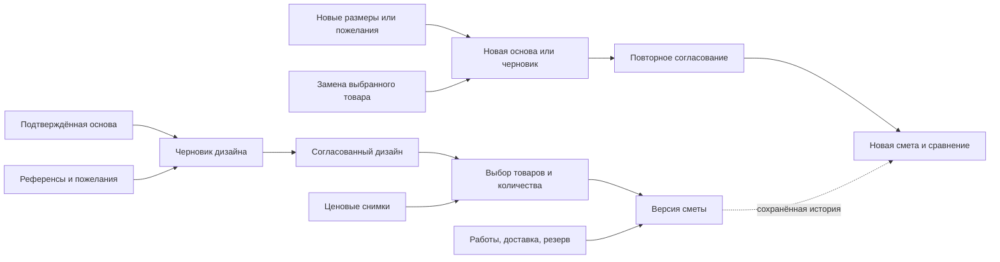
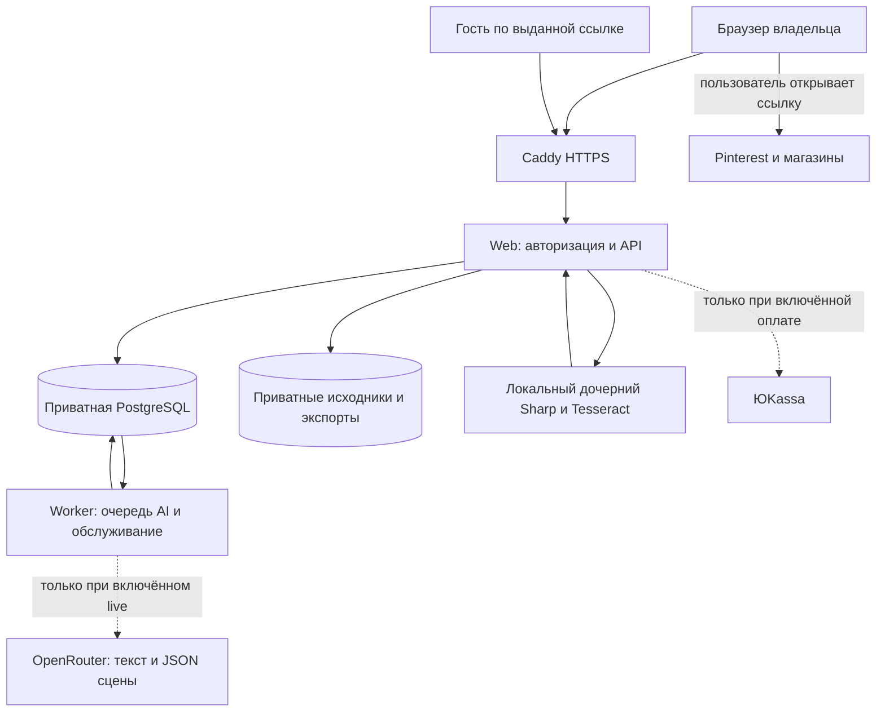

# Как устроен конвейер N8: от обмеров до дизайна, покупок и бюджета

Сверено с работающим стендом **https://n8.77.83.87.178.sslip.io** 14.10.2026.
Режимы сняты в 16:36 UTC из контейнера `web`, версия OCR — из установленного Tesseract,
экраны и порядок операций — из исходников. Код проекта: коммит `ffcdfb7a`;
работающий образ: `sha256:181590da9bf545d69fb927e56abb5da50f52f5ead7bd3d0fdcca8a45d90058ee`.

Это описание **текущего процесса**, аналогичное walkthrough проекта N6.
Целевой CJM шире реализации: Gemini через OpenRouter, автоматический подбор товаров
и полноценная работа с референсами остаются незавершёнными интеграциями.
Наличие адаптера не означает, что соответствующий сервис включён.

Устройство модулей — в [Architecture.md](Architecture.md), схемы — в
[C4_Diagrams.md](C4_Diagrams.md), решения — в [anti-drift-decisions.md](anti-drift-decisions.md),
запуск — в [INSTALL.md](../INSTALL.md), результаты проверок — в
[public-release.md](public-release.md).

---

## Кто делает работу и какие модели используются

| Стадия | Исполнитель | Модель / инструмент | Фактический режим стенда |
|---|---|---|---|
| Чтение размерных подписей на чертеже | Изолированный дочерний процесс `web` | **Tesseract 5.3.0**, языки `rus+eng`; Sharp готовит изображение | Работает локально, без LLM |
| Проверка размеров и построение основы | Серверный модуль `space` | Геометрические правила и десятичная арифметика | Работает |
| Показ плана и 3D | Браузер | 2D-план и Babylon.js | Работает; есть fallback при недоступности WebGL |
| Оформление и расстановка предметов | Пользователь и серверный модуль `design` | Палитры, измеренные примитивы, проверка сцены | Ручной режим |
| AI-предложение сцены | Отдельный `worker` → OpenRouter | Для подключения выбрана **`google/gemini-4-argon`**; runtime ID пока пуст | Отключено: `N8_AI_MODE=manual`, ключ отсутствует |
| Подбор товаров | Пользователь | Ссылки магазинов и ручные ценовые снимки | Автоматического API/scraping нет |
| Количества и смета | Серверный модуль `procurement` | Decimal.js и целые суммы в копейках | Работает без LLM |
| Оплата возможностей приложения | Серверный модуль `billing` → ЮKassa | Платёжный адаптер | Отключено: `N8_PAYMENTS_MODE=off` |
| Картинка для обсуждения | Браузер + серверный модуль `sharing` | Снимки одной камеры, композиция, проверка и watermark | Работает |

На стенде **нет действующей облачной LLM**. Tesseract распознаёт текст, но не понимает
план как архитектор: он не определяет автоматически, где стена, дверь, диван или размер комнаты.
Babylon.js отображает геометрию; это также не генеративная модель.
Модели агентов разработки и ревью не участвуют в обработке пользовательских проектов.

---

## Карта экранов: куда что загружать

| Экран | Что вводить или загружать | Что получается | Когда сохраняется |
|---|---|---|---|
| Личный кабинет | Название проекта, регион, при необходимости магазин | Отдельный проект ремонта | «Создать проект» |
| **01 Обмеры → Чертёж** | JPG/PNG/WebP с размерными подписями | Приватный файл и черновик распознанных чисел | Файл сохраняется при загрузке; размеры ещё не сохранены |
| **01 Обмеры → Форма обмеров** | Выбранные размеры, отсутствующая высота, двери/окна, подтверждение | Измеренная основа одной прямоугольной комнаты | «Сохранить обмеры» |
| **01 Обмеры → Загрузить 3D-скан GLB** | Self-contained GLB и контрольные измерения | Калиброванный скан; это альтернативный путь к основе | Загрузка файла, затем отдельное сохранение основы |
| **02 Референсы** | HTTPS-ссылка либо ранее загруженное изображение, заметка, теги | Доска пожеланий | «Сохранить идею» |
| **03 Дизайн** | Палитра, размеры и положение предметов | Черновик оформления поверх основы | «Сохранить вариант», затем «Согласовать дизайн» |
| **04 Покупки** | Карточка товара, цена, упаковка, наличие; выбор по элементам дизайна | Ценовые снимки и список покупок | «Сохранить снимок товара» / «Сохранить выбор» |
| **05 Смета** | Работы, доставка, резерв, лимит и причина пересчёта | Версия сметы, неизвестные расходы, этапы, сравнение | «Рассчитать и сохранить смету» |
| **06 До / после** | Подтверждение прав, просмотр картинки и подписи | Подготовленный экспорт и отдельно публичная ссылка | Подготовка изображения; затем отдельная публикация |
| **Оплата**, `/billing` | На стенде ничего оплачивать не требуется | Статус возможностей и история платежей | Live checkout выключен |

**Чертёж и скан относятся к «Обмерам»; картинки желаемого интерьера — к «Референсам».**
Чтобы добавить изображение-референс, сначала загрузите его в «01 Обмеры → Исходные файлы»,
выбрав назначение «Референс», затем выберите этот файл в «02 Референсы».
Сам переход на другую вкладку не сохраняет незаписанный вариант или расчёт.

---

## Словарь: какие данные связывают шаги

- **Проект** — контейнер одного ремонта: регион, магазин, текущая версия и ссылки на выбранные результаты.
- **Исходник (`Asset`)** — приватное изображение или GLB. Файл на диске, описание и право доступа — в БД.
- **Основа (`ShellRevision`)** — подтверждённая геометрия или калиброванный скан. Сохранённое содержимое неизменно.
- **Референс (`Reference`)** — изображение или ссылка с пояснением, что нравится. Не меняет геометрию сам по себе.
- **Дизайн (`DesignRevision`)** — материалы и предметы, привязанные к конкретной основе и её хешу.
- **Снимок товара (`ProductSnapshot`)** — товар, место, дата, цена, единицы, упаковка и наличие на момент проверки.
- **Выбор (`ShoppingLine`)** — решение для конкретной поверхности или предмета: купить, оставить или пока не подобрать.
- **Смета (`BudgetRevision`)** — сохранённые входы расчёта и результат, позволяющие воспроизвести старую версию.
- **Экспорт и ссылка** — подготовленная картинка и разрешение гостю посмотреть её. Это два отдельных объекта.

## Шаг 0. Вход и создание проекта

**Исполнитель:** браузер → `web` → PostgreSQL. **LLM:** нет.

Создайте аккаунт на стенде и в личном кабинете задайте название ремонта и регион.
Регион и выбранный магазин дальше определяют, подходит ли сохранённая цена вашему проекту.
Один аккаунт может иметь отдельные проекты; исходники одного проекта нельзя использовать
как собственные исходники другого владельца.

При открытии проекта сервер возвращает текущие указатели на основу, дизайн и смету,
а интерфейс загружает историю основ, файлы и референсы. Изменения отправляются с версией проекта:
если другая вкладка успела сохранить новые данные, сервер возвращает конфликт, а не затирает их.

## Шаг 1. Получение измеренной основы — «01 Обмеры»

**Исполнитель:** `web`, модуль `space`, локальные декодеры. **Ресурсы:** хранение и CPU/RAM VPS.

Здесь три пути к основе: чертёж с размерными подписями, ручной обмер или GLB.
Новый проект не получает выдуманные длину, ширину и высоту.

### 1а. Чертёж: распознать числа, выбрать размеры, подтвердить

1. Загрузите **JPG, PNG или WebP до 10 МиБ** и подтвердите право использовать файл.
   Можно вместо новой загрузки выбрать уже сохранённое изображение своего проекта.
2. Сервер проверяет формат, сохраняет приватный исходник и его хеш. Для изображений также
   создаётся нормализованное представление. Одного расширения файла для допуска недостаточно.
3. Отдельный запрос распознавания проверяет вход, владельца, проект, версию и лимит частоты.
   Затем Sharp готовит изображение, а Tesseract локально читает размерные подписи.
4. Интерфейс показывает исходный чертёж с номерами и распознанными числами. Для подписей
   без единиц выберите **мм / см / м**, затем назначьте подписи длине и ширине нужной комнаты.
   Высоту можно выбрать, если она напечатана. Приложение не выбирает автоматически два самых больших числа.
5. Нажмите **«Перенести размеры в обмеры»**. Форма получает значения в метрах без повторного набора.
   Неизвестная высота остаётся пустой; старые проёмы и старое подтверждение очищаются.
6. Уточните высоту и двери/окна, проверьте размеры, отметьте подтверждение и нажмите
   **«Сохранить обмеры»**. Только этот шаг создаёт измеренную основу.

Распознавание не сохраняет геометрию и не меняет версию проекта; загрузка самого файла её меняет.
Перенос также не является сохранением. Исходный чертёж остаётся связан с сохранённой основой:
после перезагрузки доступна ссылка **«Посмотреть чертёж-источник»**.

Текущий результат — одна подтверждённая **прямоугольная комната**.
Распознанное число может относиться к мебели, проёму или другой комнате: назначение проверяет человек.
Подписи площадей, масштабов и дат отфильтровываются, но OCR всё равно может ошибиться.
Мебель на исходном плане необязательна. Автоматического выделения мебели, стен и проёмов нет.
PDF/DWG/DXF пока преобразуйте в изображение нужной страницы или одной комнаты.

**Пределы OCR из кода:** вход до 20 мегапикселей, до трёх ориентаций, общий таймаут 20 секунд,
до 256 МиБ суммарной RSS дочернего процесса и native OCR, один общий слот декодирования файлов.
Вывод native OCR ограничен 512 КиБ на проход. Это пределы обработки, а не обещание времени ответа.
Пустой результат оставляет ручной ввод; ошибки занятости и таймаута не считаются успешным распознаванием.
Изображение не отправляется в OpenRouter.

### 1б. Ручной обмер

Введите длину, ширину и высоту в метрах. Добавьте двери и окна: стену, смещение,
ширину, высоту и высоту подоконника. Подтвердите проверку и сохраните.
Сервер проверяет геометрию и проёмы; площадь пола считается из длины и ширины.
Этот путь также подходит, если OCR не прочитал чертёж.

### 1в. GLB вместо чертежа

На экране **«01 Обмеры»** есть одна форма **«Загрузить фото, чертёж или GLB»**. Выберите GLB, подтвердите права и нажмите **«Загрузить GLB»**. Расширение `.glb` или MIME `model/gltf-binary` определяются автоматически; сервер проверяет содержимое. После загрузки новый скан выбирается в калибровке справа.

Загрузка нового скана очищает поля калибровки для него, но не заменяет подтверждённую основу. Заполните контрольные точки и сохраните масштаб отдельным действием.
Принимается self-contained GLB v2 до 25 МиБ. Встроенные текстуры — до 8192 пикселей по каждой стороне, суммарно до 134217728 пикселей (две полные текстуры 8K). Предел 20 МП относится к отдельным фото и чертежам. При проверке текстуры декодируются последовательно в ограниченный результат; исходные байты скана не изменяются. OBJ, FBX и Gaussian splat не поддерживаются.
Scaniverse — предлагаемый источник пользовательского экспорта; реальный экспорт с устройства
ещё не использовался как acceptance sample, поэтому его точность здесь не заявляется.

В предпросмотре нажмите «Выбрать точку A» и щёлкните по скану, затем отметьте B. Введите только реальное расстояние между ними. Либо выберите «Сохранить масштаб 1:1», если независимо проверили размеры, и подтвердите его.
Если площадь пола измерена отдельно, её можно подтвердить; иначе площадь остаётся неизвестной.

Скан не превращается автоматически в список стен и комнат. Оригинальные байты сохраняются,
калибровка записывается отдельно. Проверка физического размещения предметов внутри сложного mesh
не равна проверке в ручной прямоугольной комнате.

## Шаг 2. Пожелания — «02 Референсы»

**Исполнитель:** пользователь → `web` → PostgreSQL. **LLM и скачивание Pinterest:** отсутствуют.

Сохраните публичную HTTPS-ссылку, например Pinterest, либо выберите своё ранее загруженное изображение.
Добавьте заметку — «нравится фактура дерева», «хочу такую форму дивана» — и теги цвета, материала, формы.
Подтвердите право использования и нажмите **«Сохранить идею»**.

При ссылке сервер сохраняет URL и заметку, но не скачивает картинку и не импортирует доску Pinterest.
При изображении сохраняется связь с приватным файлом. Референсы не заменяют обмеры.
В ручном дизайне референсы не применяются. В режиме «По референсам» в разделе 03 доступен подбор цветов из изображений.
Кнопка «Удалить» убирает референс из текущего списка; прежние дизайны, их изображения и история сохраняются.

## Шаг 3. Оформление и согласование — «03 Дизайн»

**Исполнитель:** пользователь, `design`, браузерный viewer. **LLM:** на стенде нет.

Обновление 14.10.2026: в разделе 03 выберите **«Ручной дизайн»** или **«По референсам»**.
В ручном режиме задаются цвета и предметы, референсы к новой версии не прикрепляются.
В режиме по референсам отметьте 1–5 **загруженных изображений** и нажмите
**«Применить референсы»**. Сервер локально извлекает доминирующий цвет каждой картинки,
смешивает цвета с равным весом и создаёт новый черновик. Потолок остаётся белым;
геометрия и уже расставленные предметы сохраняются. Вариант сразу открывается в «После».
Pinterest-ссылку можно выбрать без ручной загрузки: для публичного пина появится его картинка, для подборки /ideas/ — до 8 разных изображений. Выберите картинку в галерее и нажмите «Применить референсы». Приложение само загрузит выбранное изображение, проверит его и сохранит приватно, затем создаст вариант. Исходная ссылка остаётся в списке. Ручная загрузка предлагается только при фактической недоступности Pinterest или неподдерживаемом источнике; доступно повторное получение галереи. Закрытые страницы, видео и полный обход доски не поддерживаются.
Это подбор цветов, без Gemini, переноса мебели, текстур или полного стиля фотографии.

Сначала должна существовать сохранённая основа. В ручном режиме выберите палитру и при необходимости
цвета поверхностей. В **«Создать измеренный предмет»** задайте название, форму
и ширину/высоту/глубину; сейчас это прямоугольный или цилиндрический примитив.
Затем добавьте предмет в вариант, задайте X/Z его центра, Y его низа и поворот.
Размеры предмета закреплены в каталоге; для других размеров создайте новый предмет.

Нажмите **«Сохранить вариант»**: появится новая версия-черновик.
После проверки нажмите **«Согласовать дизайн»**. Для согласования текущие изменения
должны быть сохранены. Приложение не согласовывает дизайн автоматически.

Материалы и предметы привязаны к ID и хешу основы. Они не могут менять стены, проёмы или масштаб.
В ручной комнате сервер проверяет габаритные коробки относительно комнаты, предметов и проёмов.
Это предварительная проверка, не инженерная гарантия. Для GLB физический fit остаётся неподтверждённым.
«До / После» сохраняет одну камеру; история позволяет просмотреть прошлый вариант
или восстановить совместимый с текущей основой вариант **новым черновиком**.

### Где должен появиться Gemini и что уже умеет адаптер

На стенде карточка помощника сообщает ручной режим. Сам факт наличия OpenRouter-кода
не означает генерацию дизайна из изображения или автоматическую рекомендацию мебели.

В подготовленном режиме `live` порядок такой:

1. Пользователь запрашивает предпросмотр передачи данных: основа, стиль, текст пожеланий,
   **заметки и теги** референсов, каталог предметов и их размеры.
2. Интерфейс показывает точное тело запроса; пользователь явно подтверждает передачу.
   Изображения, GLB и содержимое Pinterest в этот запрос **не входят**.
3. Сервер проверяет актуальность основы, права и финансовые лимиты, резервирует кредит
   и допустимый расход, создаёт задачу в PostgreSQL. Предпросмотр согласия ограничен по времени.
4. `worker` забирает задачу, проверяет бюджет ключа провайдера и перед отправкой фиксирует dispatch.
   Затем обращается к `https://openrouter.ai/api/v1/chat/completions`.
5. Ответ — **декларативный JSON сцены**, а не GLB, изображение, видео или исполняемый код.
   Проверяются схема, ID/хеш основы, предметы, размеры и размещение. Допустимый ответ становится
   новым черновиком; согласование остаётся за владельцем.

Модель берётся из `N8_AI_MODEL_ID` и должна входить в `N8_AI_ALLOWED_MODELS`.
Владелец выбрал **`google/gemini-4-argon`** для следующего подключения. На момент снимка
модель ещё не подключена и runtime ID пуст. Наличие и поддержку structured outputs проверили
по [странице модели](https://openrouter.ai/google/gemini-4-argon) и публичному каталогу OpenRouter
14.10.2026: выходная модальность — текст, поэтому JSON сцены визуализирует наш Babylon.js.
Запрос задаёт `temperature: 0`, строгую JSON-схему и `allow_fallbacks: false`.
Верхняя граница `max_tokens` — 4096, тело запроса — 32 КиБ, ответ — 256 КиБ, timeout — 30 секунд.
Отдельная проверка бюджета ключа использует `/api/v1/key` с timeout 10 секунд.

`demo` — отдельный локальный демонстрационный режим, не Gemini; сейчас он тоже не включён.
После неопределённого внешнего результата автоматического повторного платного вызова нет:
задача остаётся `uncertain` для сверки. Старый результат не должен затирать новую основу.

## Шаг 4. От оформления к товарам — «04 Покупки»

**Исполнитель:** пользователь и `procurement`. **LLM/API/scraping:** сейчас не используются.

Интерфейс предлагает ссылки на Лемана ПРО и Дом Лента. Предыдущие пробы карточек магазинов
вернули HTTP 401; приложение использует ручное подтверждение, не обход блокировок.
Поиск по всему рынку и подбор самой дешёвой позиции не реализованы.

Откройте карточку магазина сами. В **«Добавить товар»** сохраните название, артикул,
ссылку, цену упаковки/штуки, основную единицу, покрытие или объём упаковки,
наличие и при необходимости все три габарита штучного товара. Регион и магазин берутся из проекта.
Цена в пустом поле означает **неизвестно**, а не ноль. Подтверждение фиксирует факт ручной проверки.

В **«Что покупаем»** для каждой поверхности и предмета выберите одно решение:

- **Купить выбранный товар** — связать элемент с конкретным ценовым снимком.
- **Оставить имеющееся** — указать причину; покупка этой позиции исключается из расчёта.
- **Пока не подобрано** — сохранить неизвестную статью расходов.

Задайте источник количества, запас и этап: подготовка, отделка или обстановка.
Площадь пола и стен берётся из подтверждённых обмеров; для ручного количества или площади
поверхности требуется подтверждение относительно текущей основы.
Товар для предмета закупается поштучно; для материалов важна совместимость единиц и упаковки.

Выбирать товары можно для сохранённого черновика, но **смета требует согласованного дизайна**.
Цена считается актуальной для того же региона/магазина в течение 24 часов после проверки.
Истёкшая цена, смена места или неизвестное наличие требуют уточнения; кнопка обновления
не означает успешно выполненный scraper. Новую цену сохраняйте новым снимком.

## Шаг 5. Расчёт — «05 Смета»

**Исполнитель:** серверный `procurement` → PostgreSQL. **Ресурсы:** локальная арифметика; LLM нет.

Укажите **работы** и **доставку** явно: подтверждённая сумма, оценка, неизвестно или исключено.
Для неизвестного и исключённого расхода нужна причина. Затем задайте резерв, его базу,
при необходимости лимит ремонта и причину расчёта. Нажмите **«Рассчитать и сохранить смету»**.

Порядок расчёта:

1. Проверить текущую основу, согласованный дизайн и соответствие строк его элементам.
2. Определить количество: площадь пола; площадь стены минус её проёмы; подтверждённое ручное значение.
3. Добавить запас и округлить закупку **вверх** до целой упаковки или штуки.
4. Умножить на сохранённую цену; проверить актуальность цены и наличие.
5. Учесть работы и доставку, отдельно подтверждённые и оценочные суммы.
6. Рассчитать резерв от выбранной базы, итоги этапов и сравнение с лимитом.
7. Сохранить входы и результат новой версией; прежнюю смету не переписывать.

```text
Нужно = исходное количество × (1 + запас / 100)
Упаковок = ceil(Нужно / покрытие одной упаковки)
Стоимость позиции = число упаковок × цена упаковки
```

Пример: пол 6 × 3 м → 18 м², запас 10%, упаковка 2 м² за 1600 ₽.
Нужно 19,8 м² → `ceil(19,8 / 2)` = **10 упаковок**, закупка 20 м² за **16 000 ₽**.
Это стоимость материала, а не всего ремонта: работы, доставка и остальные позиции считаются отдельно.

**Известный подытог** включает подтверждённые позиции и расходы.
**Сценарный итог** также учитывает оценки и резерв, но остаётся неизвестным при неразрешённых статьях.
Резерв от известного подытога можно вычислить при неполной смете; резерв от сценарного подытога
при неизвестных статьях также остаётся неизвестным. «Неполная смета» не означает «дешёвый ремонт».

Суммы хранятся в копейках, количества считаются десятичной арифметикой.
CSV относится к выбранной сохранённой версии: содержит источники, формулы, упаковки и неизвестные статьи.
Работы и доставка учитываются в общем итоге отдельно от этапных сумм закупок.
Изменение входов требует явного пересчёта; просмотр старой сметы не обновляет её цены.

## Шаг 6. Пересмотр: что происходит при изменении решения

**Исполнитель:** пользователь, серверные транзакции, история ревизий.

Новые обмеры создают новую основу и снимают указатель на текущую смету.
Старый дизайн остаётся связан со старой основой и не становится автоматически пригодным для новой.
Новый дизайн сохраняется черновиком; восстановление прошлого варианта также создаёт новую версию.

Замена уже выбранного товара требует подтверждения: интерфейс показывает старый и новый товар,
цену и габариты. Замена создаёт новый черновик дизайна и требует повторного согласования и пересчёта.
Смена количества, запаса, этапа или цены также требует нового расчёта.
Новая смета показывает добавленные, удалённые и изменённые входы относительно предыдущей.



## Шаг 7. Обсуждение результата — «06 До / после»

**Исполнитель:** браузер снимает пару кадров, `web` проверяет и сохраняет экспорт.

Сравнение относится к сохранённому дизайну. Подтвердите права, подготовьте изображение:
браузер снимает основу и оформленный вариант **одной камерой**, компонует картинку,
сервер проверяет её и добавляет watermark при отсутствии права на экспорт без него.
Это сравнение 3D-сцен, не обязательно пара «загруженная фотография / фотореалистичная генерация».

Экспорт сначала приватный. Просмотрите изображение, удалите личные данные из подписи,
отметьте подтверждение просмотра и только затем создайте ссылку на семь дней.
Гость получает подготовленную картинку и подпись, а не доступ к кабинету, чертежам, скану или бюджету.
Автоматической публикации в Pinterest или соцсети нет; адрес можно скопировать самостоятельно.

Ссылка показывается при создании: сервер хранит хеш токена, поэтому потерянный адрес не восстанавливается.
Ссылку можно отозвать; отзыв блокирует новые просмотры, но не удаляет уже скачанные копии.
Для нового текущего дизайна требуется соответствующий ему экспорт.

---

## Data flow: где находятся данные и что уходит наружу



Файл → приватный том; метаданные, связи и разрешения → PostgreSQL.
Черновик OCR → браузер; подтверждённые размеры → новая основа в PostgreSQL.
Дизайн, ценовые снимки и сметы → отдельные сохранённые объекты с историей.
Подготовленная картинка → приватный том; публичный доступ → только через проверку ссылки.

Гиперссылка на магазин или Pinterest открывается самим пользователем и не является серверным импортом.
На стенде AI и платежи выключены; показанные пунктиром вызовы — подготовленные ветви кода.
OCR запускается в дочернем процессе `web`, **не** как задача AI-worker.
Worker использует PostgreSQL; отдельные Redis, GPU-сервис и embeddings-конвейер N6 не перенесены.

## Деньги: три разных значения

| Величина | Смысл | Текущий статус |
|---|---|---|
| **Бюджет ремонта, ₽** | Покупки, работы, доставка, резерв | Считается локально из пользовательских входов |
| **Цена возможностей N8, ₽** | Покупка AI-кредитов / права на экспорт без watermark | Live checkout выключен; цены магазина приложения не настроены |
| **Расход на модель, $** | Фактическая стоимость внешнего AI-запроса | LLM не подключена; локальный OCR не требует provider API |

В подготовленном live AI до отправки резервируются кредит и допустимая стоимость:
потолок одного запроса, аккаунта в сутки и платформы в сутки.
Резерв не равен подтверждённому расходу. Расход берётся из ответа провайдера;
таймаут после отправки не доказывает, что вызов был бесплатным.
Неопределённые расходы не должны исчезать при смене суток или повторе запроса.
Конкретные тарифы модели сейчас не настроены; выдуманной цены запроса в этом документе нет.

В подготовленном checkout цена SKU задаётся сервером. Возврат пользователя со страницы оплаты
не начисляет права: сервер проверяет уведомление и перечитывает платёж у ЮKassa.
Для live нужны отдельные настройки и проверка. Сам OCR и расчёт сметы не являются платными LLM-вызовами,
но потребляют ресурсы VPS; стоимость инфраструктуры здесь не измерялась.

## Что связывает шаги и защищает сохранённый результат

Сервер проверяет владельца и проект при чтении, изменении и выдаче файлов.
Чужой и отсутствующий объект дают одинаковое «не найдено».
Сессионная cookie HttpOnly; изменения проверяют точный Origin и актуальную версию проекта.
Секреты OpenRouter, БД и оплаты не передаются браузеру.

Сохранённое содержимое основы, дизайна, ценового снимка и сметы не переписывается задним числом.
Проект хранит указатели на выбранные результаты, а новая версия сохраняет собственные входы.
Это позволяет понимать, почему изменился бюджет, вместо подмены цифр внутри старого расчёта.
Архивирование делает проект доступным только для чтения и отзывает публичные ссылки.

## Чего пока нет и где заканчивается проверенная функциональность

- Полноценной мультимодальной Gemini-интеграции: текущий адаптер принимает текст/геометрию и ожидает JSON сцены.
- Автоматической рекомендации мебели, фотореалистичной генерации по Pinterest, генерации GLB или видео.
- Автоматического импорта доски Pinterest и автоматического подбора/обновления товаров из магазинов.
- Импорта PDF/CAD, автоматической геометрии всей квартиры и выделения стен/дверей/мебели из изображения.
- Инженерной гарантии расстановки, проектирования электрики/сантехники и проверки реального Scaniverse-экспорта.
- Включённой оплаты, партнёрской программы со строительными сетями и автоматической публикации пользовательских данных.

Реальная браузерная проверка последней версии импорта: 30 проверок в Chromium/Firefox/WebKit,
включая клавиатуру, мобильный экран, приватность, подтверждение и повторное открытие источника.
Полная регрессия: 247 тестов; основной CJM: 21 проверка совместимости на предшествующем образе,
после которого менялся только фокус результата OCR. Точность на реальном пользовательском чертеже
этими синтетическими fixtures не измерялась. Walkthrough не является новым прогоном E2E.

## Откуда проверять детали

| Вопрос | Источник |
|---|---|
| Шесть вкладок и загрузка проекта | [RoomEditor.tsx](../apps/web/src/components/RoomEditor.tsx) |
| Импорт чертежа и перенос | [DrawingImport.tsx](../apps/web/src/components/DrawingImport.tsx), [space.ts](../apps/web/src/server/space.ts) |
| Числа OCR и процессные лимиты | [floorplan.ts](../packages/domain/src/space/floorplan.ts), [native adapter](../packages/adapters/src/floorplan.ts) |
| Ручной дизайн | [DesignPanel.tsx](../apps/web/src/components/DesignPanel.tsx) |
| Будущий AI-запрос и worker | [provider.ts](../packages/domain/src/design/provider.ts), [jobs.ts](../apps/worker/src/jobs.ts), [openrouter.ts](../packages/adapters/src/openrouter.ts) |
| Товары и точная смета | [ProductsPanel.tsx](../apps/web/src/components/ProductsPanel.tsx), [calculator.ts](../packages/domain/src/procurement/calculator.ts) |
| Экспорт и публикация | [SharingPanel.tsx](../apps/web/src/components/SharingPanel.tsx) |
| Режимы AI и оплаты | [config.ts](../apps/web/src/server/config.ts), [INSTALL.md](../INSTALL.md) |
| Измерения, ревью и ограничения | [public-release.md](public-release.md), [receipt импорта](telemetry/p-replicator/20261014T080942Z-plan-import-8984/evidence/floorplan-import-final-1.md) |

### Выбор файлов и референсов
На этапе «Обмеры» в списке GLB нажмите «Выбрать скан», затем подтвердите масштаб. Текущая основа помечена отдельно. Неиспользованные сканы можно удалить; сканы сохранённых основ защищены для истории. На этапе «Дизайн» галочками выберите референсы этой версии и сохраните вариант; изменение выбора создаёт новый черновик. После сохранения этапа подсказка предлагает явный переход дальше.

## 2026-10-14: перенос цветов по зонам из референса

В разделе 03 режим «По референсам» передаёт уменьшенные изображения выбранных референсов в `google/gemini-4-argon` через OpenRouter. Нажатие «Применить референсы» подтверждает передачу картинок и резервирование одного кредита (до $0.10). Первый выбранный референс основной, остальные дополняют отсутствующие зоны. Pinterest сначала импортируется в приватное хранилище прежним механизмом.

Поток данных: приватный нормализованный файл → проверка владельца/прав/хеша → JPEG до 160 px → замороженный запрос durable job → OpenRouter → строгий JSON `{walls,floor,furniture,ceiling}` с цветом и пояснением → сервер собирает новый черновик из прежней неизменной основы. Неопределённый цвет равен null и не перекрашивает поверхность. Модель не меняет размеры, геометрию или расстановку.

В ручной комнате цвета получают отдельные стены/пол/потолок и уже добавленная мебель. В цельном GLB треугольники группируются по геометрии приблизительно: пол, большие вертикальные плоскости, потолок, низкие предметы. Остальные треугольники сохраняют исходный материал. Это не распознавание конкретной кровати, не перенос узоров/текстур. Сложные, общие или деформируемые сетки могут остаться без перекраски. «До» восстанавливает исходные материалы и индексы. Переключение «Ручной дизайн» отключает автоматический слой и возвращает обычную палитру.

Готовый черновик появляется автоматически после выполнения задания; найденные цвета и объяснения видны в карточке «Цвета из референса». При неясном ответе провайдера автоматического платного повтора нет. Сохраняются действующие лимиты: $5 в сутки на уровне приложения, $10 в неделю на ключе провайдера. Обработка асинхронная. Реальная точность цветов зависит от света на референсе, а классификация GLB — от геометрии скана.
